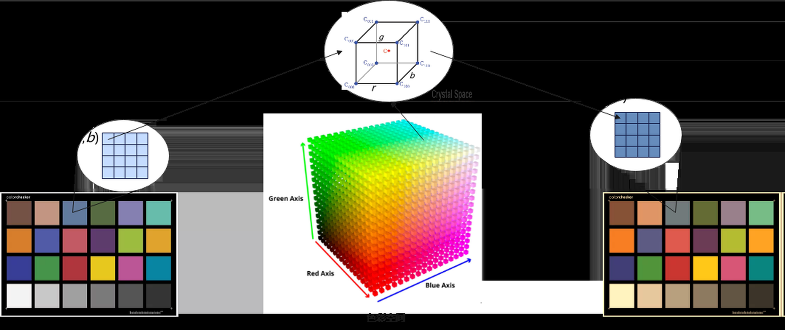

# 极速焕彩

> 【2026 Hackathon 决赛】第 16 题。出题方：华为；技术专家：张斌（zhangbin155@hisilicon.com）。
>
> 所属赛事：2026年度Hackathon软件难题挑战赛；领域：Multimedia。
>
> 来源：[茶思屋原题页面](https://www.chaspark.com/#/races/competitions/1326689437612879872)。本文依据用户提供的网页 HTML 快照（`source.htm`，发布日期 10-08）整理，公式图片已转写并保存在 `assets/`。原页面无附件。

## 1. 赛事背景

在智能手机、车载显示和车载流媒体等实时图像处理场景中，对高清输入图像进行快速、精准的色彩风格化或色彩校正是一项核心需求，满足用户多样化的拍照体验。

## 2. 赛题任务

系统输入一张 RGB 图和 4 个三维颜色空间，该图的像素 RGB 值作为输入坐标，在给定的颜色空间中查找计算得到目标值。参赛选手需要设计并实现一个**色彩空间稀疏化算法**和**图像色彩映射算法**：

1. 首先从三维色彩映射空间（`256*256*256`）维度稀疏化到 `m*m*m`，`m` 限制为 `17 <= m <= 33`；
2. 然后在稀疏色彩空间中计算出像素的映射值；
3. 在满足特定色差精度限制的前提下，经过 4 次颜色空间映射，输出最终的图像结果。

### 每个像素的计算步骤

1. 将给定的三维色彩空间 LUT 稀疏化到 `m*m*m` 晶体空间（Crystal Space），稀疏化算法由选手设计实现；
2. 确定输入像素在晶体空间中的位置（所在立方体）；
3. 在立方体中通过插值算法求出目标值 `C`，插值算法由选手设计实现。

以上完成了单个像素色彩空间的映射。计算共需要完成 4 次映射，分别对应 4 个颜色空间，完成所有颜色的映射调整。

> 示意图说明：左侧为输入色卡图像，取像素 `(r, g, b)`；中间为三维 RGB 色彩空间（色彩空间）；顶部为晶体空间中的一个立方体，8 个顶点为 `C000, C001, C010, C011, C100, C101, C110, C111`，沿 `r, g, b` 三个方向插值得到目标点 `C`；右侧为映射后的输出色卡图像。

### 输入数据规格

1. 输入图像规格
   - 图像分辨率：`1024 × 768` 像素
   - 图像格式：RGB 3 通道彩色图
   - 位深：每通道 8-bit 量化（像素值范围 `0 ~ 255`）
2. 输入色彩空间规格
   - LUT 规格：`256*256*256`
   - LUT 数量：4 个
   - LUT 变量类型：整型

### 选手输出件

- 提供稀疏算法，完成颜色空间从 `256*256*256` 到 `m*m*m` 的稀疏化处理；
- 提供查找和插值算法，完成输入图像像素在稀疏颜色空间的映射计算。

### 变换约束与定义

- **色彩映射**：每一步色彩映射均在稀疏化空间 `m*m*m` 中完成，且 `m*m*m` 空间与原色彩空间变量类型一致，`m` 约束为 `17 <= m <= 33`。
- **多级串联**：输入图像必须通过 4 次独立且不同的色彩映射调整。4 次色彩映射可以依次顺序通过，也可以做等价计算优化次数；每次映射变化的输入/输出约束均为整型变量，与最终计算结果输出类型一致。
- **联合优化**：稀疏化算法可以与查找/插值算法联合优化设计，达到精度和速度最优。

## 3. 核心限制与技术引导

- **矩阵稀疏化与压缩**：选手需要设计稀疏化方案（如稀疏采样、矩阵低秩分解、基函数拟合等），在降低内存占用的同时保证插值效率。
- **技术路线不设限**：允许并鼓励使用传统并行加速算法（如 CUDA 优化、多线程插值、SIMD 指令集）或轻量化 AI 算法（如感知器拟合、超轻量神经网络、网络剪枝）。
- **精度硬约束**：输出图像与理论标准变换图像之间，必须满足色差公式约束：

$$
\Delta E < \text{Threshold}
$$

（注：$\Delta E$ 为总色差，Threshold 赛题组将在测试集发布时统一公布，用以过滤低质量退化图像。）

$\Delta E$ 计算方法为：

$$
\Delta E = \sqrt{(R_1 - R_2)^2 + (G_1 - G_2)^2 + (B_1 - B_2)^2}
$$

参考链接：<https://snki.nl/en/blogs/kleurverschilformules-uitgelegd-cie76-cmc-cie94-ciede2000>

## 4. 评估指标与评分标准

评测将从**正确性**、**运行速度**和**内存占用**三个维度进行综合考量，总分 100 分。

### A. 算法正确性与精度（硬门槛，通过得 40 分）

选手的输出图像必须完全通过 $\Delta E$ 的硬性阈值约束。

若单张图片未能通过约束，则该图片计为 0 分。整个测试集平均色差越低，此项得分越高。

### B. 执行速度（性能核心，40 分）

- 评测环境：统一在指定配置的服务器上运行。
- 吞吐量测试：计算算法处理 100 张图像完成 4 次色彩变换的平均耗时。如在 Intel(R) Core(TM) i7-14700 @ 2.1G 通用 CPU 下，单张图像处理耗时应在 1.5 s 以下。耗时最短的队伍获得满分，其余队伍按比例得分。

### C. 架构与算法创新性（20 分）

- 内存与工程优化：考察映射矩阵的稀疏化压缩比、高效插值计算方法等。
- 代码架构：考量代码的工程落地可行性，是否便于移植到嵌入式或移动端设备。

---

## 附：整理者备注（非原文）

### 2026-10-26 用户补充确认

以下为本次会话用户补充，作为当前实施和测试口径；不改写上方原题快照：

1. 四级的m可以彼此不同，均遵守17..33。每个LUT的稀疏化参数一旦确定，整个测试图像集保持一致，不按单张图像重新调整。
2. ΔE取所有像素的平均值；p99和max作为附加诊断，不能替代平均误差。
3. LUT面向日常图像处理，可理解为Photoshop进行图像调整所生成的LUT。
4. 时间指标考察批次处理总时间。本轮同时报告已准备模型的100图映射总时间，以及模型创建至首批100图输出的连续wall，明确列出解码、稀疏拟合等计时边界。
5. 调试与验证保持软件环境一致，只使用通用CPU，不使用GPU/NPU；初步目标为Intel Xeon Gold 6140，语言可选C/C++/Python。本机结果必须注明真实硬件，不能冒充6140成绩。
6. 内存优化指运行期间LUT、图像及暂态空间；测试机器至少几十GB，容量远大于本任务使用量。不能仅以磁盘文件大小或传输压缩比声称运行内存改善。

因此，下列历史备注中的ΔE聚合粒度及目标硬件，以上述新口径为准；官方Threshold数值及具体评测计时起止尚未获得更细说明。离线确定参数与运行时每批处理的成本分别披露。

### 原始整理备注

以下是原文未明确、需在后续确认的点：

1. **LUT 输出格式**：原文只说 LUT 为 `256*256*256`、整型，未说明每个格点存的是 RGB 三通道 8-bit 值还是更高位深，也未给出文件格式。
2. **ΔE 粒度**：公式是 RGB 空间欧氏距离（与参考链接中的 CIE76 同形，但作用于 RGB 而非 Lab）。未说明 Threshold 判定是逐像素、取最大值还是整图平均；“整个测试集平均色差越低得分越高”暗示精度分是按平均 ΔE 连续计分。
3. **“理论标准变换图像”**：推测为用 4 个完整 256³ LUT 逐像素直接查表、顺序串联得到的结果。
4. **“等价计算优化次数”**：原文允许把 4 次映射合并（例如预先复合成单个 LUT），但同时要求每步在 `m*m*m` 稀疏空间中完成、中间结果为整型，两者如何兼容需向出题方确认。
5. **计时范围**：未说明 1.5 s/张是否包含 LUT 稀疏化（预处理）耗时，以及图像/LUT 的 I/O 耗时。
6. **评分维度**：开头称从“正确性、运行速度和内存占用”三维度评价，但具体分项为 A 正确性 40 + B 速度 40 + C 架构与创新性 20，内存占用体现在 C 项的“稀疏化压缩比”中。
