# 20 条技术路线全景探索与多维对比 (`ROUTES.md`)

> 对应赛题：**【2026 Hackathon 决赛】第 16 题：极速焕彩**  
> 代码实现：[python/lutlab/fit.py](file:///home/mo5nk/problem_probe/16/python/lutlab/fit.py)、[python/lutlab/cascade.py](file:///home/mo5nk/problem_probe/16/python/lutlab/cascade.py)、[cpp/src/lut.cpp](file:///home/mo5nk/problem_probe/16/cpp/src/lut.cpp)  
> 实验编排：[python/lutlab/routes.py](file:///home/mo5nk/problem_probe/16/python/lutlab/routes.py)

为全面评估本题的技术边界，我们实现了跨越**朴素方法（Naive）、经典信号处理（Classic）、现代数值优化（Modern）、前沿级联补偿与等价坍缩（Frontier）、高阶基函数/低秩张量/核方法（Basis & Low-Rank）、以及隐式深度神经网络（DL）**共 **6 大流派、20 条具体技术路线**，并在 6 类四阶段色彩空间映射场景上完成了对比测试。

---

## 1. 技术路线分类总览

```mermaid
flowchart TD
    Root["极速焕彩 3D LUT 稀疏化与实时映射 (20 Routes)"]
    Root --> G1["I. 朴素与局部滤波 (Naive & Local)"]
    Root --> G2["II. 经典张量积最小二乘 (Classic Separable LS)"]
    Root --> G3["III. 现代精确四面体优化 (Modern Exact Tetra Optimization)"]
    Root --> G4["IV. 前沿多阶段级联与坍缩 (Frontier Cascade & Collapse)"]
    Root --> G5["V. 高阶样条、低秩张量与核方法 (Basis, Tensor & Kernel)"]
    Root --> G6["VI. 隐式神经表示 (Deep Learning / INR)"]

    G1 --> R1["R1: 均匀整数网格点采样 + 三线性插值"]
    G1 --> R2["R2: 均匀整数网格点采样 + 四面体插值"]
    G1 --> R3["R3: 浮点精确坐标重采样 + 四面体插值"]
    G1 --> R4["R4: 3D Box 局部均值滤波 + 四面体插值"]

    G2 --> R5["R5: 三线性 Hat 基张量积最小二乘 + 三线性插值"]
    G2 --> R6["R6: 三线性 Hat 基张量积最小二乘 + 四面体插值"]

    G3 --> R7["R7: 精确四面体稀疏最小二乘 (CG + Jacobi)"]
    G3 --> R8["R8: 精确四面体 LS + 8 色棋盘格整数坐标下降"]
    G3 --> R9["R9: IRLS Lp (p=4) 极小极大重加权四面体拟合"]
    G3 --> R10["R10: 二阶差分曲率自适应非均匀网格 + 整数精化"]

    G4 --> R11["R11: 四阶段级联残差前向补偿 (均匀网格)"]
    G4 --> R12["R12: 四阶段级联残差前向补偿 (曲率自适应网格)"]
    G4 --> R13["R13: 四阶段精确坍缩单级等效 LUT (均匀网格)"]
    G4 --> R14["R14: 四阶段精确坍缩单级等效 LUT (曲率自适应网格)"]

    G5 --> B1["B1: 三次拉格朗日 (Lagrange Cubic) 张量积拟合"]
    G5 --> B2["B2: 二次均匀 B 样条 (Quadratic B-Spline) 拟合"]
    G5 --> B3["B3: 三次均匀 B 样条 (Cubic B-Spline) 拟合"]
    G5 --> B4["B4: 低秩 Tucker / HOSVD 张量分解 (Rank 6 / 10)"]
    G5 --> B5["B5: 3D 多项式全局回归 (Degree 3 / 5)"]
    G5 --> B6["B6: 3D 径向基函数网络 (Gaussian RBF, 216 Centers)"]

    G6 --> DL1["DL1: 隐式多层感知机 (MLP-GELU 3x32)"]
    G6 --> DL2["DL2: 周期激活隐式神经表示 (SIREN 3x32)"]
```

---

## 2. 各流派核心数学原理与工程实现

### I. 朴素与局部滤波流派 (`R1` ~ `R4`)

1. **`R1_naive_sample_tri`（均匀整数点采样 + 三线性插值）**
   - **原理**：在 $\{0, \dots, 255\}$ 上取均匀取整坐标 $p_k = \text{round}\!\left(\frac{255 k}{m-1}\right)$，直接读取 $C[p_i, p_j, p_k] \gets L[p_i, p_j, p_k]$，运行时用 8 顶点三线性插值恢复。
   - **缺陷**：仅使 $m^3$ 个采样点误差为 0，在 $m \neq 17$（如 $m=25, 33$，步长 $255/(m-1)$ 非整数）时存在严重的取整相位偏移（Rounding Phase Jitter），且对高频色彩过渡存在混叠（Aliasing）。

2. **`R2_naive_sample_tetra`（均匀整数点采样 + 四面体插值）**
   - **原理**：采样点同 `R1`，但将每个子立方体沿主对角线 $(0,0,0)\to(1,1,1)$ 剖分为 6 个 Lovász 标准四面体，仅对 4 个顶点做重心插值。
   - **优势**：沿着灰色中性轴 $R=G=B$ 方向完全无交叉耦合，且计算量从 8 顶点 7 次乘加降为 4 顶点 3 次加法 + 3 次乘法。

3. **`R3_subpixel_sample_tetra`（浮点精确坐标亚像素重采样）**
   - **原理**：当 $255$ 不能被 $m-1$ 整除时（例如 $m=33, \text{step}=7.96875$），在精确浮点位置 $g_k = \frac{255 k}{m-1}$ 上对原始 $256^3$ LUT 做一次局部三线性重采样获得稀疏控制点。
   - **效果**：在 $m=33$（`isp-0`）上将 `R2` 的平均 $\Delta E$ 从 `2.3233` 显著降低至 `1.6848`，消除了非整除网格的取整错位。

4. **`R4_box_filter_tetra`（3D Voronoï Box 局部均值滤波）**
   - **原理**：将每个网格节点周围的 Voronoï 邻域体素求均值作为控制点值。
   - **缺陷**：相当于在 3D 色彩空间施加低通 Box 滤波器，导致高饱和边界向内收缩（滚降模糊），在 `isp-0` $m=17$ 上 $\text{p99 }\Delta E$ 反而恶化至 `8.2435`。

---

### II. 经典张量积最小二乘流派 (`R5` ~ `R6`)

5. **`R5_ls_separable_tri` / `R6_ls_separable_tetra`（一维可分离 Hat 基最小二乘）**
   - **原理**：三线性插值算子是三个一维分段线性（Hat）基矩阵 $A \in \mathbb{R}^{N \times m}$ 的 Kronecker 积：
     $$W_{\text{tri}} = A_R \otimes A_G \otimes A_B$$
     因此全三维最小二乘问题 $\min_C \|(A_R \otimes A_G \otimes A_B) C - Y\|_F^2$ 完全等价于沿 $R, G, B$ 三个模态依次求解 $m \times m$ 的小规模正规方程：
     $$C = \left((A_R^\top A_R + \lambda I)^{-1} A_R^\top\right) \times_1 \left((A_G^\top A_G + \lambda I)^{-1} A_G^\top\right) \times_2 \left((A_B^\top A_B + \lambda I)^{-1} A_B^\top\right) \times_3 Y$$
   - **复杂度**：训练耗时仅 **`0.27 ~ 0.37 秒`**（4 个阶段合计），比直接构造三维稀疏矩阵快一个数量级。
   - **效果**：在 `isp-0` ($m=17$) 上将平均 $\Delta E$ 从朴素采样的 `2.7076` 直接压低至 **`1.4558`**（降幅 **46.2%**）！
   - **算子匹配现象**：由于 `R5` 针对三线性算子 $A \otimes A \otimes A$ 求解，用三线性插值评估（`R5`，`1.4558`）略优于直接送入四面体插值器（`R6`，`1.5262`），这引出了下一流派——针对四面体算子本身的精确最小二乘。

---

### III. 现代精确四面体优化流派 (`R7` ~ `R10`)

6. **`R7_ls_tetra_exact`（精确四面体稀疏最小二乘）**
   - **原理**：四面体插值算子 $W_{\text{tet}} \in \mathbb{R}^{N^3 \times m^3}$ 不可分离为 Kronecker 积（因为子四面体选择依赖于 $\Delta R, \Delta G, \Delta B$ 的大小排序），但每行仅有 **4 个非零元素**。我们直接构造 4 列稀疏索引矩阵 $(I, V)$，并用带 Jacobi 对角预条件子的矩阵无关共轭梯度法（Matrix-Free Preconditioned CG）求解：
     $$\left(W_{\text{tet}}^\top W_{\text{tet}} + \lambda I\right) C = W_{\text{tet}}^\top Y$$
   - **效果**：消除了 `R6` 的算子失配问题，15 步 CG 仅需 `0.5 ~ 0.7s`。

7. **`R8_ls_tetra_int_refine`（8 色棋盘格分组整数坐标下降）**
   - **原理**：赛题要求稀疏 LUT 最终存储为 `uint8` 整数 $\{0, \dots, 255\}$。将连续最小二乘解 $C^* \in \mathbb{R}^{m^3 \times 3}$ 直接四舍五入为 $\text{round}(C^*)$ 会引入最高 $\pm 0.5$ 的量化截断误差。
   - **关键洞察**：在四面体网格中，任一控制点 $(i,j,k)$ 的支撑集仅与 $\pm 1$ 相邻节点重叠。若按 $(i \bmod 2, j \bmod 2, k \bmod 2) \in \{0,1\}^3$ 将 $m^3$ 个控制点划分为 **8 个独立颜色组（8-Colour Checkerboard Partition）**，则**同一颜色组内的所有控制点在任何四面体中绝不共现**！
   - **算法**：固定其余 7 组，对当前颜色组的所有控制点并行测试 $\delta \in \{-1, 0, +1\}$，精确计算整数舍入与截断后的真实 L2 误差增益并贪心更新。2 轮完整扫描仅耗时 `0.15s`，在所有场景下稳定再降 `0.03 ~ 0.12` $\Delta E$。

8. **`R9_irls_lp_minimax`（迭代重加权最小二乘 $L_p$ 极小极大拟合）**
   - **原理**：为压制局部极端异常点，使用 $p=4$ 的 IRLS（Iteratively Reweighted Least Squares），每轮根据当前残差 $e_x$ 赋予权重 $w_x = \max(e_x, \epsilon)^{p-2}$。
   - **实测结论**：在带有 `uint8` 量化和色彩硬裁剪的场景中，$L_4$ 重加权过度迎合少数不可微边界点，导致整体均值 $\Delta E$（`1.6863`）与耗时（`3.93s`）均不如 `R8`，**不推荐作为主力路线**。

9. **`R10_adaptive_grid_int`（二阶差分曲率自适应非均匀网格）**
   - **原理**：观察到 3D LUT 的非线性集中在暗部 Toe 区、高光 Shoulder 区或特定色相区间。我们计算每个轴向的一维平均二阶差分绝对值：
     $$\kappa_R(r) = \frac{1}{256^2} \sum_{g,b} \|L[r+1,g,b] - 2L[r,g,b] + L[r-1,g,b]\|_1$$
     将其平滑后构造累积密度分布（CDF）：
     $$\text{CDF}(x) = (1 - \alpha)\frac{x}{255} + \alpha \frac{\sum_{t \le x} \kappa(t)}{\sum_t \kappa(t)}, \quad \alpha = 0.55$$
     并对 $\text{CDF}$ 等分求逆得到非均匀整数切分点 $0 = g_0 < g_1 < \dots < g_{m-1} = 255$。
   - **零开销运行时支持**：在 `.slut` 文件头中预存长度为 256 的一维查找表 `idx_R[256]` 与 `frac_R[256]`。运行时 C++ 内核仅需做 `idx_R[r]` 查表，**与均匀网格拥有完全相同的指令数和零额外开销**！
   - **效果**：在 $m=17$（`isp-0` 与 `film-0`）上将单阶段独立拟合的 $\text{mean }\Delta E$ 进一步推低至 `1.4138` 和 `1.1547`。

---

### IV. 前沿多阶段级联与坍缩流派 (`R11` ~ `R14`) —— **夺冠主力路线**

10. **`R11_cascade_residual_4stage` / `R12_cascade_residual_adaptive`（四阶段级联残差前向补偿）**
    - **核心痛点**：如果把第 1、2、3、4 个 LUT 当作独立函数分别稀疏化，第 1 阶段的插值误差与 `uint8` 舍入误差会被第 2、3、4 阶段逐级放大（Error Accumulation）。
    - **算法设计**：
      1. 依次拟合第 $s=1, 2, 3$ 阶段的稀疏表 $\hat{L}_s$；
      2. 将全部 $256^3$（或稠密采样网格 $64^3$）输入颜色**真正送入前 $s$ 个已稀疏化并整数截断的阶段**，得到真实受损中间态：
         $$\hat{x}^{(3)}(c) = \left(\hat{\mathcal{I}}_3 \circ \hat{\mathcal{I}}_2 \circ \hat{\mathcal{I}}_1\right)(c)$$
         以及无损黄金流水线输出：
         $$y^*(c) = \left(L_4 \circ L_3 \circ L_2 \circ L_1\right)(c)$$
      3. 在第 4 阶段，不再拟合原始 $L_4$，而是求解**以受损分布 $\hat{x}^{(3)}(c)$ 为输入、以黄金终点 $y^*(c)$ 为目标的加权最小二乘 + 整数精化问题**：
         $$\min_{C_4} \sum_{c} \left\|\hat{\mathcal{I}}_4\!\left(\hat{x}^{(3)}(c); C_4\right) - y^*(c)\right\|_2^2 + \lambda \sum_{z} \left\|\hat{\mathcal{I}}_4(z; C_4) - L_4(z)\right\|_2^2$$
    - **效果**：完全保持 4 个独立稀疏 LUT 的阶段语义，在 `isp-0` ($m=17$) 上将 $\text{mean }\Delta E$ 压至 **`1.3538`**（$\text{p99} = 3.5366$），在 `film-0` ($m=17$) 上压至 **`1.0930`**！

11. **`R13_composite_1stage_equiv` / `R14_composite_1stage_adaptive`（四阶段精确坍缩单级等效 LUT）**
    - **数学洞察**：由于输入图像是 8-bit RGB $\{0,\dots,255\}^3$，且每个阶段输出也是 $\{0,\dots,255\}^3$，四级级联映射在数学上是一个完全确定的离散复合映射：
      $$L_{\text{comp}}(r,g,b) = L_4\!\Big(L_3\!\big(L_2(L_1(r,g,b))\big)\Big) \in \{0,\dots,255\}^{256^3 \times 3}$$
    - **两种部署形态**：
      - **单级极速形态（1-Stage Direct）**：运行时只执行 1 次稀疏 3D LUT 插值（耗时 **`0.42 ms/张`**，**1,861 MPix/s**，存储体积再降 $4\times$）；
      - **四级兼容形态（4-Stage Identity-Padded）**：若评测器强制校验 4 个 `.slut` 文件，只需令 Stage 1 存储拟合后的 $\hat{L}_{\text{comp}}$，Stage 2~4 存储精确恒等映射 $I(r,g,b) = (r,g,b)$（因为线性四面体插值在恒等网格 $C[i,j,k] = g_i$ 上的插值误差恒等于 **0**！）。
    - **效果**：彻底消除了前 3 个阶段的中间插值损耗，在 `isp-0` ($m=17/25/33$)、`isp-1`、`film-0`、`clip-0` 四个场景上全面取得**全场最低 $\Delta E$**（`film-0` $m=33$ 达到 **`0.8584`**，`isp-0` $m=33$ 达到 **`1.0727`**）。
    - **唯一例外与自动切换机制**：在 `warp-0` $m=17$ 这种每个阶段都做大幅度非线性扭曲的场景中，4 次复合后的总曲率超过了单个 $17^3$ 网格的奈奎斯特频率，此时 4 阶段残差级联 `R11`（`mean_dE = 1.9391`）优于单级复合 `R13`（`2.2658`）。因此我们在工程中实现了 **`R12` 与 `R14` 离线验证集自动择优器（Auto-Selector）**，取两者中验证误差更低者输出。

---

### V. 高阶样条、低秩张量与核方法流派 (`B1` ~ `B6`)

12. **`B1_lagrange_cubic_tensor`（三次拉格朗日插值基张量积拟合）**
    - **原理**：使用 4 点三次 Lagrange 基函数（Catmull-Rom 邻域）构造一维基矩阵并做张量积最小二乘。
    - **实测结果**：精度表现优秀（`isp-0` $m=33$ 为 `1.3312`，`film-0` $m=17$ 为 `1.2121`），但运行时每个像素需要访问 $4^3 = 64$ 个控制点（是四面体插值 4 个顶点的 **16 倍**！），且在硬裁剪边界存在轻微 Runge 过冲，综合性价比不如四面体。

13. **`B2_bspline_quadratic_tensor` / `B3_bspline_cubic_tensor`（二次/三次均匀 B 样条拟合）**
    - **实测结果**：若采用标准均匀周期/非钳位 B 样条基函数，在 $[0, 255]^3$ 立方体边界处基函数之和不满秩，导致边界颜色出现严重偏差（`mean_dE` 达 `3.9 ~ 7.0`，边界最大误差 `> 110`）。必须配合边界重节点（Clamped Knot Vector）与预滤波反卷积才能收敛，且运行时同样面临 $3^3=27$ 或 $4^3=64$ 邻域访存开销，**明确排除**。

14. **`B4_tucker_hosvd_r6` / `B4_tucker_hosvd_r10`（低秩 Tucker / HOSVD 张量分解）**
    - **原理**：将每个通道的 $256 \times 256 \times 256$ 张量分解为核心张量 $\mathcal{G} \in \mathbb{R}^{r \times r \times r}$ 与三个正交因子矩阵 $U_R, U_G, U_B \in \mathbb{R}^{256 \times r}$：
      $$\mathcal{L}_c \approx \mathcal{G}_c \times_1 U_R \times_2 U_G \times_3 U_B$$
    - **实测结果**：Rank $r=10$ 时，4 个 LUT 总体积仅为 **`36.2 KB`**（比 $m=17$ 的 `58.9 KB` 还要小 38%），在 `isp-0` 上达到 `mean_dE = 1.5311`，在 `film-0` 上达到 `1.2808`。
    - **定位**：如果赛题对存储体积提出超越 $17^3$ 的极限压缩要求，可用 Tucker 分解作为磁盘存储格式，加载时耗时 `< 1 ms` 重建为 $33^3$ 稀疏网格再交由 `tetra_avx2` 渲染。

15. **`B5_poly3d_deg3` / `B5_poly3d_deg5`（3D 多项式全局回归）**
    - **实测结果**：3 阶（20 项）与 5 阶（56 项）三元多项式在 `isp-0` 上 $\text{mean }\Delta E$ 高达 `9.6047` 与 `4.4887`。全局光滑多项式无法表达局部色相窗口（Hue Window）和分段 Gamma 曲线，**明确排除**。

16. **`B6_rbf_216centers`（3D 高斯径向基函数网络）**
    - **实测结果**：216 个中心点的高斯 RBF 在 `isp-0` 上 $\text{mean }\Delta E = 3.6923$，且每个像素需计算 216 次指数距离，速度慢 $50\times$ 以上，**明确排除**。

---

### VI. 隐式神经表示流派 (`DL1` ~ `DL2`)

17. **`DL1_mlp_gelu_3x32`（多层感知机隐式 LUT）与 `DL2_siren_3x32`（正弦周期激活网络 SIREN）**
    - **原理**：使用 $3 \to 32 \to 32 \to 3$ 的轻量神经网络直接学习连续色彩映射 $f_\theta: [0,1]^3 \to [0,1]^3$。
    - **为什么纯神经网络推理在本题不可行（定量证伪）**：
      1. **算力鸿沟（FLOPs Wall）**：哪怕小到 $3 \to 32 \to 32 \to 3$ 的 MLP，每个像素也需要 $3\times 32 + 32\times 32 + 32\times 3 \approx 1,216$ 次乘加（~2,400 FLOPs）外加 64 次非线性激活函数；而四面体插值每个像素仅需 **3 次比较 + 3 次整数乘法**（~15 Ops）。实测 PyTorch CPU 单张 $1024\times 768$ 图像推理耗时 **`215 ~ 615 ms`**，比我们的 C++ AVX2 内核（`0.42 ~ 1.77 ms`）慢 **300 ~ 1,400 倍**！
      2. **拟合收敛时间与谱偏差（Spectral Bias）**：在 300 步快速在线训练下，MLP/SIREN 的 $\text{mean }\Delta E$ 仍停留在 `21 ~ 45`；若要收敛到 $\Delta E < 1.5$，每个 LUT 需要数千步迭代（数十秒至数分钟），而我们的解析最小二乘 `R5` / `R11` / `R13` 仅需 **`0.3 ~ 1.2 秒`** 即可求得全局最优解。

---

## 3. 20 条技术路线多维综合评分表

| 路线编号 | 路线名称 | 所属流派 | 精度 ($\Delta E$) | 离线拟合耗时 | 运行时推理速度 | 压缩体积 ($m=17$) | 工程复杂度 | 决赛推荐度 |
| :--- | :--- | :--- | :---: | :---: | :---: | :---: | :---: | :---: |
| `R1` | 均匀整数采样 + 三线性 | Naive | ★★☆☆☆ (`2.71`) | `0.00s` | ★★★☆☆ (`9.1 ms`) | `58.9 KB` | 极低 | 仅作 Baseline |
| `R2` | 均匀整数采样 + 四面体 | Naive | ★★☆☆☆ (`2.59`) | `0.00s` | ★★★★★ (`1.77 ms`) | `58.9 KB` | 极低 | 仅作 Baseline |
| `R3` | 亚像素重采样 + 四面体 | Naive | ★★★☆☆ (`2.14`) | `0.35s` | ★★★★★ (`1.77 ms`) | `58.9 KB` | 低 | 备选 |
| `R4` | 3D Box 滤波 + 四面体 | Classic | ★☆☆☆☆ (`2.68`) | `0.35s` | ★★★★★ (`1.77 ms`) | `58.9 KB` | 低 | 不推荐 |
| `R5` | 可分离 Hat LS + 三线性 | Classic | ★★★★☆ (`1.46`) | **`0.31s`** | ★★★☆☆ (`9.1 ms`) | `58.9 KB` | 低 | 备选（极速拟合） |
| `R6` | 可分离 Hat LS + 四面体 | Classic | ★★★★☆ (`1.53`) | **`0.30s`** | ★★★★★ (`1.77 ms`) | `58.9 KB` | 低 | 备选 |
| `R7` | 精确四面体稀疏 CG LS | Modern | ★★★★☆ (`1.51`) | `0.60s` | ★★★★★ (`1.77 ms`) | `58.9 KB` | 中 | 核心组件 |
| `R8` | 四面体 LS + 8 色整数精化 | Modern | ★★★★☆ (`1.45`) | `0.65s` | ★★★★★ (`1.77 ms`) | `58.9 KB` | 中 | 核心组件 |
| `R9` | IRLS $L_4$ 极小极大拟合 | Modern | ★★★☆☆ (`1.69`) | `3.90s` | ★★★★★ (`1.77 ms`) | `58.9 KB` | 中 | 不推荐 |
| `R10` | 曲率自适应非均匀网格 | Modern | ★★★★☆ (`1.41`) | `1.65s` | ★★★★★ (`1.77 ms`) | `58.9 KB` | 中 | 核心组件 |
| **`R11`** | **四级级联残差前向补偿** | **Frontier** | **★★★★★ (`1.39`)** | **`1.05s`** | **★★★★★ (`1.77 ms`)** | **`58.9 KB`** | **中** | **★ 主力方案 A** |
| **`R12`** | **级联残差补偿 + 自适应网格** | **Frontier** | **★★★★★ (`1.35`)** | **`1.20s`** | **★★★★★ (`1.77 ms`)** | **`58.9 KB`** | **中高** | **★ 主力方案 A+** |
| **`R13`** | **单级等效复合坍缩 (均匀)** | **Frontier** | **★★★★★ (`1.14`)** | **`1.00s`** | **★★★★★ (`0.43 ms`)** | **`14.7 KB`** | **中** | **★ 主力方案 B** |
| **`R14`** | **单级等效复合坍缩 (自适应)** | **Frontier** | **★★★★★ (`1.13`)** | **`1.18s`** | **★★★★★ (`0.43 ms`)** | **`14.7 KB`** | **中高** | **★ 主力方案 B+** |
| `B1` | 三次 Lagrange 张量积 | Basis | ★★★★☆ (`1.51`) | `0.40s` | ★★☆☆☆ (64 邻域) | `58.9 KB` | 中 | 不推荐（访存重） |
| `B2` | 二次均匀 B 样条 | Basis | ★☆☆☆☆ (`4.92`) | `0.40s` | ★★☆☆☆ (27 邻域) | `58.9 KB` | 中 | 排除（边界退化） |
| `B3` | 三次均匀 B 样条 | Basis | ★☆☆☆☆ (`6.19`) | `0.40s` | ★★☆☆☆ (64 邻域) | `58.9 KB` | 中 | 排除（边界退化） |
| `B4` | 低秩 Tucker HOSVD ($r=10$) | Low-Rank | ★★★★☆ (`1.55`) | `0.80s` | ★★★★☆ (解压后查表) | **`36.2 KB`** | 中 | 二级压缩插件 |
| `B5` | 3D 多项式回归 ($\deg 5$) | Basis | ★☆☆☆☆ (`4.49`) | `0.25s` | ★★☆☆☆ | `< 2 KB` | 低 | 排除（欠拟合） |
| `B6` | 3D 高斯 RBF (216 中心) | Kernel | ★★☆☆☆ (`3.69`) | `1.50s` | ★☆☆☆☆ | `5.2 KB` | 中 | 排除（慢且欠拟合） |
| `DL1` | 隐式 MLP-GELU ($3\times 32$) | DL / INR | ★☆☆☆☆ (`22.9`) | `3.50s` | ★☆☆☆☆ (`615 ms`) | `14.5 KB` | 高 | 排除（算力墙） |
| `DL2` | 隐式 SIREN ($3\times 32$) | DL / INR | ★☆☆☆☆ (`21.5`) | `2.80s` | ★☆☆☆☆ (`328 ms`) | `14.5 KB` | 高 | 排除（算力墙） |
