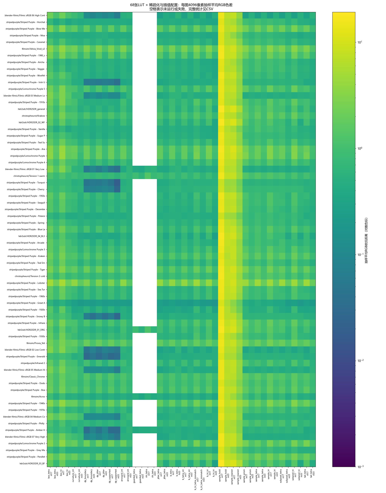
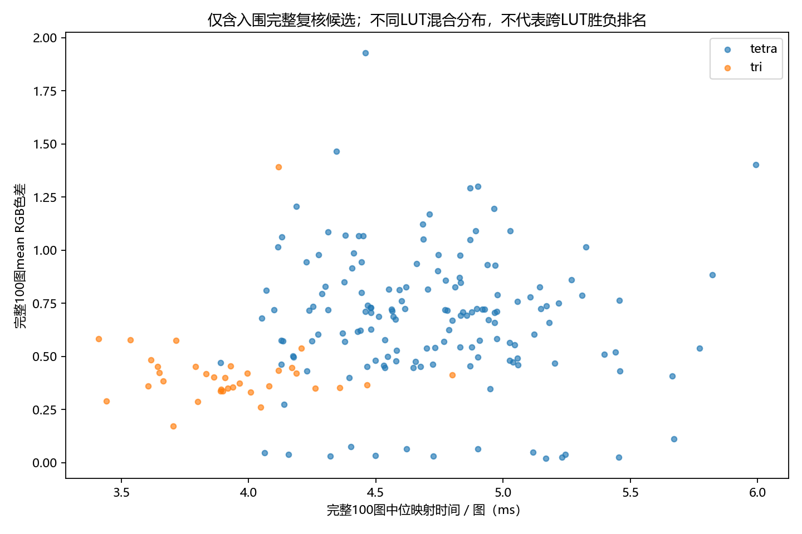

# LUT与实际照片适配度检测报告

日期：2026-10-16。状态：研究与精简归档已完成，经用户审核通过，随Luts分支PR提交。

本PR仅纳入可运行源码、测试、报告、两张图和关键汇总表。完整源码快照、模型、逐图明细及日志保存在本地，不重复上传。

## 1. 算法检测结果

### 1.1 LUT、图片与检测范围

- LUT共68个：Striped Purple 49、HDR2SDR 5、FilmSim 4、Christoph Wurst 3、Blender Filmic 7；格式为54个CUBE、7个Hald TIFF、7个3DL。文件名、来源、格式与SHA见[LUT清单](summary/luts.csv)。
- 照片共100张：Kodak 5、DPED 14、DIV2K 81；均为1024×768 RGB8，涵盖日常物体、人物、街景、自然及纹理。[图片清单](summary/images.csv)逐张列出ID、来源、路径和SHA；原始授权随assets保留。
- 20个基础配置分别覆盖68个LUT和17³/33³；IRLS、guarded各覆盖五个来源代表LUT和两档尺寸。合计22个配置名称、44个配置/尺寸组合、2740条LUT配置初筛记录；配置名称不等于独立算法数量。
- 每配置在每张照片固定抽4096个像素（共409600）。按最低mean、最低max及33³采样四面体基线选择候选，去重后188条配置验证全部100张完整图片。全部2740条配置均有抽样逐图结果，只有入围188条有完整性能结果。
- 另测三组四级数值链×10配置×两档尺寸，共60条；188个单级候选穷举完整256³ RGB8输入。

### 1.2 精度与性能指标

精度使用题目RGB欧氏距离 `sqrt(dR²+dG²+dB²)`。mean为平均距离，RMS为均方根距离，p99为每图99%分位数，max为最大像素距离；汇总中的worst_image_p99为最差单图p99。另保存误差≥1/2/3/5的像素比例。
性能为预加载100图、预热后重复3次的映射耗时，含输出分配，不含PNG解码、JIT、拟合与误差统计。记录每图中位ms、100图三次原始ms、拟合秒数、节点/序列化字节及宿主RSS。拟合复用缓存，fit_s不代表独立冷启动总成本。
环境：Windows-11-10.0.26200-SP0；Intel64 Family 6 Model 170 Stepping 4, GenuineIntel；Numba 0.60.0 CPU四线程，BLAS单线程；Python 3.12.7，NumPy 1.26.4。基础提交 `b9e923f14f5ad167168ef803a282561a35b6d7e0`。
正确性测试13项通过；原始研究最终核验通过，1788份不同模型校验一致。CMake缺失、g++启动DLL错误，未完成原有C++/CUDA门禁。本轮性能不能代表目标服务器的部署性能。
源LUT按原网格三线性恢复，显式clip/round为RGB8黄金表，该定义可能有利于三线性候选；未知摄影色彩空间未推断。筛选与复核使用同一批照片，不是盲测。官方Threshold和聚合口径未知，不宣布官方达标。

### 1.3 实际检测的算法简述与结果

下表S17/S33为对应尺寸在已测LUT上的抽样mean中位数；完整N为两档尺寸入围条数，完整mean和ms为这些入围记录的中位数。不同算法入围的LUT集合不同，此表不能直接作公平速度排名；未测表示没有完整图测速。逐尺寸精确值见[算法汇总](summary/algorithm-summary.csv)，逐LUT结果见[全部配置](summary/compatibility.csv)。

| 配置 | 算法简述 | S17 | S33 | 完整N | 完整mean | ms/图 |
|---|---|---:|---:|---:|---:|---:|
| `sample_tetra` | 均匀网格直接采样，四面体插值（4顶点） | 1.0958 | 0.7717 | 76 | 0.7393 | 4.7445 |
| `sample_tri` | 均匀网格直接采样，三线性插值（8顶点） | 1.3307 | 0.8106 | 1 | 0.4335 | 4.1166 |
| `sample_nearest` | 均匀网格直接采样，最近邻查询 | 7.3001 | 3.7811 | 0 | 未测 | 未测 |
| `sample_hold` | 均匀网格直接采样，单元下界零阶保持（255取上端点） | 14.2481 | 7.1349 | 0 | 未测 | 未测 |
| `sample_prism` | 均匀网格直接采样，沿B轴拉伸的三角棱柱插值（6顶点） | 1.2127 | 0.7670 | 0 | 未测 | 未测 |
| `subpixel_tri` | 按精确网格坐标重采样节点，三线性恢复 | 1.2349 | 0.6438 | 3 | 0.4183 | 3.8321 |
| `subpixel_tetra` | 按精确网格坐标重采样节点，四面体恢复 | 0.9253 | 0.6055 | 0 | 未测 | 未测 |
| `box_tri` | Box局部平均构建节点，三线性恢复 | 2.0248 | 0.9905 | 0 | 未测 | 未测 |
| `box_tetra` | Box局部平均构建节点，四面体恢复 | 1.7060 | 0.9136 | 1 | 0.6935 | 4.8322 |
| `ls_tri_tri` | 三线性基函数最小二乘拟合，三线性恢复 | 0.9062 | 0.4822 | 31 | 0.3834 | 3.9076 |
| `ls_tri_tetra_mismatch` | 三线性最小二乘拟合，改用四面体恢复；显式算子失配对照 | 0.9324 | 0.5135 | 3 | 0.5647 | 4.7326 |
| `ls_tetra` | 四面体最小二乘拟合，节点量化后四面体恢复 | 0.7153 | 0.5489 | 6 | 0.5491 | 4.6377 |
| `ls_tetra_int` | 四面体最小二乘加整数节点精化，四面体恢复 | 0.6993 | 0.5315 | 11 | 0.6159 | 4.7043 |
| `jitter_tetra` | 分层jitter采样拟合，四面体恢复 | 0.6969 | 0.4915 | 5 | 0.4950 | 4.4986 |
| `curvature_int` | 曲率驱动非均匀网格，四面体拟合加整数精化 | 0.8932 | 0.5638 | 8 | 0.8282 | 4.5042 |
| `dp_jitter` | 动态规划非均匀网格，分层jitter拟合及四面体恢复 | 0.6824 | 0.5124 | 14 | 0.6816 | 4.7796 |
| `errorgrid_int` | 误差驱动非均匀网格，四面体拟合加整数精化 | 0.8208 | 0.5683 | 6 | 0.7048 | 4.7443 |
| `dp_boundary` | 动态规划网格，边界补全采样拟合及四面体恢复 | 0.6825 | 0.4910 | 7 | 0.7288 | 4.4800 |
| `dp_supported` | 动态规划网格，补足所有节点数据支撑后拟合及四面体恢复 | 0.6824 | 0.4882 | 16 | 0.0565 | 4.8713 |
| `tail_tetra` | 尾部误差加权拟合加整数精化，四面体恢复 | 0.7731 | 0.5482 | 0 | 未测 | 未测 |
| `irls_tetra` | 迭代重加权最小二乘，关注较大残差，四面体恢复（来源代表子集） | 0.5619 | 0.6156 | 0 | 未测 | 未测 |
| `guarded_tetra` | 带独立守护颜色集的Q16整数精化，四面体恢复（来源代表子集） | 0.4943 | 0.4422 | 0 | 未测 | 未测 |

### 1.4 每个LUT的完整100图最优候选

按已复核候选的mean选取；p99列为最差单图p99，max为100图所有像素最大值。平均误差低仍可能有较大局部误差。下表缩写仅去除文件扩展名，完整路径见[完整188条结果](summary/full-results.csv)。

| LUT（来源/名称） | 配置/尺寸 | mean | RMS | 最差p99 | max | ms/图 |
|---|---|---:|---:|---:|---:|---:|
| blender-filmic/Filmic sRGB 01 Very Low Contrast | `dp_supported/m33` | 0.0378 | 0.1966 | 1.7321 | 1.7321 | 4.1579 |
| blender-filmic/Filmic sRGB 02 Low Contrast | `dp_boundary/m17` | 0.0450 | 0.2150 | 1.4142 | 1.7321 | 4.0624 |
| blender-filmic/Filmic sRGB 03 Medium Low Contrast | `dp_supported/m33` | 0.1103 | 0.3381 | 1.4142 | 1.7321 | 5.6711 |
| blender-filmic/Filmic sRGB 04 Medium Contrast | `dp_supported/m33` | 0.0746 | 0.2801 | 1.7321 | 1.7321 | 4.4025 |
| blender-filmic/Filmic sRGB 05 Medium High Contrast | `dp_supported/m33` | 0.0647 | 0.2572 | 1.0000 | 1.7321 | 4.9000 |
| blender-filmic/Filmic sRGB 06 High Contrast | `dp_supported/m33` | 0.0639 | 0.2557 | 1.0000 | 1.7321 | 4.6207 |
| blender-filmic/Filmic sRGB 07 Very High Contrast | `dp_supported/m33` | 0.0491 | 0.2242 | 1.0000 | 1.7321 | 5.1186 |
| christophwurst/Tension 1 warm | `ls_tri_tri/m33` | 0.5832 | 0.9147 | 8.0000 | 12.1244 | 3.4114 |
| christophwurst/Tension 2 cold | `ls_tri_tri/m33` | 0.5771 | 0.9509 | 11.0000 | 20.0000 | 3.5359 |
| christophwurst/Krakow | `errorgrid_int/m33` | 0.6870 | 0.9221 | 3.0000 | 7.3485 | 4.5691 |
| filmsim/Acros | `ls_tri_tri/m33` | 0.3361 | 0.7635 | 1.7321 | 3.4641 | 3.8985 |
| filmsim/Classic_Chrome | `ls_tetra_int/m33` | 0.8135 | 1.0743 | 4.6904 | 17.4929 | 4.5932 |
| filmsim/Provia_Std | `curvature_int/m33` | 1.0516 | 1.3762 | 9.0000 | 22.2935 | 4.6866 |
| filmsim/Velvia_Vivid_v2 | `curvature_int/m33` | 1.1231 | 1.4589 | 7.0711 | 49.0000 | 4.6841 |
| hdr2sdr/HDR2SDR_01_DRG | `dp_supported/m33` | 0.4460 | 0.7200 | 1.7321 | 7.6811 | 4.5356 |
| hdr2sdr/HDR2SDR_02_WF | `ls_tri_tri/m33` | 0.3483 | 0.6204 | 1.7321 | 1.7321 | 3.9191 |
| hdr2sdr/HDR2SDR_03_BF | `ls_tri_tri/m33` | 0.2871 | 0.5660 | 1.7321 | 1.7321 | 3.7997 |
| hdr2sdr/HDR2SDR_04_BL3 | `ls_tri_tri/m33` | 0.2608 | 0.5353 | 1.7321 | 1.7321 | 4.0487 |
| hdr2sdr/HDR2SDR_general | `ls_tri_tri/m33` | 0.4213 | 0.7119 | 3.0000 | 5.7446 | 3.9956 |
| stripedpurple/Striped Purple - Amber Haze | `dp_supported/m17` | 0.0331 | 0.1823 | 1.0000 | 1.7321 | 4.4983 |
| stripedpurple/Striped Purple - Arcade Dayz | `ls_tri_tri/m33` | 0.4195 | 0.6827 | 2.0000 | 3.1623 | 4.1876 |
| stripedpurple/Striped Purple - Blow Me Down | `dp_jitter/m33` | 0.7079 | 1.0491 | 4.4721 | 13.3417 | 4.8777 |
| stripedpurple/Striped Purple - Caramel Plum Cake | `ls_tri_tri/m33` | 0.3834 | 0.6513 | 2.0000 | 9.0554 | 3.6643 |
| stripedpurple/Striped Purple - Cherry Champagne | `dp_supported/m33` | 0.0259 | 0.1618 | 1.4142 | 1.4142 | 5.4555 |
| stripedpurple/Striped Purple - Pendleton | `dp_jitter/m33` | 0.7226 | 0.9720 | 3.3166 | 9.2736 | 4.5623 |
| stripedpurple/Striped Purple - Polaroid Mint Cream | `ls_tri_tri/m33` | 0.4132 | 0.6718 | 1.7321 | 1.7321 | 4.8006 |
| stripedpurple/Striped Purple - Sugar Plums | `ls_tri_tri/m33` | 0.3606 | 0.6250 | 1.4142 | 1.7321 | 4.0814 |
| stripedpurple/Striped Purple - Turquoise | `dp_supported/m33` | 0.0199 | 0.1412 | 1.0000 | 1.4142 | 5.1687 |
| stripedpurple/Striped Purple - Veggie Crisps | `ls_tri_tri/m33` | 0.3591 | 0.6248 | 1.7321 | 2.4495 | 3.6048 |
| stripedpurple/Striped Purple - Woelfelly Neon | `ls_tri_tri/m33` | 0.3556 | 0.6206 | 1.4142 | 3.1623 | 3.9392 |
| stripedpurple/Striped Purple - 1910s | `dp_supported/m33` | 0.4575 | 0.7698 | 4.1231 | 9.4868 | 4.5307 |
| stripedpurple/Striped Purple - 1920s | `ls_tri_tri/m33` | 0.2885 | 0.7076 | 1.7321 | 3.4641 | 3.4408 |
| stripedpurple/Striped Purple - 1930s | `ls_tetra_int/m33` | 0.5004 | 0.7735 | 3.0000 | 4.6904 | 4.1751 |
| stripedpurple/Striped Purple - 1940s | `ls_tetra_int/m33` | 0.9320 | 1.2061 | 6.4031 | 14.2127 | 4.9384 |
| stripedpurple/Striped Purple - 1950s | `jitter_tetra/m33` | 0.4522 | 0.7145 | 2.0000 | 6.0000 | 4.4655 |
| stripedpurple/Striped Purple - 1960s | `jitter_tetra/m33` | 0.4950 | 0.7632 | 2.4495 | 6.4807 | 4.1776 |
| stripedpurple/Striped Purple - 1970s | `ls_tri_tri/m33` | 0.4529 | 0.7130 | 1.7321 | 3.3166 | 3.7921 |
| stripedpurple/Striped Purple - 1980_s | `ls_tetra_int/m33` | 0.6573 | 0.9308 | 2.8284 | 6.4031 | 4.9675 |
| stripedpurple/Striped Purple - Aricha Blend | `ls_tri_tri/m33` | 0.3314 | 0.5979 | 1.4142 | 1.7321 | 4.0082 |
| stripedpurple/Striped Purple - Blue Lagoon | `ls_tetra_int/m33` | 0.5441 | 0.7953 | 2.2361 | 5.0990 | 4.8769 |
| stripedpurple/Striped Purple - Horchata | `ls_tri_tri/m33` | 0.3354 | 0.6052 | 1.7321 | 1.7321 | 3.8895 |
| stripedpurple/Striped Purple - Vanilla Bean | `ls_tri_tri/m33` | 0.3449 | 0.6121 | 1.7321 | 1.7321 | 3.8925 |
| stripedpurple/Infrared 2 | `jitter_tetra/m33` | 0.4800 | 0.7633 | 2.2361 | 4.1231 | 4.4986 |
| stripedpurple/Striped Purple - Infrared | `ls_tri_tri/m33` | 0.5758 | 0.8764 | 3.3166 | 6.5574 | 3.7144 |
| stripedpurple/Lomochrome Purple 2 | `ls_tetra_int/m33` | 0.8146 | 1.2027 | 13.1909 | 49.1935 | 4.7043 |
| stripedpurple/Lomochrome Purple 3 | `ls_tetra_int/m33` | 0.5391 | 0.7953 | 2.2361 | 5.0990 | 4.6998 |
| stripedpurple/Lomochrome Purple 4 | `ls_tri_tri/m33` | 0.5376 | 0.7879 | 2.0000 | 3.7417 | 4.2080 |
| stripedpurple/Lomochrome Purple 5 | `ls_tetra_int/m33` | 0.6159 | 0.8627 | 2.4495 | 4.6904 | 4.4291 |
| stripedpurple/Lomochrome Purple | `ls_tetra_int/m33` | 0.7296 | 1.0098 | 5.9161 | 17.8045 | 4.4787 |
| stripedpurple/Striped Purple - Grey Matter | `ls_tri_tri/m33` | 0.4014 | 0.6809 | 1.7321 | 3.4641 | 3.8640 |
| stripedpurple/Striped Purple - December Greens | `ls_tri_tri/m33` | 0.4242 | 0.6870 | 2.0000 | 4.1231 | 3.6490 |
| stripedpurple/Striped Purple - Emerald Malaise | `dp_supported/m17` | 0.0308 | 0.1760 | 1.0000 | 1.4142 | 4.3202 |
| stripedpurple/Striped Purple - Irish Uprising | `dp_supported/m33` | 0.0390 | 0.1979 | 1.0000 | 1.7321 | 5.2453 |
| stripedpurple/Striped Purple - Philly Fog | `ls_tri_tri/m33` | 0.4825 | 0.7385 | 1.7321 | 4.3589 | 3.6169 |
| stripedpurple/Striped Purple - Sea Turtle | `ls_tetra_int/m33` | 0.4670 | 0.7261 | 1.7321 | 3.4641 | 5.2039 |
| stripedpurple/Striped Purple - Seagull Cove | `ls_tri_tri/m33` | 0.4551 | 0.7187 | 2.0000 | 2.8284 | 3.9302 |
| stripedpurple/Striped Purple - Snowy Blues | `dp_supported/m33` | 0.0257 | 0.1605 | 1.0000 | 1.4142 | 5.2325 |
| stripedpurple/Striped Purple - Spring Water | `ls_tri_tri/m33` | 0.4002 | 0.6634 | 1.7321 | 3.0000 | 3.9076 |
| stripedpurple/Striped Purple - Teal Embers | `ls_tetra_int/m33` | 0.4612 | 0.7202 | 1.7321 | 4.3589 | 4.7233 |
| stripedpurple/Striped Purple - Teal Supreme | `ls_tri_tri/m33` | 0.4462 | 0.7218 | 2.2361 | 4.5826 | 4.1709 |
| stripedpurple/Striped Purple - Ara | `jitter_tetra/m33` | 0.8703 | 1.2014 | 8.0623 | 20.0499 | 4.8279 |
| stripedpurple/Striped Purple - Boa | `dp_jitter/m33` | 0.7096 | 0.9661 | 4.2426 | 16.0000 | 4.9763 |
| stripedpurple/Striped Purple - Dodo | `dp_jitter/m33` | 0.6588 | 0.9133 | 3.0000 | 10.0499 | 5.1821 |
| stripedpurple/Striped Purple - Great Auk | `ls_tri_tri/m33` | 0.1726 | 0.5468 | 1.7321 | 1.7321 | 3.7043 |
| stripedpurple/Striped Purple - Kraken | `dp_jitter/m33` | 0.7044 | 1.0126 | 12.0000 | 22.0227 | 4.9664 |
| stripedpurple/Striped Purple - Lobster | `dp_boundary/m33` | 1.0899 | 1.6765 | 11.0905 | 29.0172 | 5.0291 |
| stripedpurple/Striped Purple - Moa | `ls_tri_tri/m33` | 0.3518 | 0.6232 | 1.7321 | 1.7321 | 4.3590 |
| stripedpurple/Striped Purple - Tiger | `jitter_tetra/m33` | 0.7875 | 1.1841 | 15.0333 | 29.0689 | 5.3112 |

已复核候选中最低mean的方案分布：ls_tri_tri 28个LUT、dp_supported 14个LUT、ls_tetra_int 11个LUT、dp_jitter 5个LUT、jitter_tetra 5个LUT、curvature_int 2个LUT、dp_boundary 2个LUT、errorgrid_int 1个LUT。没有一个配置在所有LUT上胜出。

完整图片18800条逐图指标及抽样图片274000条逐图指标仅保存在本地完整归档，不随本PR上传。两类结果可用LUT路径、profile、m和image关联，抽样值不等于完整图值。

### 1.5 四级串联与全色域结果

三组链使用不同的四张LUT，每级RGB8取整。它们是数值级联压力测试，未宣称摄影色彩域兼容。每组全部20条的算法/尺寸、mean、最差p99、max、时间见[四级结果](summary/chains.csv)；各链的四个LUT和配置定义见[链配方](summary/chain-recipes.json)。完整逐图结果与三次原始计时保留本地；单级三次原始计时保留在full-results.csv。

| 四级链 | 已测配置 | 最低mean候选 | mean | 最差p99 | max | ms/图 |
|---|---:|---|---:|---:|---:|---:|
| 1 | 20 | `dp_supported/m33` | 1.1514 | 8.6023 | 21.0238 | 24.6959 |
| 2 | 20 | `curvature_int/m33` | 1.7591 | 9.8489 | 9.8489 | 24.6952 |
| 3 | 20 | `dp_supported/m33` | 0.6672 | 3.1623 | 4.5826 | 24.0199 |

[全色域结果](summary/cube-finalists.csv)含188条单级候选的16,777,216种颜色精确统计；它覆盖照片未出现的颜色，但不能代替四级全色域证明。高阶样条、棱锥、神经网络、R25/R26原生全域拟合与C++/CUDA部署性能尚未纳入本轮实测。





## 2. 已经开发的文件及作用

### 2.1 可运行代码

源码按仓库原目录保存，直接运行，不上传重复code快照。已有拟合与插值模块继续使用仓库中的实现。

| 文件 | 作用 |
|---|---|
| [python/lutlab/source_lut.py](../../../python/lutlab/source_lut.py) | 新增：解析CUBE、Hald TIFF、3DL，按明确轴序、裁剪和舍入政策生成黄金表。 |
| [python/lutlab/study_kernels.py](../../../python/lutlab/study_kernels.py) | 新增：Numba像素查询、五种插值、256³展开及精确色差直方图统计。 |
| [python/lutlab/compatibility.py](../../../python/lutlab/compatibility.py) | 新增：组合配置、固定抽样、拟合缓存、候选选择、100图验证、计时与断点续跑。 |
| [python/lutlab/study_chains.py](../../../python/lutlab/study_chains.py) | 新增：四级融合查询、逐级整数舍入、三组数值链及逐图指标。 |
| [scripts/local_compatibility_pipeline.py](../../../scripts/local_compatibility_pipeline.py) | 新增：统一调度正确性、筛选、串行测速、四级、全色域、逐图导出、汇总和核验。 |
| [scripts/study_worker.py](../../../scripts/study_worker.py) | 新增：为Windows检查点文件占用注入有限重试，不改变数值算法。 |
| [scripts/run_local_lut_study.py](../../../scripts/run_local_lut_study.py) | 新增：早期简化启动入口；完整复现优先使用统一pipeline。 |
| [scripts/check_full_cube_finalists.py](../../../scripts/check_full_cube_finalists.py) | 新增：入围模型穷举全部16,777,216个RGB8输入。 |
| [scripts/export_screen_per_image.py](../../../scripts/export_screen_per_image.py) | 新增：导出所有配置的抽样逐图指标，核对与原筛选汇总一致。 |
| [scripts/report_local_lut_study.py](../../../scripts/report_local_lut_study.py) | 新增：原始汇总报告、最优候选CSV和两张科学图表。 |
| [scripts/audit_local_lut_study.py](../../../scripts/audit_local_lut_study.py) | 新增：检查素材、代码、参考表、模型哈希及各结果表记录数量。 |
| [scripts/archive_local_lut_study.py](../../../scripts/archive_local_lut_study.py) | 本次新增：整理code/report快照、配置指标汇总及本报告。 |
| [tests/test_compatibility.py](../../../tests/test_compatibility.py) | 新增：源格式通道/轴序、既有Q16实现对照、三线性、棱柱、端点与统计测试。 |
| [tests/test_chain_study.py](../../../tests/test_chain_study.py) | 新增：四级融合与逐级既有Q16实现一致性、独立误差统计测试。 |
| [experiments/local-study-requirements.txt](../../../experiments/local-study-requirements.txt) | 新增：本机独立研究环境的依赖版本。 |
| [docs/local-lut-compatibility-workflow.md](../../../docs/local-lut-compatibility-workflow.md) | 新增：复现命令、CI关系、范围、参考解释及已知限制。 |
| [python/lutlab/fit.py](../../../python/lutlab/fit.py) | 既有依赖：各类节点拟合、整数精化、权重及非均匀网格实现。 |
| [python/lutlab/interp.py](../../../python/lutlab/interp.py) | 既有依赖：独立插值实现与Q16正确性对照。 |
| [python/lutlab/io.py](../../../python/lutlab/io.py) | 既有依赖：稀疏LUT序列化、均匀网格及轴查表。 |
| [python/lutlab/curve.py](../../../python/lutlab/curve.py) | 既有依赖：拟合与曲线相关辅助代码。 |

### 2.2 随PR提交的报告与汇总

| 文件 | 作用 |
|---|---|
| `report.md` | 两部分审核报告：算法、数据集、指标与文件说明。 |
| `summary/algorithm-summary.csv` | 22种配置×两档尺寸的44条覆盖与指标汇总。 |
| `summary/compatibility.csv` | 2740条初筛及188条完整记录，stage区分范围；不含逐图明细。 |
| `summary/best-per-lut.csv` | 68个LUT各自的最优候选、基线对照及全色域指标。 |
| `summary/full-results.csv` | 188个完整候选的精度、拟合/内存及三次原始计时。 |
| `summary/chains.csv`、`summary/chain-recipes.json` | 60条四级结果和三组链的具体LUT配方。 |
| `summary/cube-finalists.csv` | 188个候选的完整RGB8色域统计。 |
| `summary/luts.csv`、`summary/images.csv` | 68个LUT与100张照片的ID、路径、来源及SHA索引。 |
| `summary/run.json`、`summary/workflow-code-sha256.json` | 原始实验环境、参数、代码身份；不代表精简包可独立恢复本地检查点。 |
| `summary/audit.json` | 完整本地证据的历史核验结论，部分受检模型与明细未随PR上传。 |
| `accuracy-heatmap.png`、`full-accuracy-time.png` | 算法精度覆盖与入围候选精度—耗时图。 |

### 2.3 本地保留内容与复现

完整code/report归档仍位于本机`artifacts/local-lut-study/20261016/archive/`；1788份模型、18800条完整逐图指标、274000条抽样逐图指标、黄金表缓存及阶段日志均保留本地，不进入本PR。两份历史调研草稿已作本地备份。
新检出仓库只包含摘要，不含完整检查点。安装研究依赖后，在仓库根目录使用新输出目录重跑；代码/换行或环境变化时不得混用旧运行身份。初筛及全图验证需要较长时间，普通CI不运行该研究。

```powershell
python -m pip install -r experiments/local-study-requirements.txt
python scripts/local_compatibility_pipeline.py --output artifacts/local-lut-study/rerun
```

本次精简仅调整提交范围和报告链接，未修改冻结的数值算法，也未重新计时。
