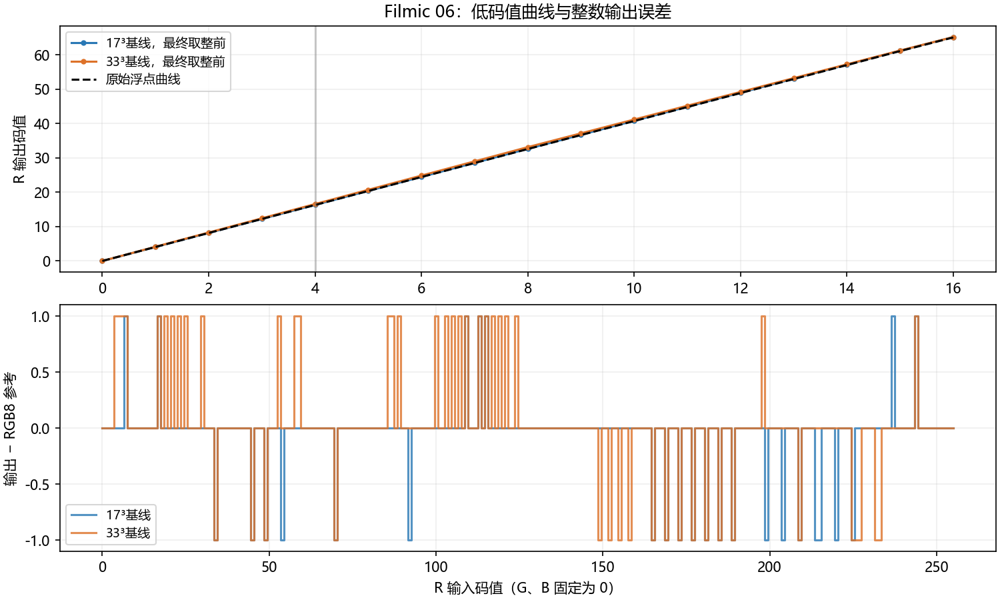
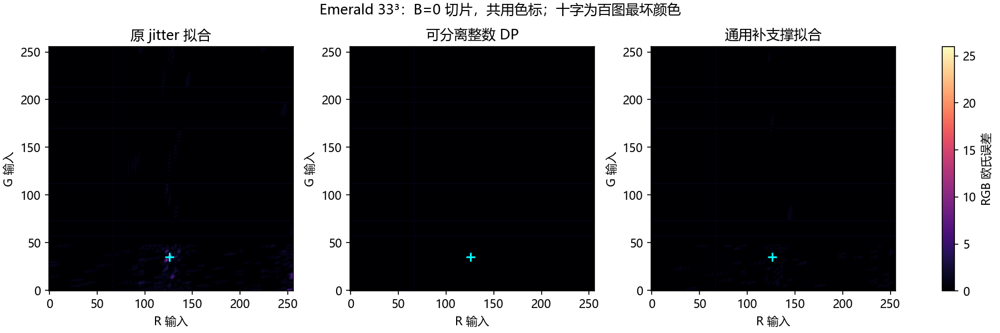

# Filmic 06 与 Emerald Malaise 的误差来源诊断

状态：本地实验、审计与报告已完成，用户已审核通过；本阶段通过 Luts 分支提交 PR，供团队审查，不自动合并。

Agent：Codex；Operator：本次会话用户；Task：双尺寸反例拆解与两种 DP 方法对照。

## 1. 阶段目标与结论

本阶段解释两个具体问题：Filmic 06 为什么直接采样基线从 17³ 增加到 33³ 后平均误差反而上升；Emerald Malaise 为什么两种 DP 方法平均误差很接近，最大误差却差别很大。只研究两个已冻结素材，不扩展方法扫描、不修改默认模型。

主要结论：

1. Filmic 06 在当前源解释下是严格可分离的分段线性曲线。保持原始浮点节点、准确采样位置和浮点权重时，两档都能逐字节重建 RGB8 参考。实际基线把浮点网格位置取整后采样，再把取到的 RGB8 值放回原浮点网格位置；这种位置错配和节点量化共同造成误差。节点量化在 17³ 上抵消了部分误差，在 33³ 上却增加了误差。两档的 Q16 权重与浮点权重输出相同，三线性与四面体输出也相同，因此这两项不是本例最终字节误差差异的来源。
2. 必须纠正此前仅按配置名作出的解释：两个素材的 `dp_supported` 实际都走 `verified_axis_separable`，即全色域验证可分离后采用逐通道整数 DP，未调用通用补支撑三维拟合。不能把其全部收益归因于补足节点训练样本。
3. Emerald 的 jitter 拟合确有支撑不足：17³/33³ 分别存在 10/631 个数据 Hessian 对角为零的节点。但百图最坏点对应的 33³ 节点有一个训练样本，问题并非只有零支撑。该样本由两个偏差方向相反的节点插值得到正确值，训练点准确掩盖了端点的大误差。
4. 在固定 DP 网格、Q16 表和整数精化方法的新增对照中，通用补支撑拟合将 33³ 百图 max 从 25.258662 降至 3.605551；结构专用整数 DP 为 1.732051。补支撑显著缓解问题，但没有复现结构专用路径的全部精度。

## 2. 算法简述与实际执行路径

| 配置/对照 | 网格和节点生成 | 恢复方式及本轮用途 |
|---|---|---|
| `sample_tetra` | 均匀浮点网格；`fit_sample` 对位置使用 `np.round` 后读取完整 RGB8 表；节点为 RGB8 | 冻结的 Q16 四面体、最终逐通道 half-up 取整；17³/33³ 基线 |
| `dp_jitter` | 动态规划按轴向弦线 SSE 选择非均匀整数网格；每个 4×4×4 色块抽一个固定 jitter 点，共 262144 个；四面体最小二乘、正则化和整数节点精化 | 相同 Q16 四面体；并未保证每个节点有足够的独立观测 |
| `dp_supported`（这两个素材的实际路径） | 全部 256³ 参考颜色验证每个输出通道仅依赖一个输入通道；固定 DP 网格上，逐通道整数 DP 先最小化最大绝对字节误差，再在该界内最小化 SSE；展开回三维节点表 | 仍使用同一三维 Q16 恢复；不是修改运行时，也不是泛化三维 LUT 的全局最优证明 |
| `general_supported`（本轮新增消融） | 绕过可分离分派，显式调用 `fit_supported_tetra`：精确覆盖边界和网格顶点，按剩余体积加权抽样内部；随后使用相同整数精化 | 与 jitter 同一网格、同一 Q16 表；用于分开检验支撑采样方案与结构约束的作用 |

DP 网格目标是轴向弦线 SSE 代理目标，并不是最终三维 Q16/RGB8 误差的全局优化。通用补支撑对照同时改变样本集合、权重与随机种子，本阶段没有进一步把三者做全因子分解，不能把变化量全部归给单一顶点锚定操作。

代码依据：`python/lutlab/fit.py` 的 `fit_sample`、`adaptive_dp_grid`、`fit_stratified_tetra`、`fit_supported_tetra`、`fit_structured_tetra`，以及 `python/lutlab/curve.py`。旧实际分派与新求解诊断都保存在 [details.json](data/details.json)。

## 3. 误差分析思路与依据

### 3.1 数据、范围和指标

- 冻结源：Filmic sRGB 06 High Contrast（源 SHA `0846de8be0c34616b5d3375940ad9e6ab526cce760b5b1d3c5f1f3e97d2e2c4f`）、Striped Purple - Emerald Malaise（完整 SHA 见 run.json）。
- 使用原 100 张 1024×768 RGB8 照片，共 78643200 像素；没有增加或挑选新图片。每个变体重新计算完整百图指标，另计算全部 16777216 个 RGB8 输入。
- 10 个冻结模型：Filmic 的两档基线与 `dp_supported`；Emerald 的两档基线、`dp_jitter`、`dp_supported`。另有 8 个 Filmic 数值消融和 2 个新通用补支撑模型，共 20 个变体。
- RGB 欧氏 mean/RMS/max；百图 p99 为最差逐图 p99，全色域 p99 单列。`error >= 2` 是本轮诊断计数，不是官方 Threshold。
- 100 张图的 RGB 频数用于加权统计；同时输出每张图的实际指标，避免用总体 p99 冒充最差逐图 p99。所有照片尺寸一致，因此逐图 mean 平均等于总体像素 mean。

### 3.2 正确性与拟合误差分开验证

对 10 个冻结模型及 2 个新增模型，分别穷举全色域，用独立 NumPy int64/Q16 加权与取整对照 Numba 映射，全部逐字节一致。这是运行时一致性验证。随后相对完整源参考计算误差，这是模型近似精度；两者不能互相替代。

Filmic 原始 3DL 节点先验证可分离，再用独立一维 `np.interp` 展开、clip/half-up 取整，与旧完整 RGB8 参考全色域逐字节一致。沿用既有源解释：近恒等 10bit shaper 视为恒等，输出按 12bit 缩放；本轮不重新裁定其摄影色彩空间，也不宣称验证了另一种 OCIO/shaper 解释。

10 个冻结模型的百图 mean/RMS/最差逐图 p99/max 均与已发布双基线结果相差小于 1e-10。输入与研究源 123 项 SHA 检查通过。独立审计另核对 20 个唯一变体、2000 条逐图记录和聚合公式。

## 4. Filmic 06：位置错配与节点量化的相互作用

### 4.1 按处理顺序逐步引入误差

固定源参考、最终 RGB8 取整及照片集合，只依次改变采样位置、节点精度、权重精度。

| 对照步骤 | 17³ 百图 mean | 33³ 百图 mean | 17³ 全色域 mean | 33³ 全色域 mean |
|---|---:|---:|---:|---:|
| 原始浮点曲线，在准确网格位置采样，精确权重 | 0.000000 | 0.000000 | 0.000000 | 0.000000 |
| 采样位置改为取整位置，节点仍为浮点 | 0.366854 | 0.390457 | 0.338381 | 0.358565 |
| 节点再量化为 RGB8，权重仍为浮点 | 0.272780 | 0.519827 | 0.297432 | 0.522546 |
| 权重再量化为 Q16，即实际冻结基线 | 0.272780 | 0.519827 | 0.297432 | 0.522546 |

准确位置的 17³ 网格与源曲线结点对齐，33³ 又细分这些线段；在当前解释下两者都可以表达原浮点曲线。这个零误差对照使用浮点节点，仅用于归因，不是可直接装入现有 RGB8 SLUT 的新零误差模型。

真实采样代码读取 `T[round(grid)]`，但把数值登记在原 `grid` 上。局部斜率越大，横向位置偏移越可能跨过最终输出的半整数边界。本例两档位置取整都引入误差。

继续引入节点 RGB8 量化时，17³ 的百图 mean 下降 0.094074，33³ 却上升 0.129369。故量化不是一个与其他步骤独立、必然增加 mean 的项：它可能抵消已有偏差。上述是固定顺序的消融增量，不是唯一的可加“误差贡献率”，改变引入顺序可能得到不同分配。

### 4.2 可直接复算的颜色反例

取 RGB 输入 `[4, 0, 0]`：

| 项目 | R 输出 |
|---|---:|
| 原始浮点参考 | 16.2852258852 |
| RGB8 参考 | 16 |
| 17³ Q16 基线，最终取整前 | 16.3134765625 |
| 17³ 最终输出 | 16 |
| 33³ Q16 基线，最终取整前 | 16.5649566650 |
| 33³ 最终输出 | 17 |

17³ 的偏差没有跨过 16.5，33³ 的偏差跨过了，因此新增一个码值的误差。这个反例解释了输出取整如何把较小的连续偏差变成离散差异；并不代表只有这一输入造成总体变化。



完整逐码值结果见 [filmic-curves.csv](data/filmic-curves.csv)。本例三个输出通道具有同类一维结构，图中展示 R 通道。

### 4.3 已排除与尚未证明的原因

- 冻结基线改用三线性恢复：两档全色域输出均与四面体逐字节相同，因此本例不支持“插值类型不匹配导致退化”。这依赖可分离结构，不推广到其他 LUT。
- 同一 RGB8 节点，用精确权重或 Q16 权重：两档全部 RGB8 输出相同；不代表取整前浮点值完全相同。
- 现有 Q16 实现与整数参考全色域一致，没有在这批输入发现运行时实现错误。
- 位置取整和节点量化的交互有实测证据；未通过本实验判断其他源格式、其他 LUT 或真实视觉感知的因果关系。
- 原 `dp_supported` 在百图上将两档 mean 降至 0.125111/0.063911，说明保留 RGB8 节点约束后仍有优化空间，但不能从浮点零误差对照推断整数节点也能零误差。

## 5. Emerald Malaise：相同网格下，支撑与结构约束的差别

### 5.1 两种原方法与新增对照

实际核对：每个尺寸的 `dp_jitter` 与 `dp_supported` 网格、序列化 idx/frac 完全相同。新增 `general_supported` 也沿用这些表。差异来自节点估计方式。

| 尺寸 | 节点拟合路径 | 百图 mean | 百图 RMS | 最差逐图 p99 | 百图 max | 全色域 max |
|---|---|---:|---:|---:|---:|---:|
| 17³ | jitter 三维拟合 | 0.031157 | 0.176900 | 1.000000 | 8.366600 | 8.602325 |
| 17³ | 新通用补支撑拟合 | 0.030895 | 0.176146 | 1.000000 | 1.414214 | 1.414214 |
| 17³ | 原结构专用整数 DP | 0.030829 | 0.175961 | 1.000000 | 1.414214 | 1.414214 |
| 33³ | jitter 三维拟合 | 0.048700 | 0.226749 | 1.000000 | 25.258662 | 28.442925 |
| 33³ | 新通用补支撑拟合 | 0.045597 | 0.215309 | 1.000000 | 3.605551 | 3.741657 |
| 33³ | 原结构专用整数 DP | 0.035075 | 0.187900 | 1.000000 | 1.732051 | 1.732051 |

jitter 的 `error >= 2` 百图像素比例从 17³ 的 0.0000458% 增至 33³ 的 0.0222321%，对应 36 和 17484 个像素，涉及 5 和 99 张照片。它们占比低，因而两档最差逐图 p99 都只有 1，但最大误差非常明显。新增 33³ 通用补支撑拟合仍有 1298 个这类像素；结构专用路径没有。

### 5.2 支撑不足不是“求解器没收敛”

| jitter 数据支撑指标 | 17³ | 33³ |
|---|---:|---:|
| 总节点数 | 4913 | 35937 |
| 数据 Hessian 对角为零的节点 | 10 | 631 |
| 对角小于 1/64 的节点（含零） | 17 | 757 |
| 节点相对对应参考颜色的最大 RGB 误差 | 8.602325 | 28.442925 |

这里的对角来自未加正则化的 `AᵀA`，表示数据观测的支撑，不把正则化当作真实样本。每块一个 jitter 点并不能保证非均匀网格的狭窄单元和边界充分被观察。旧诊断的三个通道求解器均报告收敛；求解收敛只说明解满足该拟合问题，不保证未采样位置准确。

新增通用补支撑方案两档均消除了零对角节点，最小对角为 1/64。17³ 的全色域尾部降至 1.414214，33³ 降至 3.741657。这是支撑设计能够缓解问题的直接对照，但不是消除全部三维近似误差的保证。

### 5.3 具体反例：训练颜色完全正确，端点却严重错误

33³ jitter 的百图最大误差发生在 `[126, 35, 0]`：

- 完整参考：`[99, 44, 17]`。
- jitter 输出：`[80, 53, 31]`，RGB 距离为 `sqrt(638) = 25.258662`。
- 结构专用 DP 输出：`[99, 44, 17]`。
- 该输入恰好是节点 14553，查询权重为 1，不存在多个节点的运行时混合来解释这次偏差。

该节点并不是零支撑：它只出现在训练颜色 `[124, 33, 0]` 的一个非零权重项中。这个训练颜色只用两个节点：

| 节点坐标 | Q16 权重 | jitter 节点值 | 该节点的参考值 |
|---|---:|---|---|
| `[123,32,0]` | 0.6666717529 | `[107,38,10]` | `[97,42,17]` |
| `[126,35,0]` | 0.3333282471 | `[80,53,31]` | `[99,44,17]` |

两个错误节点相互抵消，在训练点得到 `[98,43,17]`，与该点参考完全一致。但移动到第二个端点后，抵消消失。这是“训练样本准确不代表节点与邻域准确”的具体证据，也说明只检查非零对角或样本总数不够。不能由一个反例推断全部异常都来自同一种局部抵消。

全色域最坏点另为 `[102,23,158]`，参考 `[80,34,123]`，jitter 输出 `[108,34,118]`，误差 28.442925；这个颜色没有出现在 100 张照片中，进一步说明百图 max 不是全色域上界。



三图使用相同色标，稀少异常在整体视图中面积很小；十字标识百图最坏颜色。训练样本与节点明细见 [emerald-training-witness.json](data/emerald-training-witness.json)。

### 5.4 为什么结构专用 17³ 仍比 33³ 更好

它不是 jitter 支撑问题，因为两档都走完整的一维整数优化。旧证书记录三通道 256 个输入上的平方误差和分别为：17³ `[4,3,0]`，33³ `[1,6,2]`。合计从 7 增至 9，对应本轮全色域 RMS 从 0.165359 增至 0.187500。

两档 DP 网格重新优化，并非保证嵌套；轴向布点代理目标也不是最终整数输出目标。逐通道 DP 的证书只针对各自固定 Q16 轴，因此“33³ 可选节点更多”不意味着该具体固定轴表上必然更好。证书和实测能解释最优性范围，本轮没有枚举所有 33³ 网格，不能宣称 17³ 全局优于 33³。

## 6. 下一步算法设计建议

| 优先级 | 建议 | 依据及下一轮验收方式 |
|---|---|---|
| P0 | 报告记录实际分派路径，区分 DP 布点、三维补支撑拟合和可分离整数 DP | 本轮发现配置名掩盖真实算法；方法排行应按实际路径分组，不把结构收益归给通用采样 |
| P1 | Filmic 保留网格位置一致性，并在 RGB8 节点约束下进行真实 Q16/最终取整优化 | 增加“原浮点源精确位置采样后量化”与现有 `sample_interp` 的受控比较；每次同时检查完整色域和百图。浮点节点零误差仅作诊断，不作为可交付收益 |
| P1 | 对已严格证明可分离的 LUT，优先使用已有整数曲线优化 | 本轮结构专用路径尾部优于通用拟合；保持原 SLUT 与恢复内核，不把近似可分离当成精确可分离 |
| P1 | 通用三维拟合采用显式边界/顶点观测，并检查局部独立约束和节点残差 | 零对角应拒绝或回退；非零对角仍可能有抵消。加入本轮 `[124,33,0]` 与两个端点作为固定回归反例；不能只靠增加全局随机点数 |
| P2 | 布点选择与量化后的真实目标联合验收，跨尺寸保留可比候选 | 比较当前 DP 网格与保留旧断点的加密网格，固定 mean/RMS/p99/max 保护；不假定嵌套后整数节点即可无损表示旧曲线 |
| P2 | 将新通用方案视为研究候选，进一步检查残余尾部 | 33³ 通用补支撑仍有 max 3.741657，未达到结构路径；先定位残余反例，再决定约束、权重或局部联合变量，避免直接扩大无解释扫描 |

本轮不新增默认算法，不升级冠军，也不进行四级或实板性能宣称。针对其他一般三维 LUT，结构专用方案可能不适用；上述建议需在新范围另行验证。

## 7. 环境、复现与交付文件

实际环境：Windows 11 10.0.26200 AMD64，Intel Core Ultra 5 125H（18 逻辑 CPU）；Anaconda CPython 3.12.7，NumPy 1.26.4，SciPy 1.15.2，Numba 0.60.0，llvmlite 0.43.0，Pillow 10.4.0。Numba LLVM CPU/TBB 4 线程，BLAS/MKL/OMP 环境固定为 1。本轮没有 C++ 编译，未执行 AVX2/CUDA/实板后端，也未采集可比较的性能计时；拟合诊断用于精度研究。

实测源码基线：`75dc5b074775eaca217dd9e9eb95ea8708d9523f`，工作分支 Luts。发布前已快进整合主干 `da5ed25`（上一轮 PR #38 的合并提交，文件树不变），不把同步后的提交冒充实测起点。数值源 SHA 与输入 SHA 在 [run.json](data/run.json)。没有改动 AGENTS.md、共享运行时或已有成果。提交哈希由对应 PR 正文记录，阶段文件与作用见下表。

本机已拥有同 SHA 的旧冻结模型和参考；新克隆没有这些本地大文件，须先恢复同 SHA 输入。以下为本轮从仓库根目录实际执行的命令；`analyze.py` 为完整重跑，不是断点续跑。保留本轮目录，复现实验应先把代码复制到同层级的新日期目录，避免覆盖已审核证据。

```powershell
$env:PYTHONIOENCODING='utf-8'
D:\anaconda\python.exe artifacts/lut-cause-study/20261018/code/analyze.py
D:\anaconda\python.exe artifacts/lut-cause-study/20261018/code/audit.py
D:\anaconda\python.exe artifacts/lut-cause-study/20261018/code/illustrate.py
```

| 文件 | 作用与交付范围 |
|---|---|
| `code/analyze.py` | 冻结输入校验、20 变体、全色域整数参考对照、百图指标、支撑诊断及两次通用拟合 |
| `code/audit.py` | 独立 SHA、范围、逐图聚合、消融结论检查 |
| `code/illustrate.py` | 训练点抵消反例、Filmic 曲线图、Emerald 误差切片 |
| `data/metrics.csv`、`data/per-image.csv` | 20 条汇总与 2000 条逐图记录，区分全色域与百图 |
| `data/details.json`、`data/filmic-curves.csv`、`data/emerald-training-witness.json` | 具体反例、模型路径、网格、支撑和逐码值误差 |
| `data/run.json`、`data/checks.json`、`data/audit.json`、`run.log` | 实际环境、源码与数据身份、检查记录及运行日志 |
| `data/*.png` | 两张可复核图示 |
| `data/emerald-general-supported-m*.slut` | 两份新增消融模型，共约 128 KiB；模型哈希另见交付清单 |
| `data/*-d2.npy` | 两个大型全色域平方误差中间数组，仅本地保留，拟提交清单排除 |

阶段验收：20 个变体完成；12 个模型各完成 256³ 整数参考逐字节对照；10 个冻结模型复现旧百图四项误差；123 项输入/数值源 SHA 核验；独立审计通过。两张图已实际查看，标签与数值范围可读。未运行全仓测试套件，因为没有修改公共代码；本轮验证仅覆盖本阶段研究代码和对应输入。

已知边界：两种已见 LUT 和同批已见照片，不是盲测；源解释沿用旧合同；RGB 欧氏误差不是 CIEDE2000；诊断阈值不是比赛门槛；通用支撑消融不是样本/权重/种子的全因子实验；本轮未验证其他 LUT、四级误差传播或硬件性能。
