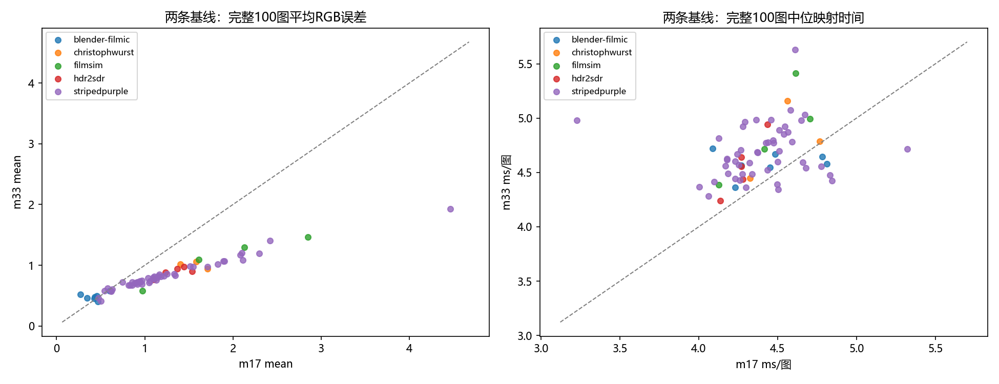

# LUT m17/m33双基线与配对精度性能报告

状态：实验已完成并经用户审核，提交至Luts分支的[PR #38](https://github.com/WyEhNf/flash-chroma/pull/38)供维护者审阅。

## 1. 算法检测结果

### 1.1 输入、模型与实验范围

- 使用原68个LUT、100张1024×768 RGB8照片，源文件/照片/黄金表及1788份不同模型均先核SHA。复用原冻结节点与轴表，不重新拟合；原拟合耗时不冒充新测量。
- 全部22种配置名称保留原覆盖：20种基础配置各68个LUT；IRLS/guarded各5个来源代表LUT。m17/m33共2740条固定样本测量，每图4096像素，固定旧seed20261016，误差与旧记录逐项核对。
- 68个LUT的直接采样+Q16四面体基线均完整测m17与m33，共136条；原188条结果冻结178个LUT/方法组合，两档共356条完整100图记录，未按本轮结果重新选方法。其他配置只有抽样结果，不冒充完整图成绩。
- 每个LUT/方法的两档相邻执行，方法顺序及先测哪一档由seed20261017冻结。每个模型预热后测三次；全部计时本轮串行新测，旧计时未混入。未控制操作系统全部后台负载，三次变异保留，不宣布统计显著加速。
- 基线是sample_tetra/m17及sample_tetra/m33，不是自动取第一行；同尺寸、跨尺寸、跨尺寸跨方法分表。两档节点载荷14739与107811字节，比值约7.315；序列化大小另列。

### 1.2 指标与环境

精度为RGB码值欧氏mean/RMS、最差逐图p99、所有图片max及阈值比例；最差单图p99不是全体像素的全局p99。性能含输出分配，不含解码、JIT、拟合或质量统计。完整时间单位ms/图（100图整组中位时间除100），抽样时间单位ms/409600查询，二者禁止混算。三次原始整组耗时、最小/最大值及宿主RSS保留；RSS不是模型独占内存。
环境：Windows-11-10.0.26200-SP0；Intel(R) Core(TM) Ultra 5 125H；Python 3.12.7；NumPy 1.26.4 / Numba 0.60.0 / llvmlite 0.43.0；Numba 4线程，线程层tbb；BLAS/MKL/OMP=1。源提交`ec5cd8fa891f58d72738af0cd9db2c67f9682e7d`及未提交研究源SHA见run.json。
本次24项定向正确性测试通过，覆盖两尺寸Q16、独立插值统计、四级回归、唯一基线、配对缺失/重复、零基线及环境变更拒绝。首次沙箱因禁止NTFS硬链接导致原有来源保护测试失败，保留日志；宿主运行同组24项全部通过，未改来源保护实现。
本轮未重新编译或测量C++/AVX2/C99/CUDA，没有新四级拟合或实板性能。当前照片均已观察，不称盲测；参考是原网格三线性展开再clip/round的RGB8，可能有利于三线性；未知摄影色彩域保持未知。官方Threshold未定，不宣布通过。

### 1.3 两条基线的完整100图对比

m33相对m17，mean改善61个LUT、持平0个、退化7个；逐LUT相对降幅的中位数为28.43%，时间比中位数为1.068。m33并不自动保证每个LUT误差更低。
这里比较的是指定直接采样/Q16四面体方法的实测，不是两档网格容量的理论最优。节点增多也会改变采样与舍入位置；本轮没有对每个退化LUT逐一作因果分解。
下表每行是同一LUT的直接采样四面体基线；p99/max等完整字段见[baseline-pairs.csv](baseline-pairs.csv)。负降幅表示m33更差。

| LUT | m17 mean | m33 mean | 降幅% | m17 ms/图 | m33 ms/图 |
|---|---:|---:|---:|---:|---:|
| blender-filmic/Filmic sRGB 01 Very Low Contrast | 0.47018 | 0.39912 | 15.1145 | 4.2713 | 4.5633 |
| blender-filmic/Filmic sRGB 02 Low Contrast | 0.34679 | 0.46086 | -32.8935 | 4.4526 | 4.5454 |
| blender-filmic/Filmic sRGB 03 Medium Low Contrast | 0.45545 | 0.49573 | -8.8447 | 4.4837 | 4.6713 |
| blender-filmic/Filmic sRGB 04 Medium Contrast | 0.60319 | 0.57574 | 4.5503 | 4.2299 | 4.3634 |
| blender-filmic/Filmic sRGB 05 Medium High Contrast | 0.43047 | 0.48142 | -11.8355 | 4.0892 | 4.7192 |
| blender-filmic/Filmic sRGB 06 High Contrast | 0.27278 | 0.51983 | -90.5662 | 4.8128 | 4.5815 |
| blender-filmic/Filmic sRGB 07 Very High Contrast | 0.42950 | 0.45249 | -5.3518 | 4.7817 | 4.6438 |
| christophwurst/Tension 1 warm | 1.40072 | 1.01521 | 27.5223 | 4.5611 | 5.1602 |
| christophwurst/Tension 2 cold | 1.58278 | 1.06300 | 32.8401 | 4.7683 | 4.7891 |
| christophwurst/Krakow | 1.71268 | 0.94376 | 44.8955 | 4.3243 | 4.4484 |
| filmsim/Acros | 0.97327 | 0.57482 | 40.9392 | 4.6129 | 5.4156 |
| filmsim/Classic_Chrome | 1.61104 | 1.09001 | 32.3411 | 4.7050 | 4.9952 |
| filmsim/Provia_Std | 2.13041 | 1.29292 | 39.3110 | 4.4178 | 4.7167 |
| filmsim/Velvia_Vivid_v2 | 2.84767 | 1.46441 | 48.5752 | 4.1264 | 4.3858 |
| hdr2sdr/HDR2SDR_01_DRG | 1.44374 | 0.97529 | 32.4465 | 4.4357 | 4.9417 |
| hdr2sdr/HDR2SDR_02_WF | 1.23415 | 0.88353 | 28.4100 | 4.2699 | 4.5549 |
| hdr2sdr/HDR2SDR_03_BF | 1.53829 | 0.90233 | 41.3420 | 4.2706 | 4.6392 |
| hdr2sdr/HDR2SDR_04_BL3 | 1.09923 | 0.76416 | 30.4827 | 4.1368 | 4.2396 |
| hdr2sdr/HDR2SDR_general | 1.36743 | 0.93740 | 31.4480 | 4.2785 | 4.4399 |
| stripedpurple/Striped Purple - Amber Haze | 0.57634 | 0.62386 | -8.2453 | 4.5819 | 5.0740 |
| stripedpurple/Striped Purple - Arcade Dayz | 1.10227 | 0.77995 | 29.2415 | 4.6120 | 5.6322 |
| stripedpurple/Striped Purple - Blow Me Down | 2.29488 | 1.19529 | 47.9151 | 4.5651 | 4.8726 |
| stripedpurple/Striped Purple - Caramel Plum Cake | 0.96725 | 0.75095 | 22.3624 | 4.2608 | 4.4293 |
| stripedpurple/Striped Purple - Cherry Champagne | 0.74599 | 0.72452 | 2.8777 | 4.2303 | 4.4418 |
| stripedpurple/Striped Purple - Pendleton | 2.42180 | 1.40311 | 42.0632 | 4.1784 | 4.6158 |
| stripedpurple/Striped Purple - Polaroid Mint Cream | 0.88435 | 0.70595 | 20.1734 | 4.5922 | 4.7826 |
| stripedpurple/Striped Purple - Sugar Plums | 0.91445 | 0.71836 | 21.4440 | 4.8456 | 4.4256 |
| stripedpurple/Striped Purple - Turquoise | 0.61695 | 0.56933 | 7.7186 | 4.1861 | 4.4921 |
| stripedpurple/Striped Purple - Veggie Crisps | 1.14091 | 0.79567 | 30.2602 | 4.8332 | 4.4780 |
| stripedpurple/Striped Purple - Woelfelly Neon | 0.85577 | 0.67444 | 21.1892 | 4.5022 | 4.5977 |
| stripedpurple/Striped Purple - 1910s | 1.10864 | 0.81102 | 26.8454 | 4.1799 | 4.6274 |
| stripedpurple/Striped Purple - 1920s | 0.47457 | 0.46216 | 2.6144 | 4.5408 | 4.8512 |
| stripedpurple/Striped Purple - 1930s | 0.85675 | 0.71870 | 16.1132 | 3.2269 | 4.9792 |
| stripedpurple/Striped Purple - 1940s | 2.09860 | 1.20659 | 42.5049 | 4.2524 | 4.5685 |
| stripedpurple/Striped Purple - 1950s | 0.90220 | 0.71576 | 20.6645 | 4.2773 | 4.4874 |
| stripedpurple/Striped Purple - 1960s | 0.95140 | 0.72145 | 24.1698 | 4.3212 | 4.5895 |
| stripedpurple/Striped Purple - 1970s | 1.09609 | 0.79906 | 27.0994 | 4.0023 | 4.3685 |
| stripedpurple/Striped Purple - 1980_s | 1.82807 | 1.01550 | 44.4497 | 4.6801 | 4.5396 |
| stripedpurple/Striped Purple - Aricha Blend | 1.15553 | 0.82676 | 28.4520 | 4.0631 | 4.2813 |
| stripedpurple/Striped Purple - Blue Lagoon | 1.12753 | 0.75952 | 32.6390 | 4.2306 | 4.6046 |
| stripedpurple/Striped Purple - Horchata | 1.03459 | 0.79003 | 23.6385 | 4.5102 | 4.6967 |
| stripedpurple/Striped Purple - Vanilla Bean | 1.16711 | 0.84882 | 27.2716 | 4.3699 | 4.6896 |
| stripedpurple/Infrared 2 | 1.04653 | 0.71549 | 31.6318 | 4.2425 | 4.6708 |
| stripedpurple/Striped Purple - Infrared | 1.51061 | 0.98699 | 34.6626 | 4.5045 | 4.3437 |
| stripedpurple/Lomochrome Purple 2 | 1.90075 | 1.06636 | 43.8981 | 4.4598 | 4.9868 |
| stripedpurple/Lomochrome Purple 3 | 1.21700 | 0.82497 | 32.2126 | 4.2673 | 4.7069 |
| stripedpurple/Lomochrome Purple 4 | 1.18016 | 0.81658 | 30.8075 | 4.5446 | 4.9220 |
| stripedpurple/Lomochrome Purple 5 | 1.34545 | 0.82822 | 38.4431 | 4.4399 | 4.7754 |
| stripedpurple/Lomochrome Purple | 2.11307 | 1.08515 | 48.6456 | 4.4746 | 4.7728 |
| stripedpurple/Striped Purple - Grey Matter | 0.91441 | 0.69161 | 24.3659 | 4.3630 | 4.9857 |
| stripedpurple/Striped Purple - December Greens | 0.81542 | 0.67110 | 17.6978 | 4.7766 | 4.5561 |
| stripedpurple/Striped Purple - Emerald Malaise | 0.54620 | 0.58164 | -6.4885 | 4.0973 | 4.4165 |
| stripedpurple/Striped Purple - Irish Uprising | 0.62171 | 0.57672 | 7.2365 | 4.4344 | 4.5215 |
| stripedpurple/Striped Purple - Philly Fog | 1.24954 | 0.85985 | 31.1870 | 4.2791 | 4.9256 |
| stripedpurple/Striped Purple - Sea Turtle | 0.94620 | 0.73805 | 21.9989 | 4.3733 | 4.6826 |
| stripedpurple/Striped Purple - Seagull Cove | 0.93889 | 0.72332 | 22.9592 | 4.4710 | 4.7978 |
| stripedpurple/Striped Purple - Snowy Blues | 0.62871 | 0.60416 | 3.9040 | 4.4975 | 4.3892 |
| stripedpurple/Striped Purple - Spring Water | 0.91894 | 0.72302 | 21.3209 | 4.3004 | 4.3605 |
| stripedpurple/Striped Purple - Teal Embers | 0.96731 | 0.68855 | 28.8185 | 4.1286 | 4.8148 |
| stripedpurple/Striped Purple - Teal Supreme | 1.05975 | 0.74049 | 30.1262 | 4.6723 | 5.0302 |
| stripedpurple/Striped Purple - Ara | 2.08092 | 1.17032 | 43.7595 | 5.3230 | 4.7145 |
| stripedpurple/Striped Purple - Boa | 1.55035 | 0.97680 | 36.9946 | 4.6512 | 4.9821 |
| stripedpurple/Striped Purple - Dodo | 1.33296 | 0.85861 | 35.5866 | 4.2937 | 4.9669 |
| stripedpurple/Striped Purple - Great Auk | 0.50526 | 0.40728 | 19.3928 | 4.4265 | 4.7740 |
| stripedpurple/Striped Purple - Kraken | 1.71226 | 0.97837 | 42.8606 | 4.1700 | 4.5608 |
| stripedpurple/Striped Purple - Lobster | 4.46582 | 1.92962 | 56.7913 | 4.6606 | 4.5921 |
| stripedpurple/Striped Purple - Moa | 0.83628 | 0.67015 | 19.8662 | 4.3375 | 4.4874 |
| stripedpurple/Striped Purple - Tiger | 1.88995 | 1.06890 | 43.4429 | 4.5089 | 4.8885 |

### 1.4 同方法跨尺寸：完整图片候选

每行只汇总实际完整复核的方法/LUT集合；不同方法覆盖集合不同，不能横向把此表当成公平全数据集排名。同一行的两档严格配对。mean列分别为逐LUTmean中位数，时间比为逐LUT时间比中位数。

| 配置 | LUT数 | m17 mean | m33 mean | 改善/持平/退化 | m33/m17时间比 |
|---|---:|---:|---:|---|---:|
| box_tetra | 1 | 0.69352 | 0.46186 | 1/0/0 | 1.041 |
| curvature_int | 8 | 1.68720 | 0.82815 | 8/0/0 | 1.075 |
| dp_boundary | 7 | 1.73618 | 0.72882 | 6/0/1 | 1.073 |
| dp_jitter | 14 | 1.20064 | 0.68164 | 13/0/1 | 1.089 |
| dp_supported | 16 | 0.09957 | 0.05653 | 14/0/2 | 1.090 |
| errorgrid_int | 6 | 1.16386 | 0.70481 | 6/0/0 | 1.052 |
| jitter_tetra | 5 | 0.87811 | 0.49496 | 5/0/0 | 1.094 |
| ls_tetra | 6 | 0.85783 | 0.54908 | 6/0/0 | 1.074 |
| ls_tetra_int | 11 | 1.07923 | 0.61594 | 11/0/0 | 1.046 |
| ls_tri_tetra_mismatch | 3 | 0.92710 | 0.56473 | 3/0/0 | 1.045 |
| ls_tri_tri | 29 | 0.66624 | 0.40021 | 29/0/0 | 1.019 |
| sample_tetra | 68 | 1.09766 | 0.77205 | 61/0/7 | 1.068 |
| sample_tri | 1 | 0.43355 | 0.37844 | 1/0/0 | 1.000 |
| subpixel_tri | 3 | 0.87133 | 0.41832 | 3/0/0 | 1.037 |

### 1.5 同尺寸方法收益及小模型对大基线

[full-same_size.csv](full-same_size.csv)共356条：候选m17只对m17直接采样基线，m33只对m33基线。mean、RMS、最差p99、max均给出绝对差，mean另给相对降幅；零误差基线相对降幅留空，绝对差保留。
[full-small_vs_large_baseline.csv](full-small_vs_large_baseline.csv)含178条m17对m33基线的明确跨尺寸比较。110条非基线方法/LUT记录中，27条在mean/RMS/最差p99/max四项均不差于m33基线，其中24条在本次中位映射时间也不慢。该筛选是已见数据的描述，不等于新LUT或新照片的保证。命中明细见[m17-matches-m33-baseline.csv](m17-matches-m33-baseline.csv)。

### 1.6 全部22种配置的抽样配对

所有配置在同一批409600查询上串行重新计时，能够比较该固定查询批量；不得称为实际100张完整图片耗时。下面mean为固定样本误差，单元格时间单位ms/409600查询。完整逐LUT配对见[screen-size_pair.csv](screen-size_pair.csv)。

| 配置 | LUT数 | m17 mean | m33 mean | m17 查询ms | m33 查询ms |
|---|---:|---:|---:|---:|---:|
| box_tetra | 68 | 1.70602 | 0.91359 | 2.9124 | 2.8339 |
| box_tri | 68 | 2.02477 | 0.99050 | 2.4962 | 2.5658 |
| curvature_int | 68 | 0.89323 | 0.56381 | 2.9499 | 3.0085 |
| dp_boundary | 68 | 0.68246 | 0.49099 | 2.8385 | 2.9768 |
| dp_jitter | 68 | 0.68241 | 0.51243 | 2.8860 | 3.0083 |
| dp_supported | 68 | 0.68243 | 0.48820 | 2.8850 | 2.9482 |
| errorgrid_int | 68 | 0.82076 | 0.56833 | 2.8553 | 3.0900 |
| guarded_tetra | 5 | 0.49428 | 0.44217 | 3.0846 | 3.4583 |
| irls_tetra | 5 | 0.56193 | 0.61561 | 3.1692 | 3.3953 |
| jitter_tetra | 68 | 0.69685 | 0.49152 | 2.8444 | 2.9572 |
| ls_tetra | 68 | 0.71532 | 0.54892 | 2.7998 | 3.0483 |
| ls_tetra_int | 68 | 0.69929 | 0.53146 | 2.8694 | 2.8633 |
| ls_tri_tetra_mismatch | 68 | 0.93239 | 0.51355 | 2.7921 | 2.9681 |
| ls_tri_tri | 68 | 0.90618 | 0.48219 | 2.4152 | 2.4289 |
| sample_hold | 68 | 14.24813 | 7.13487 | 1.3572 | 1.4322 |
| sample_nearest | 68 | 7.30013 | 3.78105 | 1.3787 | 1.4693 |
| sample_prism | 68 | 1.21274 | 0.76704 | 2.2037 | 2.3194 |
| sample_tetra | 68 | 1.09576 | 0.77167 | 2.8470 | 2.8748 |
| sample_tri | 68 | 1.33071 | 0.81057 | 2.4114 | 2.5181 |
| subpixel_tetra | 68 | 0.92535 | 0.60548 | 2.7776 | 2.9187 |
| subpixel_tri | 68 | 1.23492 | 0.64381 | 2.4894 | 2.6045 |
| tail_tetra | 68 | 0.77305 | 0.54817 | 2.8246 | 2.9737 |

## 2. 文件作用与复现

| 文件 | 作用 |
|---|---|
| `python/lutlab/paired_baselines.py` | 冻结配对计划、验证旧模型与参考、同环境重新测量、生成三类严格关联的配对表。 |
| `scripts/run_lut_pairs.py` | 固定Numba四线程及BLAS/MKL/OMP单线程的启动入口。 |
| `scripts/report_lut_pairs.py` | 生成本审核报告、基线/方法摘要和图表；不影响计时内核。 |
| `scripts/audit_lut_pairs.py` | 独立核对输入/代码SHA、完整配对、CSV算式、旧结果全部质量字段及188个旧完整输出SHA。 |
| `tests/test_paired_baselines.py` | 两档唯一基线、配对完整性、零分母、范围隔离及Q16独立对照。 |
| `run.json`、`validated-inputs.json` | 新测量身份、代码/数据/环境、冻结覆盖及输入核验。 |
| `full-results.csv`、`screen-results.csv` | 新实测原始指标、三次时间、模型和输出SHA。 |
| `*-same_size.csv` | 同LUT同尺寸方法对直接采样基线。 |
| `*-size_pair.csv` | 同LUT同方法m33对m17。 |
| `*-small_vs_large_baseline.csv` | 同LUT的m17方法对m33直接采样基线。 |
| `per-image.csv`、`luts/` | 本地保留的35600条完整逐图结果与逐LUT检查点，不全部上传。 |
| `findings.json`、`method-summary.csv`、`baseline-pairs.csv` | 本轮描述性结论及精简汇总。 |

已有本机冻结模型时，从仓库根目录执行：

```powershell
python scripts/run_lut_pairs.py --input artifacts/local-lut-study/20261016 --output artifacts/lut-dual-baseline/20261017
python scripts/report_lut_pairs.py --input artifacts/lut-dual-baseline/20261017
```

新检出仓库不包含旧1788份模型及黄金表，不能直接假装复现此同字节测量；需恢复同SHA模型/参考，或用既有拟合工作流在新目录生成另一组输入并明确作为新实验。源码、环境、输入任一身份变化都拒绝复用当前输出，须指定新目录。
本轮模型拟合来源为原20261016实验；本轮运行环境与耗时为全新记录，二者不能混写。完整旧实验、失败日志和本轮逐图证据保留本地。


