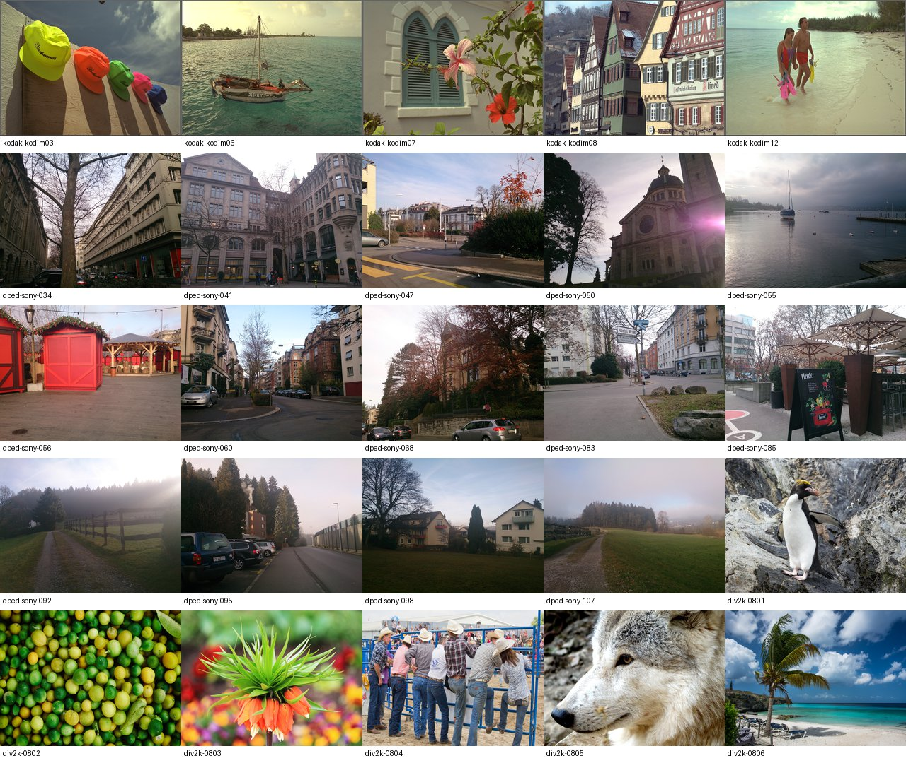
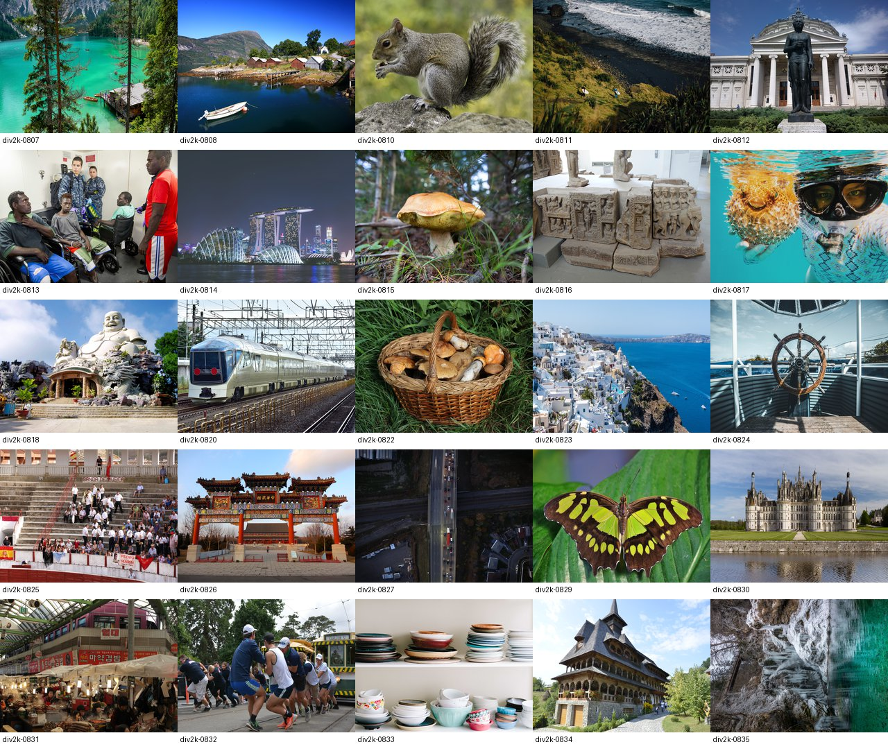
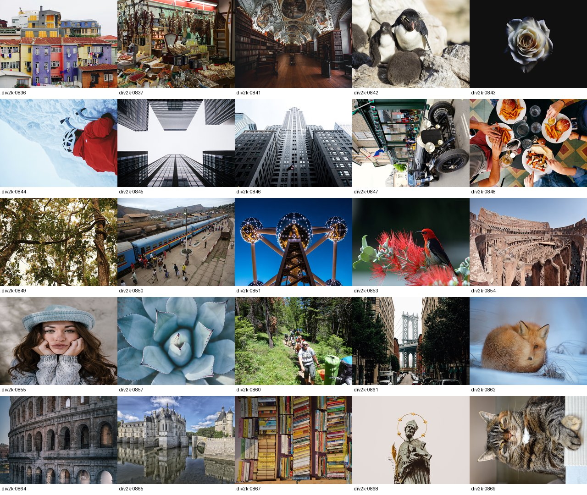
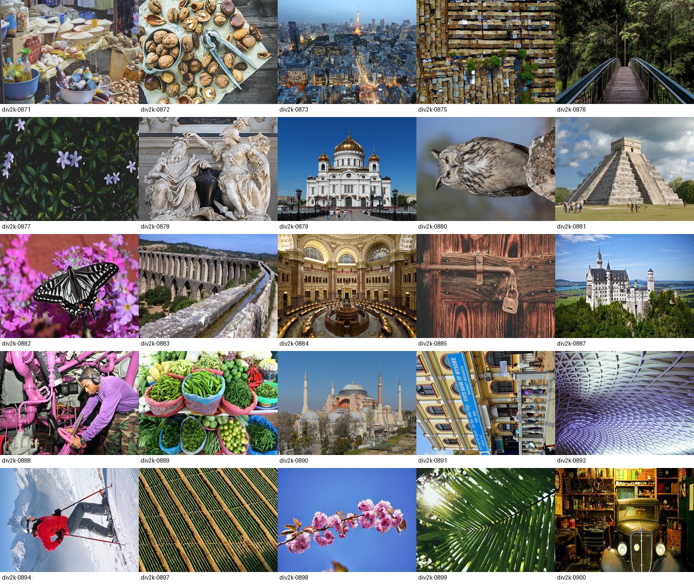

# 日常摄影测试集：100张

用于LUT色彩映射的真实照片小型测试集，覆盖普通手机街景、旅行风景、人物、建筑、餐饮/商品、室内、花草和动物。按缩略图人工选取；不包含合成色条、随机噪声图或专门的极端曝光测试图。保留自然照片本身的少量背光、阴影和普通夜景。

## 数量与位置

| 来源 | 独立输入文件数 | 位置 | 选择规则 |
|---|---:|---|---|
| [Kodak](https://r0k.us/graphics/kodak/) | 5 | [kodak/rgb8-1024x768](kodak/rgb8-1024x768) | 保留上一批五张，原图仍在kodak/original |
| [DPED](https://aiff22.github.io/) | 14 | [dped/rgb8-1024x768](dped/rgb8-1024x768) | sample包14个场景，每场景只取Sony Xperia Z一张，不重复计入其他相机版本 |
| [DIV2K](https://data.vision.ee.ethz.ch/cvl/DIV2K/) | 81 | [div2k/rgb8-1024x768](div2k/rgb8-1024x768) | validation集合100张中，经缩略图检查排除19张特殊题材/强风格/重复题材案例 |
| **合计** | **100** | [eval.txt](eval.txt) | **5张已有＋95张新增** |

每张评测图均为1024×768、RGB 8-bit、无损PNG。100张的解码像素SHA-256互不相同；这不是近重复检测或场景统计独立性的证明。场景分布不是严格均衡的，主要用于首批实际照片检查，不宣称代表官方测试集。

`previews/`的四张联系表只是缩略图总览，不计入100张评测输入；原有五张Kodak原图也不重复计数。

## 使用

从仓库根目录显式传入 `assets/photos/eval.txt`。它每行一张图片，路径相对于仓库根目录。已有接收图片列表的 `validate`/`bench` 等命令可使用该列表，具体选项以各命令的 `--help` 为准。列表不会自动替换原有29图/100图数据，新增照片也不代表已经完成LUT精度或性能测试。

[manifest.json](manifest.json)保存逐图来源、数据集成员名、原始字节SHA-256、原始尺寸/模式、评测PNG哈希、解码像素哈希和下载包哈希。DPED与DIV2K只上传评测PNG；原始下载包保留在本地 `tmp/`，避免把约554MiB压缩源数据纳入Git。可通过manifest中的官方URL和成员名重新获取原始文件。

评测副本遵循已有 `_to_frame` 尺寸政策：EXIF方向修正、竖图旋转90度后转RGB，再以Lanczos缩放至1024×768，可能改变原始宽高比；不调整曝光、色调或饱和度。PNG保存不再引入有损编码。输入来源为JPEG时，其原有压缩痕迹仍存在。

## 来源与使用范围

- **Kodak**：托管页面声明其理解是Kodak允许不受限制使用；保留原摄影者和来源，见[子集说明](kodak/README.md)。
- **DPED**：保留作者公开研究数据的来源及论文署名；不在这里另行授予资产授权。引用：Ignatov et al., *DSLR-Quality Photos on Mobile Devices with Deep Convolutional Networks*, ICCV 2017。
- **DIV2K**：官方明确仅供学术研究，图像版权属于原权利人。本子集及派生PNG保留该使用限制，不继承本仓库代码许可证。引用：Agustsson and Timofte, *NTIRE 2017 Challenge on Single Image Super-Resolution: Dataset and Study*, CVPR Workshops 2017。

## 重建

先从manifest中的官方地址下载两个源包，再在安装Pillow的环境中运行：

```powershell
python scripts/prepare_everyday_photo_batch.py --dped tmp/dped-sample-images.gz --div2k tmp/DIV2K_valid_HR.zip
```

脚本读取压缩包内指定成员，不向任意路径解包；复用已有五张Kodak图片，不下载或运行第三方代码。会重建95张新副本、总manifest、总列表和预览联系表。不同Pillow版本可能改变缩放/PNG字节，应重新核对哈希；manifest记录的源字节哈希用于区分源数据变化。

## 图片预览








