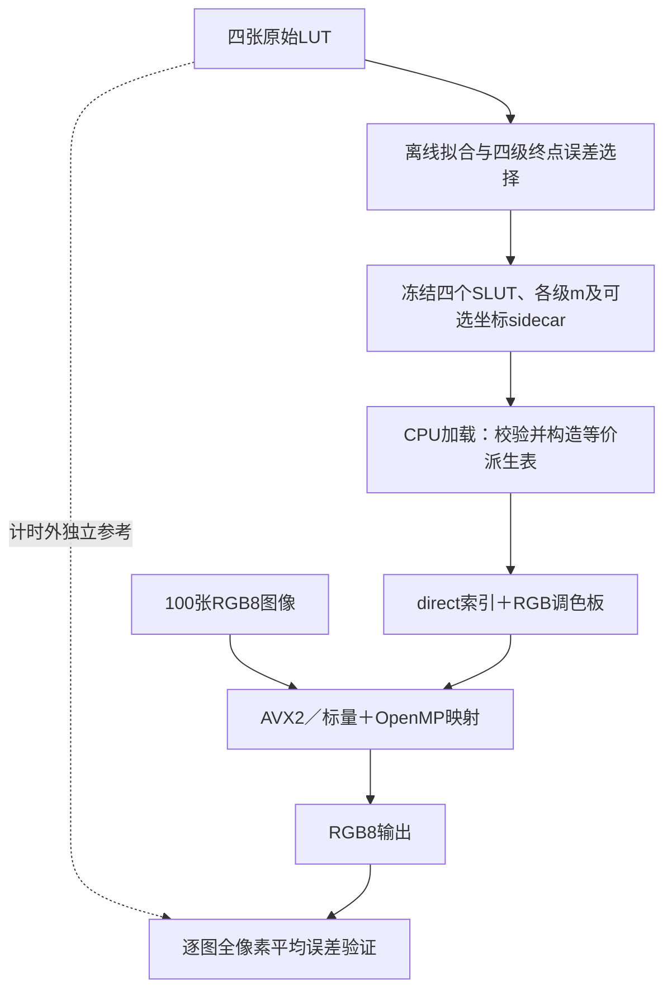

# CPU评分候选版本：性能与方法总结

本文总结2026-10-27冻结版本：代码与模型提交为 `e8d6f629bdf14186790f52d0e512961407cfaed7`，实现提交为 `dd55bb6`，原生运行时修订102。对应[PR #94](https://github.com/WyEhNf/flash-chroma/pull/94)。本文基于已归档实测整理，没有重新拟合或测速。

## 1. 版本定位与主要结果

本版本采用 **离线确定四级稀疏模型，加载时编译等价查表，运行时使用CPU SIMD并行映射** 的方案。Python负责模型打包、驱动和验证，C++17负责像素热路径；不使用GPU或NPU。

当前交付两档固定配置：

| 配置 | 采用策略 | 百图平均误差 | 最差单图平均误差 | 运行时Model容量 |
| --- | --- | ---: | ---: | ---: |
| `default`（373a） | 综合默认，AVX2＋4线程，8位direct索引 | 0.695486159059 | 1.119051322056 | 18,715,824B |
| `max_first` | 均值优先，AVX2＋4线程，16位direct索引 | 0.679090181058 | 1.084102390342 | 35,495,456B |

max_first相对default的百图平均误差下降约 **2.36%**，代价是更大的直接索引表与准备开销。默认选择373a，依据是成熟的执行路径、较小Model及已有研究证据；本轮波动环境下没有获得新的稳定速度排名。

以上精度来自固定Cinema四LUT及100张已见照片，不代表任意新LUT。官方Threshold、精度换分规则及速度评分基准尚缺，目标Xeon Gold6140尚未实测，因此本版本是当前证据支持的候选，不能证明最高总分。

## 2. 算法与运行流程



### 2.1 固定稀疏参数，按最终四级输出选择模型

四级的m可分别取17..33；当前两档示例均为33。离线阶段可以比较不同网格、节点及拟合配置，选定后全部测试图像使用同一组参数，运行时不按图重新拟合或切换profile。

固定模型继承了非均匀轴、分输出坐标及整数节点精化研究。default保留373a四级链；max_first在同一首级、轴及后缀基础上改进第二级节点，减少中间RGB碰撞带来的后续误差。历史精化同时约束均值、RMS及尾部预算，并用最终四级输出验收，避免只优化单级误差。本轮主要完成统一实现、候选筛选及重新复核，没有重做这些历史拟合。

首级sidecar保存三个输出通道各自的Q16坐标分数，用于承载已冻结的分输出模型；它不是随图变化的参数。普通模型可以不带sidecar。当前统一恢复器限定为`tetra_q16`，不会把tri/matched拟合节点直接当作四面体模型执行。[模型研究来源](stages/2026-10-24-cinema-second-nodes.md)。

### 2.2 保留每级整数边界，编译四级合成函数

每一级都执行Q16四面体插值，使用half-up规则得到RGB8整数，再送入下一级。若四个稀疏映射为S1..S4，则派生表表示：

```text
D(r,g,b) = S4(S3(S2(S1(r,g,b))))
每一级S都先完成自己的RGB8舍入
```

准备阶段枚举全部256³种RGB8输入，将四级固定模型的结果编译为direct索引和输出调色板。热路径因此主要执行“输入RGB形成地址→查输出ID→查RGB调色板→写图像”，减少每个像素重复执行四级插值的成本。

**direct表精确复现稀疏模型，并不消除稀疏模型相对原始LUT的近似误差。** 生产派生表由稀疏模型生成，原始密集LUT仅用于独立精度校验。不同模型不满足加速资格或准备分配失败时，保留精确通用执行路径。

### 2.3 缩小后缀计算域，优化准备阶段

运行时利用首级输出的通道相关性，用`R、G−R、B−R`描述到达域，缓存后三个稀疏阶段的映射。该优化要求证明首级输出不会超出缓存域；仅看节点极值不足以保证分输出插值安全。缓存预算为2MiB，两档当前实际缓存均为878,876B。

默认8位direct使用修订100扫描线准备器：完整枚举时R连续变化，G/B在行或批次内固定，R轴可连续加载，G/B可广播，减少通用轴表gather。优化保留Q16端点、分通道坐标和逐级舍入；不满足私有扫描线入口条件时回到通用准备实现。

max_first超过8位调色板容量，使用修订293接入的宽索引构造路径。扫描线准备的历史收益不能直接转授给所有宽表或所有模型。[准备优化来源](stages/2026-10-24-p16-scanline-prepare.md)。

### 2.4 按容量选择8位／16位索引，采用AVX2四线程

default使用16MiB的8位索引载荷；max_first使用32MiB索引加4B guard，其后缀缓存调色板为603项、2,412B。该调色板包含缓存域结果，其项数不等于全部RGB8输入实际可达的最终颜色数。扩大索引宽度让更准模型保留直接查表能力，但会增加常驻容量和准备工作。

AVX2同时处理多个像素的地址、索引、调色板读取和RGB打包，OpenMP把批次划分给多个CPU线程。当前入口默认4线程，优先AVX2；CPU不支持时选择标量。短尾和非对齐输入有专门的合同覆盖，不依靠越界读取处理尾部。

机器内存充裕时，本版本优先保留线性direct表，减少像素热路径的附加解码。模型对象在交付层共享，运行时只加载所选profile。

## 3. 实测性能及计时口径

### 3.1 实际环境

| 项目 | 已执行环境 |
| --- | --- |
| CPU／系统 | AMD Ryzen9 8945HX，16核32线程；Windows11 10.0.26200 |
| 原生构建 | MinGW GCC15.2，C++17 Release，OpenMP，AVX2/BMI |
| Python环境 | Python3.12.14、NumPy1.26.4、Pillow10.4.0、psutil5.9.0 |
| 运行设置 | CPU-only；性能4线程，进程亲和CPU0/2/4/6，OMP_WAIT_POLICY=PASSIVE，BLAS/MKL=1 |
| 数据与重复 | 100张1024×768 RGB8，共78,643,200像素；首次输出后预热1批，再测7批 |
| 控制边界 | 未锁频，未逐OMP线程绑核；Xeon Gold6140未执行 |

### 3.2 当前交付入口的实际耗时

| 指标 | default | max_first | 计时包含内容 |
| --- | ---: | ---: | --- |
| 模型create调用 | 57.0924ms | 102.5734ms | SLUT/sidecar读入、校验、缓存及direct准备；不含离线拟合 |
| 首次百图apply | 47.2371ms | 49.1043ms | 第一次原生整百图映射 |
| 创建至首批输出连续wall | 104.5274ms | 151.8813ms | 新句柄创建至第一批映射完成，另含封装开销 |
| 热百图apply中位数 | **37.4289ms** | **43.4661ms** | 7轮已准备模型的原生整百图映射 |
| 热百图apply最小..最大 | 25.0945..44.2755ms | 39.4171..49.1379ms | 全部正式轮次范围 |
| 读图至首批输出应用wall | **2.6447548s** | **2.6873762s** | 输入哈希、解码、双缓冲分配、创建及首次映射 |

上述是本场描述性观测。热apply排除读图、分配及输出SHA；应用wall停止于首批像素在内存可用，未启用PNG写盘，也不包含之后的重复测速和精度统计。若考察“读取文件到输出文件”的完整批处理，必须启用`--write-images`重新测量。这里的create不是从四张密集LUT重新进行稀疏拟合。

### 3.3 波动检查与结论强度

本轮另做8周期ABBA/BAAB配对，共128个百图调用，比较default自身A/A及max_first/default。预设同一实现A/A的全部周期耗时比必须落在[0.90,1.10]：

| 指标 | A/A周期范围 | 是否通过 |
| --- | ---: | --- |
| 热百图apply | 0.85159..1.39121 | 未通过 |
| 创建至首批wall | 0.64565..1.31622 | 未通过 |

因此，不能由这次中位耗时证明default一定比max_first快多少，也不能用偶然更小值升级后端。全部周期原值保留，未剔除慢轮。历史另一场的17.0495ms不能作为当前入口重测结果，也不能与本表跨场相除计算加速倍数。

## 4. 精度口径与运行内存

### 4.1 精度以逐图全像素均值为门槛

对每个像素计算预测RGB与四张原始密集LUT逐级查表结果之间的欧氏距离，再对该图全部像素取平均。判定使用每图未舍入的mean严格`<T`；百图汇总按像素数加权，p99/max为诊断值。这里的ΔE指RGB码值欧氏距离，不是CIEDE2000。

max_first整体均值更低，但历史逐图记录为99图mean改善、1图退化，并不逐图支配default。是否采用精度档仍须对真实测试数据逐图过门槛。本轮未取得官方T，程序不会报告官方分数或官方通过。

本轮复核的max48/max41百图mean分别为0.679109463497和0.680936007872，均未低于max_first。max41虽然最大误差更小，但与当前均值目标不同，保留在研究数据中。

### 4.2 内存分为模型、图像、临时空间与进程观测

| 项目 | default | max_first |
| --- | ---: | ---: |
| direct表容量 | 16,777,216B | 33,554,436B（含4B guard） |
| 后缀缓存容量 | 878,876B | 878,876B |
| Model总capacity | 18,715,824B（约17.85MiB） | 35,495,456B（约33.85MiB） |
| 百图输入缓冲 | 235,929,600B | 235,929,600B |
| 百图分离输出缓冲 | 235,929,600B | 235,929,600B |
| 上述双图像缓冲＋Model | 490,575,024B（约467.85MiB） | 507,354,656B（约483.85MiB） |
| 首批输出后实际RSS | 541,184,000B | 557,817,856B |

Model总量已经包含direct、后缀及其他模型成员，不能把各行重复相加。双缓冲＋Model也不是完整峰值：准备阶段有临时数组，Python、动态库、分配器另占内存。例如宽表构造器记录的临时容量字段为34,435,724B，仅代表该构造器的统计范围。

RSS是实际进程观测，包含上述程序开销，不能当作算法纯内存或跨环境峰值上界。四个原始密集LUT约201MB的只读映射在计时外独立精度验证时使用；表中RSS采样发生在加载它们之前。

### 4.3 包体去重与内存优化分开记账

两档的SLUT和sidecar共有10条记录、914,936B，按完整文件SHA去重后保存6个唯一对象、569,531B，模型对象包体减少 **37.75%**。此值不含manifest和许可文本；原MIT许可按字节保留。

去重减少交付和磁盘重复，不代表运行RAM减少37.75%。当前运行只加载一档，也未把压缩解码放入像素路径。逐图流式或原地执行可进一步降低图像缓冲，但不能继承本次整百图分离输出计时。

## 5. 未采用策略及原因

| 策略 | 已有观察 | 当前处理 |
| --- | --- | --- |
| AVX-512 16像素核／64像素流水 | 正确性通过；历史同场default四线程AVX2为17.0495ms、AVX-512为26.1457ms，均为另一场数据 | 保留研究源码；发行构建`P16_ENABLE_AVX512=OFF` |
| 删除预取、NTA改T0、普通缓存写等变体 | 最新联合研究A/A控制不稳定，没有稳定性能资格 | 保留成熟AVX2实现 |
| 级间节点差分、页字典等压缩热表示 | 部分精确编码容量不划算，或额外读取/解码带来速度代价；受限内存方案有独立证据边界 | 内存充裕场景采用线性表；仅吸收对象精确去重 |
| tri／逐级matched恢复 | 部分Numba研究有精度收益，但模型和恢复器不同，未接入当前统一C++验证路径 | 不直接替换tetra_q16后端 |
| 以max41作为精度默认 | max更小，但mean高于max_first | 按当前均值口径改用max_first |

更宽SIMD并不自动带来更高吞吐。本轮也没有通过硬件计数器确定AVX-512退化的唯一微架构原因，不把访存或降频猜测写成已证实结论。

## 6. 验证、使用与适用范围

| 验证对象 | 已取得结果 |
| --- | --- |
| 六模型原生输出一致性 | 24条完整RGB8流通过；每条覆盖16,777,216种输入颜色 |
| 边界及四级合同 | 6048个有限比较，混合m17/18/25/33独立u64参考、非法请求及未编入后端拒绝通过 |
| 实际百图输出 | 48个批次、4800个逐图SHA匹配 |
| 发布包 | 两档各完整RGB8重放，短尾／标量及未编入后端拒绝通过 |
| 新入口合同 | 12项本机测试通过 |
| 被总结提交e8d6f62的远端CI | 默认／纯标量／Docker及三类QEMU共6项成功；Linux默认CTest3/3、Python70通过18跳过，新增两档包完整RGB8步骤成功 |

Linux跳过项与可选依赖有关，不等于所有历史研究模块被重跑。运行时与固定稀疏模型逐字节一致，不等于相对原始LUT零误差；功能CI也不构成目标机性能验收。

```bash
pixi run --locked build-score
pixi run --locked score run --package submission/p16-cpu --library build-score/libjshc_unified.so --images assets/photos/eval.txt --image-root . --output artifacts/my-score-run --threads 4
```

选择均值优先档增加`--profile max_first`；写PNG增加`--write-images`。需验证误差时提供四张原始密集LUT及实际Threshold。新四LUT必须重新拟合、整链验收并冻结自己的模型包，不能直接套用Cinema参数；sidecar及派生表在正式提交中的格式许可仍待评测规则确认。

[运行和新LUT接入说明](../submission/README.md) · [阶段报告与提交来源](stages/2026-10-27-p16-score-candidate.md) · [实测摘要](../report/data/p16-score-candidate-20261027/selection-summary.json) · [原始记录ZIP](../report/data/p16-score-candidate-20261027/raw-evidence.zip) · [成员SHA清单](../report/data/p16-score-candidate-20261027/evidence-manifest.json)。

本文后续目标机验收应在Xeon Gold6140上使用同代码、固定模型和数据重放正确性，并在稳定A/A条件下测完整批次、首批准备和所需文件I/O范围。取得官方Threshold与计分规则后，才能确定两档的实际总分选择。

---

文档记录：Agent为Codex，Operator为本会话用户；本次仅整理已有源码与证据，不修改模型、实现或旧测量。验证范围为数值与原始JSON核对、相对链接、版本范围及Git空白检查，不新增像素测试或性能结果。
