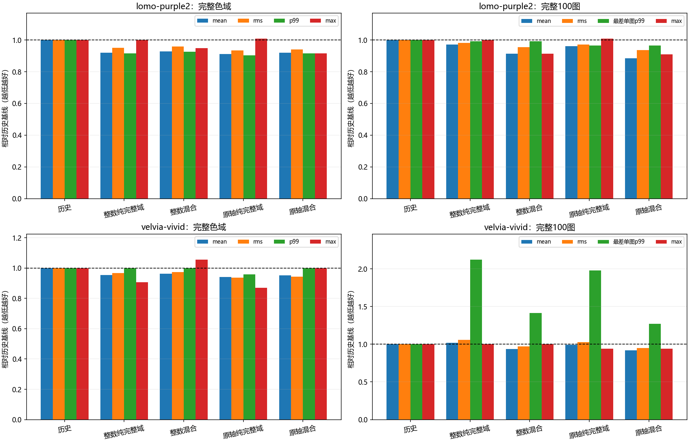

# 保留原权威轴表的完整域拟合与尾部归因

承接PR18。尾部约束修复仍是目标，但先排除一个已知混杂：PR17/18因完整拟合包装器只接受整数网格，将原小数网格rint。Lomo/Velvia原三点必要max下界13/23因此变为18/31。不能先假定原照片上限在新表示中都可达，再无限增加局部修复。

## 执行前冻结的改进

原生组装器只消费idx/frac，数值累加本身不要求网格为整数；整数限制来自原H>=I/64证明。本阶段提供可核验的通用充分证书，而非直接绕过限制：每节点最近RGB8见证互异，构造方阵Aq；精确计算`margin_i=4*Aq_ii-row_sum_i-column_sum_i`。最小值s>0时，对称部分Gershgorin给出`x^T A x>=delta||x||²`，其中`delta=s/(2*65536)`；由Cauchy-Schwarz得`||Ax||>=delta||x||`。完整域包含这些见证，所以`H>=A^T A/64`，正定下界为`s²/(64*(2*65536)²)`。

整数网格的Aq恰为65536I，恢复原1/64界。证书失败只表示这个见证方法无法证明，不代表设计必然秩亏，也不静默加正则或改网格。小数网格的原生矩仍为精确整数Q16矩；未改C++、ABI或二进制。完整域与等质量拟合的连续目标差上界改用实际证书，不能继续硬写1/64。

冻结计划为`experiments/fractional-fit-v1.json`。固定两例、原m33/原idx/frac、同完整参考、同60/20/20、同4096训练像素及1/2比例；每例只拟合原网格纯完整域和等质量两个新模型。与PR18整数纯/混合同目标配对，不扩展网格/比例矩阵。五选一沿用原四项完整域及20图选择门禁，在完整100图前冻结。

## 集中测试计划及环境

三个新支撑合同覆盖整数界恢复、独立标量设计/稠密谱界、重复见证和对称余量失败拒绝；已有完整256³ COO/1与4线程合同保留整数，并扩至小数网格；已有等质量三合同复核新支撑接入。冻结后一次集中8项验证，然后一次四模型完整色域/100图/独立整数oracle/标量AVX2。与上阶段不同，这次修改完整拟合的输入契约，完整COO复核有必要，不借用旧测试替代。

预计Windows11 10.0.26200、Ryzen9 8945HX、Python3.12.14、NumPy1.26.4、SciPy1.15.2、Numba0.60；研究Numba及完整拟合4线程、BLAS/OMP环境单线程，原生GCC15.2 Release验收单线程。目的为新支撑证书、全域组装正确性、表示混杂与精度；不比较性能。实际输入、源、库及模型SHA随结果保存。

本阶段不宣称逐图尾部已经修复。两个单级不是比赛四级成绩，官方Threshold未知；RGB欧氏距离不混作CIEDE2000，全部照片历史已观察，不称盲测。未改默认/冠军或历史报告/源码快照。后续补入实际结果及PR交付。

Agent：Codex

Operator：WyEhNf

Task：原权威Q16轴表下的完整域支撑证明与尾部归因

Status：集中实验及完整验收完成；仍有逐图尾部退化，保留研究候选

## 集中验证与实测来源

设计提交`f7996c3`后，在数值执行前用`ff14d60`统一两个旧Python源码的CRLF/LF字节，使Git冻结源与实测源一致；没有改写旧测量或旧源码ZIP。实际数值执行Git为`ff14d60`。8项合同一次通过，**8/8，25.50秒**：两个完整256³独立COO比较各包含1/4线程，整数和小数矩H/b逐项相等；3个新见证合同及3个等质量接入合同均通过，无跳过。

两例m33最近见证均为35937个互异RGB8。Lomo最小整数余量84555，对应H下界`7149548025/1099511627776 = 0.006502476048808603`；Velvia余量87375，对应`7634390625/1099511627776 = 0.006943437824702414`。整数网格合同仍严格恢复1/64。证明只依赖权威Q16设计和完整域覆盖，不依赖求解器成功标记或经验特征值。运行时、C++组装器、ABI及原生源指纹均未改变。

两个纯完整域CG按既有准则收敛，四个正式box问题（两个纯完整域、两个混合）均通过可行性/KKT。完整域拟合仍沿用既有带正则的CG热启动，正式box目标和混合目标不加先验，支撑证明不依赖热启动正则。差上界统一使用实际证书，不再对小数网格套1/64。两种原网格混合候选的精确未舍入SSE选择均接受；不由此推出RGB8尾部最优。

## 保留原轴表后的配对结果

以下四个“原轴”配置为本轮新执行的完整256³；历史/整数配置明确复用PR18同模型、同参考结果。新模型的全部idx/frac字节均与历史模型一致；SLUT仍为m33/uint8节点，没有改运行时插值或文件格式。

| LUT/方案 | 全域mean | RMS | p99 | max |
| --- | ---: | ---: | ---: | ---: |
| Lomo历史 | 0.907090 | 1.687408 | 7.000000 | 49.193496 |
| Lomo整数纯完整域 | 0.834684 | 1.605486 | 6.403124 | 49.203658 |
| Lomo整数混合 | 0.842396 | 1.616773 | 6.480741 | 46.669048 |
| Lomo原轴纯完整域 | 0.826305 | 1.575908 | 6.324555 | 49.578221 |
| Lomo原轴混合 | 0.833800 | 1.587236 | 6.403124 | 45.011110 |
| Velvia历史 | 1.031289 | 1.992443 | 7.000000 | 54.000000 |
| Velvia整数纯完整域 | 0.983722 | 1.928825 | 7.000000 | 49.000000 |
| Velvia整数混合 | 0.994103 | 1.941731 | 7.000000 | 57.000000 |
| Velvia原轴纯完整域 | 0.971210 | 1.866885 | 6.708204 | 47.010637 |
| Velvia原轴混合 | 0.981550 | 1.879308 | 7.000000 | 54.000000 |

完整100图结果如下，p99列为最差单图p99。mean逐图等权，RMS按相同尺寸的全像素平方汇总；不将最差单图p99写作全像素合并p99。

| LUT/方案 | 照片mean | RMS | 最差单图p99 | 整体max |
| --- | ---: | ---: | ---: | ---: |
| Lomo历史 | 0.814611 | 1.202680 | 13.190906 | 49.193496 |
| Lomo整数纯完整域 | 0.791731 | 1.180890 | 13.076697 | 49.203658 |
| Lomo整数混合 | 0.744379 | 1.148333 | 13.076697 | 44.955534 |
| Lomo原轴纯完整域 | 0.783396 | 1.167149 | 12.727922 | 49.578221 |
| Lomo原轴混合 | 0.720201 | 1.126070 | 12.727922 | 44.777226 |
| Velvia历史 | 1.123080 | 1.458911 | 7.071068 | 49.000000 |
| Velvia整数纯完整域 | 1.142652 | 1.543773 | 15.000000 | 49.000000 |
| Velvia整数混合 | 1.051152 | 1.416628 | 10.000000 | 49.000000 |
| Velvia原轴纯完整域 | 1.113284 | 1.496525 | 14.000000 | 46.043458 |
| Velvia原轴混合 | 1.031672 | 1.383643 | 9.000000 | 46.043458 |

同目标配对中，保留原轴表改善两例纯/混合的全域mean/RMS和照片mean/RMS。Lomo混合的全域mean由整数0.842396降到0.833800，照片由0.744379降到0.720201；Velvia混合全域max57降回54，最差单图p99从10降至9。这些是固定拟合策略下的网格表示差异，不能把它与历史采样LS到全域box的改动混算为单一贡献。

Lomo原轴混合相对历史的100张图mean**全部严格改善**，整体mean下降约11.59%；但RMS仍有1图、p99有15图、max有57图退化。Velvia原轴混合mean为93图改善/7图退化，RMS11图、p99 13图、max 43图退化。整体下降不能升级为逐图所有指标支配。

## 仍失败的约束与实际原因

两个五选一仍按原条件回退历史，没有看到完整100图后改阈值。Lomo原轴纯完整域的选择p99及最差单图p99与历史相等，但全域max49.578221及选择max25.238859仍超限。原轴混合通过完整域四项证书，选择mean/RMS继续改善，却在p99（2.449490→2.828427）、max（21.470911→26.645825）及最差单图p99（5.389768→5.744563）上失败。

Lomo输入`(1,89,73)`、图片`div2k-0847`的`(14,123)`，原完整参考`(3,89,65)`、历史模型`(5,85,86)`，整数混合与原轴混合都输出`(9,82,90)`，平方误差均从461升至710。这个具体反例没有因恢复原轴表消失，不能把它全部归于网格取整。完整域与照片SSE目标仍在牺牲局部尾部，下一步需要显式分位/最大误差约束，而不是增加CG次数。

Velvia原轴混合通过完整域、选择mean/RMS/p99/max，只剩最差单图p99门禁：选择集从历史7升到9.05，定位到`kodak-kodim06`。完整100图最差单图p99也从7.071068升到9，说明不是只有抽样才出现的虚假问题。固定旧三点下界仍为13/23，既没有因为新节点“失效”，也不证明当前45/54最优。

因此先前取整混杂已分离，下一阶段将以保留原轴表的混合模型作为主要修复起点，建立p99的尾部计数预算及逐图max约束。p99并不要求所有像素小于p99阈值，不能把它错误改为逐像素硬截断；同时继续保护已取得的全域与照片均值。本阶段没有实现该修复，不将它写作已完成。



## 验收、归档与复现

四个新模型全部256³输出与独立NumPy整数oracle及标量/AVX2一致，8份原生回执0字节差异。21份数值执行源码快照、原始日志、8项合同日志、4份支撑/三点证书、1000条逐图（400新执行/600复用）、30条分组、10个SLUT和选择记录均归档；科学图已目视检查。C99专用四级入口或实板没有执行这些单级新模型，不借用其他测试代替。[证据入口](../../report/data/fractional-fit-v1/README.md)

后验诊断保留两个时期：v1读取已核验的旧基线流，v2修复诊断入口对旧忽略缓存的依赖，缺少本目录基线时直接从版本化模型恢复，并核对历史SHA。两个时期81920个选择像素的全部记录完全一致，原v1源码单独保存，不伪装成v2执行。该恢复不重拟合，也不覆盖旧测量；v2进程未显式设置Numba线程，具体缺省数未采集，只作完整SHA核验，不作性能比较。核心数值阶段的4线程及合同配置均有实际记录。

```powershell
$env:PYTHONUTF8='1'
$env:PYTHONIOENCODING='utf-8'
$env:PYTHONPATH='python'
$env:OPENBLAS_NUM_THREADS='1'
$env:MKL_NUM_THREADS='1'
$env:OMP_NUM_THREADS='1'
$env:PATH='E:\mingw64\bin;'+$env:PATH
$env:JSHC_FULL_FIT_LIB=(Resolve-Path build-engineering-alignment/libjshc_full_fit.dll).Path
# 合同进程实际另设NUMBA_NUM_THREADS=4；研究入口自行设4线程。
artifacts/error-study-py312/Scripts/python.exe -m pytest tests/test_support_certificate.py tests/test_fullfit_contract.py tests/test_full_photo_fit.py -q
artifacts/error-study-py312/Scripts/python.exe scripts/run_fractional_fit_study.py `
  --plan experiments/fractional-fit-v1.json --output artifacts/fractional-fit-reproduce `
  --executable build-engineering-alignment/jshc.exe 2>&1 | Tee-Object artifacts/fractional-fit-reproduce.log
artifacts/error-study-py312/Scripts/python.exe scripts/report_fractional_fit_study.py `
  --input artifacts/fractional-fit-reproduce --output artifacts/fractional-fit-report-reproduce
artifacts/error-study-py312/Scripts/python.exe scripts/explain_full_photo_guards.py `
  --input artifacts/fractional-fit-reproduce --output artifacts/fractional-fit-report-reproduce/guard-counterexamples.json `
  --plan experiments/fractional-fit-v1.json --profiles fractional_full fractional_mixed
```

现归档器复制本次固定名字的合同日志；独立复现可先把合同输出保存到`artifacts/fractional-fit-contracts.log`，或自行归档该日志，不能把旧合同日志冒作新环境测试。绘图需中文字体，源/图像环境变更产生新身份及图SHA。原生库仍为ABI1、SHA`ae2ce37ed38a34b21435f797bced96c0f551f872c057eeb263cc719c1f98d061`，运行时SHA`ba088c682bb2b0e2e4634b23b35e662c52d87d38806d05827b876f08c8697f3a`；无需因Python输入契约扩展重建旧二进制。

创建PR前刷新相关PR/issue/评论与审查线程，核对337a3dd实际工程修复和#8剩余迁移事项。Discussion #4最新回复访问缺口保留，不执行合并或issue关闭。本阶段通过基于PR18的独立Draft PR交付，Operator仍为WyEhNf；官方阈值、逐图约束修复及未知LUT迁移继续待办，完整目标不在本阶段结束。
