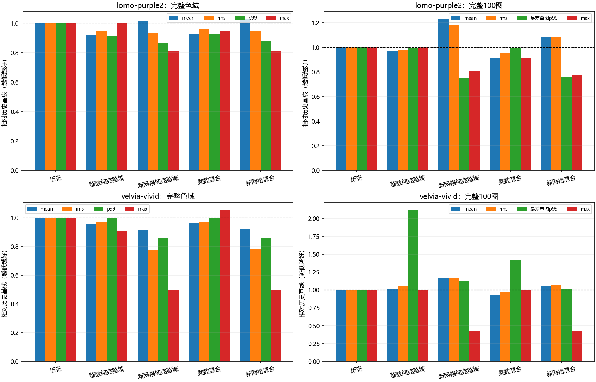

# 完整域与照片测度的等质量节点优化

承接PR17。新网格解决一部分尾部问题，但照片mean退化。这个阶段固定Lomo最小最大网格、Velvia切线SSE网格，各配一个整数历史网格作对照，只改变拟合测度；不再扫描网格、混合比例或硬件。

## 执行前冻结设计

每个网格使用完整256³的原生H/b，加60张历史训练照片各4096像素的H/b。完整矩已含1/64标度，按有效样本质量精确推导两个系数，令均匀色域与照片各一半，保留重复像素频率。无需追加正则先验：整数节点上的完整域支撑已给出H>=I/64。

连续混合矩以float64求解，KKT和可行性检查后作既有4轮整数精化。整数候选与原同网格模型的未舍入SSE比较分开计算完整域与照片的整数分量，再以Python整数交叉相乘；避免把混合float矩误写成原生精确矩。这个精确比较不保证RGB8 mean或尾部，仍需真实全域保护。

冻结计划为`experiments/full-photo-v1.json`。每例固定五候选：PR13历史、PR17整数对照/声明网格的纯完整域模型、两个新等质量模型。完整域四项相对历史均非增；20张选择图抽样四项及最差单图p99非增。通过后比较最差相对mean，失败则回退历史。完整100图仅在选择冻结后执行，不反馈优化；同时保存所有新候选的完整结果以隔离测度变化。

## 集中测试计划

一次三个必要合同：照片整数矩与独立逐行散加/测度标度和重复频率、混合目标变化对独立整数累加、箱约束解对角闭式及模型不变性。随后集中执行四个新拟合配置，模型冻结后统一完整256³/100图及整数oracle、标量/AVX2；历史完整流重建仅为新证书并核对旧SHA，不改写旧指标。

预计Windows11/Ryzen9 8945HX、Python3.12.14/NumPy1.26.4/SciPy1.15.2/Numba0.60，Numba与完整拟合4线程，BLAS/OMP环境单线程；GCC15.2 Release原生验收单线程。目的为测度分析、目标比较与位精确，不比较性能。实际环境、源码、图片像素与二进制哈希全部保存。

两例为单级诊断；Delta-E仍为RGB欧氏码值距离，非CIEDE2000。20张审计图只是本轮未参与训练/选择，历史均已观察，不称盲测。官方数据/Threshold未知。实测结果、负结果和交付后续补入本页。

Agent：Codex

Operator：WyEhNf

Task：完整域/照片等质量目标、网格候选联合选择及误差原因分析

Status：一次冻结实验与完整验收完成；选择集尾部仍有回归，保持研究候选

## 实测与实际改进

数值代码和计划冻结于`34b3daa`。三个新合同一次执行，**3/3通过，1.53秒**；随后只运行一个两例×两网格的拟合批次，不改混合比例、不追加候选。实际质量系数为完整矩`15/32`、照片矩`16/32`，两部分质量均为122880；没有额外正则先验。四个混合箱约束均可行并通过KKT，四个整数候选的精确混合SSE变化均为负。

完整256³结果如下。前三种方案为同字节旧证据复用；历史完整流另重建以形成新Q24保护证书，全部旧指标与完整SHA均一致。后两种为本轮新模型，四个新配置各完整验收一次。

| LUT/方案 | mean | RMS | p99 | max |
| --- | ---: | ---: | ---: | ---: |
| Lomo历史 | 0.907090 | 1.687408 | 7.000000 | 49.193496 |
| Lomo整数纯完整域 | 0.834684 | 1.605486 | 6.403124 | 49.203658 |
| Lomo新网格纯完整域 | 0.922450 | 1.572637 | 6.082763 | 39.874804 |
| Lomo整数混合 | 0.842396 | 1.616773 | 6.480741 | 46.669048 |
| Lomo新网格混合 | 0.934140 | 1.593613 | 6.164414 | 39.812058 |
| Velvia历史 | 1.031289 | 1.992443 | 7.000000 | 54.000000 |
| Velvia整数纯完整域 | 0.983722 | 1.928825 | 7.000000 | 49.000000 |
| Velvia新网格纯完整域 | 0.943142 | 1.545820 | 6.000000 | 27.000000 |
| Velvia整数混合 | 0.994103 | 1.941731 | 7.000000 | 57.000000 |
| Velvia新网格混合 | 0.954289 | 1.561506 | 6.000000 | 27.000000 |

完整100张照片结果如下。mean按逐图等权、RMS按所有像素平方汇总；图片尺寸相同。此处是最差单图p99，不是所有像素合并p99。

| LUT/方案 | mean | RMS | 最差单图p99 | 整体max |
| --- | ---: | ---: | ---: | ---: |
| Lomo历史 | 0.814611 | 1.202680 | 13.190906 | 49.193496 |
| Lomo整数纯完整域 | 0.791731 | 1.180890 | 13.076697 | 49.203658 |
| Lomo新网格纯完整域 | 1.002930 | 1.416112 | 9.899495 | 39.874804 |
| Lomo整数混合 | 0.744379 | 1.148333 | 13.076697 | 44.955534 |
| Lomo新网格混合 | 0.880203 | 1.308089 | 10.049876 | 38.288379 |
| Velvia历史 | 1.123080 | 1.458911 | 7.071068 | 49.000000 |
| Velvia整数纯完整域 | 1.142652 | 1.543773 | 15.000000 | 49.000000 |
| Velvia新网格纯完整域 | 1.304669 | 1.703452 | 8.000000 | 21.023796 |
| Velvia整数混合 | 1.051152 | 1.416628 | 10.000000 | 49.000000 |
| Velvia新网格混合 | 1.186076 | 1.562732 | 7.141428 | 21.023796 |

相对同网格纯完整域模型，四种混合拟合都降低照片mean，完整域mean/RMS均有小幅成本。这与四份整数分量一致：完整域未舍入SSE增加、训练照片未舍入SSE下降、等质量总目标下降。不能把总目标下降写成两个分量都下降。

Lomo整数混合相对历史基线，全域四项及照片整体四项均改善；照片mean下降约8.62%。Velvia新网格混合将上轮照片mean从1.304669拉回1.186076，并保持全域max27及照片整体max21.023796，但mean仍高于历史1.123080。这个结果缓解了分布冲突，没有消除。

## 为什么没有提升为默认

两个案例的预冻结五选一均回退历史，没有根据完整100图重新选择。Lomo整数混合通过相对历史的完整域四项证书，20图选择样本mean/RMS也下降，但合并p99从2.449490升到3，max从21.470911升到26.645825，最差单图p99从5.389768升到5.744563，违反三个既定尾部条件。

这不是只有抽样才出现的虚假退化。完整100图上，该模型虽有97图mean改善，仍有3图mean、6图RMS、23图p99和**64图max退化**。整体max从49.19降至44.96只能说明最差图的上界降低，不能说明每张图变好。Lomo新网格混合仍有82图mean和67图max退化。

Velvia整数混合照片mean改善，完整域max却升至57，高于历史54，被完整域保护拒绝，选择图RMS及最差单图p99也退化。Velvia新网格混合通过完整域四项证书，但选择样本mean/RMS/p99未达历史基线，完整100图也有79图mean、67图max退化。全部候选及门禁失败原因保留，未放宽门槛。

20张本轮未参与训练/选择的历史审计图中，Lomo整数混合mean为0.766127，低于历史0.782598，但高于纯完整域对照0.762407；Velvia整数混合为1.187603，低于历史1.210049，最差单图p99由5升至5.099020。分组结果仍显示均值与尾部不一致，审计图不称盲测。

## 从失败定位下一步

后验诊断只读本轮已保存完整流，重新构建同一81920个选择像素，逐项核对冻结guard指标，未重拟合。每个反例同时保存RGB、原图坐标、原完整LUT参考、历史与新输出，另存80条选择图配对记录。

例如Lomo整数混合在`div2k-0847`的`(14,123)`，输入`(1,89,73)`，参考`(3,89,65)`，历史输出`(5,85,86)`、新输出`(9,82,90)`，误差平方从461升至710。Velvia整数混合在`kodak-kodim03`的`(297,162)`，输入`(235,255,60)`，参考`(251,255,96)`，历史输出`(250,255,76)`、新输出`(250,255,57)`，平方误差401升至1522。这些是模型在同一真实输入上的局部近似退化，独立整数/原生流一致，不能归于后端算错。[反例与逐图诊断](../../report/data/full-photo-v1/guard-counterexamples.json)

本轮将问题缩小到“照片加权改善多数颜色，但共享节点改动伤害局部尾部”。下一阶段应优先对Lomo整数混合这个已有整体改进的候选建立逐图完整训练颜色上限，并结合既有全域保护做局部节点修复。跨网格的历史节点不能按相同下标直接当作同网格候选；需要合法的同网格原表采样/拟合候选。网格迁移改变权威idx/frac，不能套用固定网格局部支撑证明。该修复尚未在本阶段实现，不展开新的混合比例矩阵。



## 正确性与来源范围

本轮四个新模型全部256³：研究映射、独立NumPy整数oracle与原生标量/AVX2逐字节一致，8条原生回执0差异。完整原生矩的整数系统SHA与PR17同网格/同参考证据相同，复用其局部行审计，不冒称重新核验24行。C99专用四级入口及实体硬件未执行这些单级模型。

全部100图文件和解码像素SHA先行核对；训练/选择输入、索引哈希与PR14冻结60/20/20分组完全一致。保存1000条逐图（400新执行、600明确复用）、30条分组、10条配置汇总、4份精确目标分量、完整域直方图证书、10个SLUT及选择记录共18个ZIP成员，18份实测源码快照和原日志。数值执行源码目前与当前字节完全一致；归档器与后验诊断单独记录源码SHA，不冒充参与拟合。[证据入口](../../report/data/full-photo-v1/README.md)

实际环境符合冻结计划：Windows11 10.0.26200、Ryzen9 8945HX、Python3.12.14、NumPy1.26.4、SciPy1.15.2、Numba0.60；数值入口Numba/原生完整拟合4线程、BLAS/OMP环境单线程；合同进程另设NUMBA_NUM_THREADS=4，原生像素验收单线程。完整拟合库SHA仍为`ae2ce37ed38a34b21435f797bced96c0f551f872c057eeb263cc719c1f98d061`，运行时为`ba088c682bb2b0e2e4634b23b35e662c52d87d38806d05827b876f08c8697f3a`，源指纹及ABI均核验。没有重新构建或修改C++/portable/embedded。

## 复现与协作记录

```powershell
$env:PYTHONUTF8='1'
$env:PYTHONIOENCODING='utf-8'
$env:PYTHONPATH='python'
$env:OPENBLAS_NUM_THREADS='1'
$env:MKL_NUM_THREADS='1'
$env:OMP_NUM_THREADS='1'
$env:PATH='E:\mingw64\bin;'+$env:PATH
$env:JSHC_FULL_FIT_LIB=(Resolve-Path build-engineering-alignment/libjshc_full_fit.dll).Path
artifacts/error-study-py312/Scripts/python.exe -m pytest tests/test_full_photo_fit.py -q
artifacts/error-study-py312/Scripts/python.exe scripts/run_full_photo_study.py `
  --plan experiments/full-photo-v1.json --output artifacts/full-photo-reproduce `
  --executable build-engineering-alignment/jshc.exe 2>&1 | Tee-Object artifacts/full-photo-reproduce.log
artifacts/error-study-py312/Scripts/python.exe scripts/report_full_photo_study.py `
  --input artifacts/full-photo-reproduce --output artifacts/full-photo-report-reproduce
artifacts/error-study-py312/Scripts/python.exe scripts/explain_full_photo_guards.py `
  --input artifacts/full-photo-reproduce --output artifacts/full-photo-report-reproduce/guard-counterexamples.json
```

新环境会生成新身份，不覆盖旧目录；需与源指纹匹配的完整拟合库和本地已构建运行时。归档绘图使用Microsoft YaHei，其他系统需提供相应中文字体，原图SHA以本轮为准。原参考仍由既有源三线性适配、裁剪和RGB8政策生成，未知摄影色彩域不推断为自然ISP。

阶段交付前fetch目标远端并读取#12至#17正文、全部评论/review/行内线程，核对#7/#8及#9审查与337a3dd工程修复，未见新增意见；最终创建PR前再刷新。#8接口最终迁移/实板仍未完成，Discussion #4最新回复访问缺口保留，不执行合并或issue关闭。PR基于#17，Operator为WyEhNf。当前数值改进不等于已满足官方阈值或所有逐图条件，不更换默认/冠军；完整目标继续推进。
