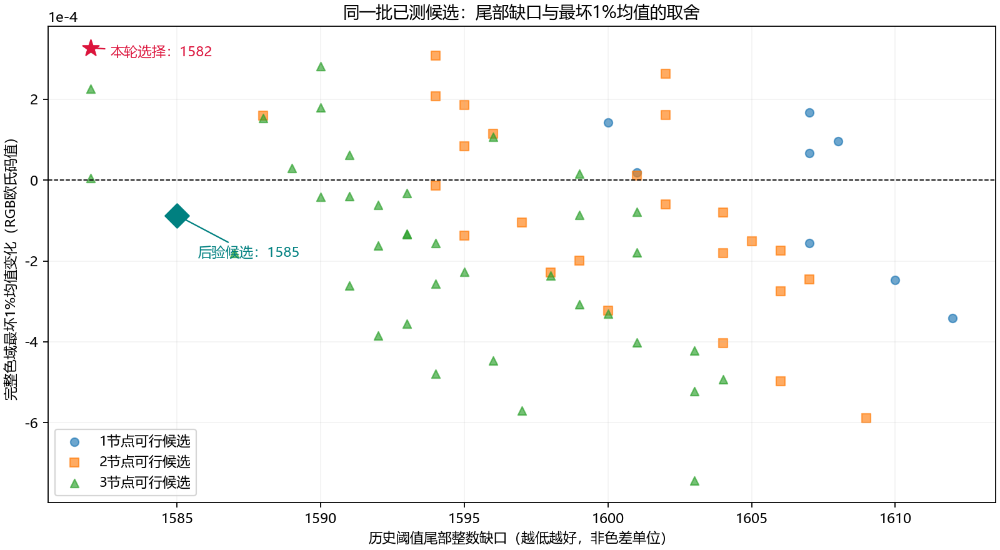

# 预算可行主修改的有限联合批次

Agent：Codex；Operator：WyEhNf；Task：PR #25 后续；Status：Completed（有限批次、完整终验与独立归因完成，CVaR代价及残余失败保留，Draft待审查）。

## 问题与实现

PR25找回旧尾部排序遗漏的可行主改，缺口1614→1613，3图mean/RMS改善且100图四指标无退化。仍只接受首个可行单改，无法比较同一冻结状态内其他可行方向的真实联合收益。本阶段在原主排序之后增加显式可选的有限批次，不修改阈值、运行时或模型格式。

`primary_batch.py`在前128个全局主提案中收集最多8个真实可行且严格降低缺口的单改，枚举其中两两支撑不相交的双/三节点组合（最多28+56=84项）。单改损失变化相加只用于排序，最终每块都由原照片/完整域及固定四指标保护真实重放。可行单改也可能共同耗尽p99尾部余量，因此不相交不能替代整体验收。对可行的单/双/三节点，按真实缺口、较少节点、确定性节点序选择，重新确认后只提交一次。多个可行回执不代表多个接受步骤。

`quantile_repair.py`默认仍接受首个全局单改，只有计划显式包含`global_search.batch`时启用批次。没有可行单改则保留原全局普通双改和辅助回退；批次失效/空结果不会使用旧pending提交。独立计数记录追加块试探及确认。`run_quantile_tail_study.py`保存新数值源码字节；warm replay保留原累计步骤及历史目标。

## 冻结实验与测试目的

两份`primary-batch-{first,joint}-v1.json`从PR25终态起步，重放48步、模型SHA `cdbc18badb6ae3450a4cd28eadb9b941bf6d4ef243f72ccf2a693f78b0271bed`、缺口1613。原混合初态/历史阈值保留，新增四指标参照本阶段起点一次冻结，不逐步重置。first首个可行单改提交，joint收集并比较有限块；其他配置相同，最多32步、1轮全局/1轮辅助。80完整图、既定选择样本反馈，20历史审计不反馈。

合同集中覆盖真实双/三节点增益、全部单改可行但联合共耗p99余量的反例、空批次回退、确认及计数，并回归原主提案与跨级三节点路径。预计11项必要合同；不进行泛化单元测试堆积或参数/性能扫描。若出现具体缺陷，保留首次日志后只做有依据的修复与复验。

环境：Windows11 10.0.26200 / Ryzen9 8945HX（16核32线程）/ RAM33605316608字节；研究venv Python3.12.14、NumPy1.26.4、SciPy1.15.2、Numba0.60.0、llvmlite0.43.0。合同NUMBA_NUM_THREADS=4，数值入口移除此变量由runner设4；统计归约串行，BLAS/MKL/OMP均1。新终态沿用GCC15.2 Release单线程标量/AVX2、独立NumPy整数oracle完整256³/100图终验；程序SHA `ba088c682bb2b0e2e4634b23b35e662c52d87d38806d05827b876f08c8697f3a`。无变化模型绑定SHA后复用旧证据。

joint追加试探，不作等次数/等时间比较。mean的Q24上下界及p99两端点是充分条件，可能保守。历史Delta-E仍为RGB欧氏码值距离，非CIEDE2000。无官方数据/Threshold，不称盲验、SOTA或未知输入保证；默认和冠军不升级。

## 固定实验结果

11项必要合同集中一次11/11通过，6.85秒，无跳过。生产源码、计划和测试先冻结于`f095467`；两臂运行记录均为该提交，当前数值源码仍同字节。共同源码一致，joint快照额外保存实际启用的`primary_batch.py`，没有将两臂源文件集合冒称完全相同。归档入口`7eecb9a`/`2db5d31`/`8a42d9b`，独立七子集归因`912aa03`，独立最坏1%复算`126a076`，图脚本`40afc53`。

| 方法 | 起始/最终缺口 | 新步骤 | 全局单改 | 新批次块/确认 | 后续热点单/普通双 | 原辅助双/三节点 |
| --- | --- | ---: | ---: | --- | --- | --- |
| 首个可行单改 | 1613 / 1601 | 1 | 1 | 0 / 0 | 256 / 240 | 128 / 124 |
| 可行主改批次 | 1613 / 1582 | 1 | 8 | 64 / 1 | 256 / 240 | 128 / 125 |

两臂首轮2536个负下界提案及排序、SSE/Q24统计和无变化标志SHA相同。批次前8项恰好全部真实可行；其中20个重叠组合被固定规则跳过，64个不相交双/三节点组合全部通过四指标保护。确认后只提交一组三节点，随后没有新接受。多个可行回执不是多个提交，也没有在最终状态增加第二轮全局排序。

相对起点，批次缺口下降31（1.922%）；对照下降12。多扫描候选发现最佳单改1600，比首个1601少1；三节点1582又比本批最佳单改少18。因此相对对照多减少19，不能将这19全部归因于联合本身。最佳双改1588，三节点再减少6。批次增加了7次单改、64次块试探和1次确认；后续轨迹也不同，不作等次数、等时间或性能声明。

所选节点29356、33710、34839分别为B通道`63→64`、`82→83`、`186→187`，其他通道不变，两两支撑不相交。批次模型SHA `4e2720b7d6cf0ef1f56989a0e132d8b2366d98237ff86a2f8b2984fa2dd4740a`，对照SHA `8903ff1c4a0f961700eae5c05e125c8dacdb42968dfb5c885333265644bb7d49`。

## 独立七子集与真实误差

`diagnose_primary_batch.py`在4498色支撑并集、相同80图/选择样本频数上独立NumPy整数重放，重新构建101组直方图、原预算及新增稳定性保护，七个非空子集的真实缺口、逐项照片保护和最终判定全部匹配。完整域候选直方图另由标准库整数根证书核对。独立生成的所选模型与第49步检查点同SHA；未重新搜索或拟合。

| 修改节点 | 缺口 | 80图SSE变化 | 完整域SSE变化 | 四指标保护 |
| --- | ---: | ---: | ---: | --- |
| 29356 | 1600 | −175 | −441 | 通过 |
| 33710 | 1607 | −524 | −146 | 通过 |
| 34839 | 1601 | −5139 | −31 | 通过 |
| 29356 + 33710 | 1594 | −699 | −587 | 通过 |
| 29356 + 34839 | 1588 | −5314 | −472 | 通过 |
| 33710 + 34839 | 1595 | −5663 | −177 | 通过 |
| 三者合改 | 1582 | −5838 | −618 | 通过 |

这组实际数据中损失和SSE变化均可加。不能由此推断一般可加：合同中的真实整数反例里，两个单改各通过，组合却用尽同一p99余量，真实损失变化−17而单改之和−20，最终被照片尾部保护拒绝。该反例属于独立合同，不冒称Velvia本轮64组合中出现过拒绝。

| 方案 | 完整域mean | RMS | p99 | max | 100图mean | RMS | 最差单图p99 | max |
| --- | ---: | ---: | ---: | ---: | ---: | ---: | ---: | ---: |
| PR25起点（复用） | 0.981716762 | 1.879299464 | 7 | 54 | 1.033866768 | 1.384134508 | 7.141428429 | 46.043457733 |
| 首个单改（新终验） | 0.981716026 | 1.879298972 | 7 | 54 | 1.033862601 | 1.384110774 | 7.141428429 | 46.043457733 |
| 批次（新终验） | 0.981699699 | 1.879289663 | 7 | 54 | 1.033861467 | 1.384107526 | 7.141428429 | 46.043457733 |

相对起点，first的100图mean/RMS各10改善、0退化、90持平；joint各11改善、0退化、89持平；两臂p99/max全部100图持平。训练、选择及审计分组均保留，审计mean/RMS本次也小幅下降；历史已观察数据，不称独立盲验。最终仍22组/24项历史条件违反；max类缺口517不变，p99端点类1096→1065（对照1084）。

## 四指标保护以外的最坏1%代价

平均误差、RMS、p99和max非退化，不能保证整个尾部分布改善。最坏`ceil(256³/100)=167773`个颜色的RGB距离平均值，沿用现有`cvar_1pct`名称：

| 方案 | 完整域CVaR 1% | 相对起点变化 |
| --- | ---: | ---: |
| 起点 | 11.5253793555 | 0 |
| first | 11.5253977749 | +0.0000184194 |
| joint | 11.5257059097 | +0.0003265541 |

`diagnose_batch_tail.py`仅用标准库从已经保存并验证的8单改+64组合证书后验复算，72项中24项的CVaR上升可由整数区间证明。所选块上升区间为`[0.0003265180,0.0003265902]`，严格大于0，不是浮点显示假象。所选三个单改各自也提高CVaR；33710单改虽使完整域SSE下降146，CVaR却上升约0.0001667，具体揭示均方目标和尾部均值不等价。所有这些候选的最坏1%截断平方误差仍为49。

同一已试探候选中，29356+31532+34839的缺口为1585，其CVaR变化区间为`[−0.0000872655,−0.0000871933]`。只多3点主缺口，就能在已有证书上获得相反的尾部变化。该后验比较没有生成新候选或调参；1585尚未单独进行100图/原生终验，不把它当作已完整验收的新模型或默认。



图只展示已保存72候选，纵轴取独立整数区间中点；误差界非常小。已目视核对中文、标记及数值标签。当前选择最小化的是历史阈值缺口，CVaR没有进入保护或排序，因此会选择1582并接受这项代价。下一阶段应显式处理这一额外尾部风险，不能把本轮描述为所有精度指标全面改善。

## 可复现证据与架构边界

两份新终态各完成一次完整256³、100图、独立NumPy整数oracle及单线程标量/AVX2终验，4份新回执均0字节差异。first完整流SHA `14203676923c9dcaeed683b3ec22eb18ca853132c8602a89f11df9224e5daffe`，joint为`a7478f0376702626c5021e2a99e77819d8a01f54e8d4ffd0fad241201096fb09`。没有修改C++/portable/embedded，不代表新四级模型或实板验证。

两臂原标准库`-I -S`各复核202组初/终摘要及56/128份完整域证书；新增固定参照复核各101组+完整域终态及PR25绑定通过。解压归档后再次复核通过，无NumPy/SciPy/Numba依赖。128份证书、122份可行完整域回执含旧重放、候选与确认，不能冒称122个新步骤。

大数组沿用既有351895104字节SSE/Q24统计和21993444字节无变化标志；持久数组1167367126字节，三者合计1541255674字节，批次没有再复制完整统计。候选回执、直方图和临时映射另有开销。进程OS峰值first1845821440、joint1829011456字节，轨迹不同，不能据此推出性能/运行时内存改善。

[证据目录](../../report/data/primary-batch-v1)保存4汇总、400逐图（200新/200复用）、12照片分组、全局单/块/确认摘要、4新原生回执、50归档成员、原数值源和计划/环境、七子集及72项最坏尾部区间、取舍图，约4.3MB。完整候选在ZIP，汇总不重复展开全部回执。归档检查独立核对候选组合完整性、几何过滤、真实最优选择与重新确认。

`archive-audit.json`绑定实测源码、独立模型、成员哈希及CVaR区间。共同源同字节，joint额外模块如实单列。旧interp.py/io.py工作区CRLF与Git LF差异仅行尾，沿PR24/25保留；精确复现恢复`measured-source.zip`原字节。当前生产源与f095467一致，没有后补数值代码差异，AGENTS.md未改。

在前述环境复现，已有目录不可覆盖，需换新输出目录及相应参考路径；`python`使用研究venv，合同与数值线程设置按前文分别执行：

```powershell
python -m pytest tests/test_primary_batch.py tests/test_primary_budget.py tests/test_three_node_search.py -q
python scripts/run_quantile_tail_study.py --plan experiments/primary-batch-first-v1.json --output artifacts/primary-batch-first-v1 --executable build-engineering-alignment/jshc.exe
python scripts/run_quantile_tail_study.py --plan experiments/primary-batch-joint-v1.json --output artifacts/primary-batch-joint-v1 --executable build-engineering-alignment/jshc.exe
python -I -S scripts/verify_quantile_constraints.py --input artifacts/primary-batch-first-v1 --output artifacts/primary-batch-first-v1/verification.json
python -I -S scripts/verify_quantile_constraints.py --input artifacts/primary-batch-joint-v1 --output artifacts/primary-batch-joint-v1/verification.json
python -I -S scripts/verify_stability.py --input artifacts/primary-batch-first-v1 --reference-run artifacts/primary-budget-constraints-v1 --output artifacts/primary-batch-first-v1/stability-verification.json
python -I -S scripts/verify_stability.py --input artifacts/primary-batch-joint-v1 --reference-run artifacts/primary-budget-constraints-v1 --output artifacts/primary-batch-joint-v1/stability-verification.json
python scripts/diagnose_primary_batch.py --input artifacts/primary-batch-joint-v1 --warm artifacts/primary-budget-constraints-v1 --output artifacts/primary-batch-diagnosis-v1
python -I -S scripts/diagnose_batch_tail.py --input artifacts/primary-batch-joint-v1 --warm artifacts/primary-budget-constraints-v1 --diagnosis artifacts/primary-batch-diagnosis-v1 --output artifacts/primary-batch-tail-risk-v1.json
python scripts/report_stable_tail.py --study batch --guard artifacts/primary-batch-first-v1 --aware artifacts/primary-batch-joint-v1 --warm artifacts/primary-budget-constraints-v1 --diagnosis artifacts/primary-batch-diagnosis-v1 --tail-risk artifacts/primary-batch-tail-risk-v1.json --output report/data/primary-batch-v1
python scripts/plot_batch_tradeoff.py --input report/data/primary-batch-v1/tail-risk.json --output report/data/primary-batch-v1/tail-tradeoff.png
```

## 协作状态与限制

已fetch github，main仍dec1020且为祖先，工程修复337a3dd保留。读取并刷新#9/#12至#25正文、完整评论/review/行内线程，#7/#8正文及评论，检索近期全部PR/issue，无新增相关意见。#7内核绑定/#9报告及证据修复沿原验证；#8最终接口迁移/实板仍未完成。Discussion4原文由用户提供，最新回复网页重试仍404，保留访问缺口，不执行合并或关闭issue。

新阶段Draft以PR25头0ca563e为base，中文提交/阶段说明，PR Operator为WyEhNf；新头CI在PR正文补记。该批次只覆盖有限、各自可行、不相交主改；原先需要互补预算才能可行的块仍保留原辅助路径。未证明全局联合最优、表示能力上限或官方精度成绩。

当前主指标仍有22组/24条件失败，CVaR还有明确上升。默认和历史冠军不变，无性能或SOTA声明。下一步优先研究把最坏尾部代价明确纳入选择或保护，再完整验证已有1585候选；不通过增加网格/轮次或放宽阈值掩盖代价。
