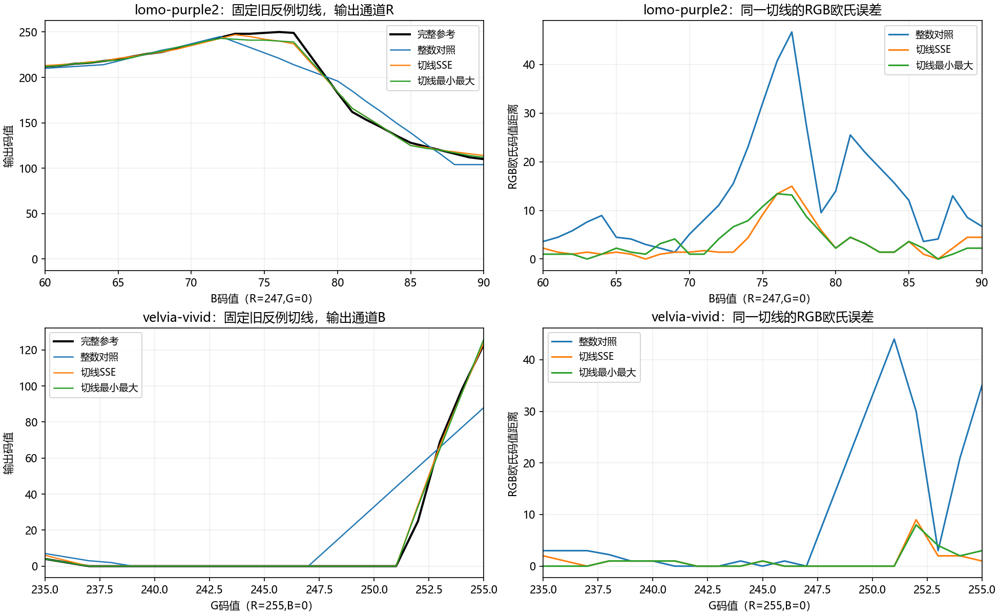

# 边界与窄峰网格分配的误差研究

承接PR #13至#16。Cinema的联合节点优化已有进展，但Lomo/Velvia单级误差仍大，固定旧网格上的三点必要max下界为13/23，继续只改节点不能绕过表示限制。本阶段固定m33和SLUT v1，针对网格位置研究，不推进硬件性能。

## 执行前冻结的设计

只研究Lomo Purple2及Velvia Vivid两个已观察真实素材。历史curvature网格沿垂直轴以步长4采样，不含255边界，而Velvia反例正位于边界；旧SSE网格最小间距2也无法安放相邻节点以保留宽1码值窄峰。这是采样/表示策略限制，尚不是运行时计算错误。

先把历史浮点网格rint为整数作为对照，再分别用相同的81条含0/255边界切线和至多32条历史热点邻域切线做SSE DP与最小最大DP。三方案全用同一完整域有界拟合，间距1至16，节点数不变。历史到对照同时改变了小数网格及拟合测度，不能单独归因；新DP与整数对照才是匹配拟合条件的网格比较。

每条候选弦按实际Q16和RGB8计算整数误差。最小最大DP分两遍：先求最优瓶颈，再在此瓶颈下优化总SSE及确定性间距项；一遍词典序DP可能错过后续被大误差边覆盖的较小SSE路径。其最优性仅针对冻结的1D切线代理，不能升级为最终3D模型全局最优。

冻结计划为`experiments/tail-grid-v1.json`。三个模型均在完整验收前冻结，然后每例集中执行完整256³、100张历史照片和整数/原生验收；不看结果重拟合，不更换默认。完整边界由保存输出分离统计，保存旧三点证书及新最坏色邻域，避免平均值掩盖尾部。

## 测试目的、环境与边界

实现后先集中验证三项新合同：小图穷举核对两遍DP、Q16窄峰及相邻节点、255边界与热点去重。真实拟合中另对每个H/b抽查四个独立局部支撑行，包含最窄间距；原生矩阵实现未修改，复用先前全COO合同，不重复高成本通用测试。

预计Windows11 10.0.26200、Ryzen9 8945HX，Python3.12.14、NumPy1.26.4、SciPy1.15.2、Numba0.60，研究Numba及原生拟合4线程、BLAS/OMP环境单线程，原生逐像素验收单线程。完整拟合库和运行时二进制先绑定当前源指纹及SHA，沿用GCC15.2 Release；不重新构建旧产物。实际环境及源码快照随运行保存。

所有指标为RGB欧氏码值距离，非CIEDE2000。两个样例为单级诊断，不计比赛四级分数；100图为历史观察数据；官方数据/Threshold未知。未测性能，不声称加速或通用SOTA。实测结果和阶段交付后续补入本页。

Agent：Codex

Operator：WyEhNf

Task：固定容量下网格位置与拟合目标的误差归因

Status：冻结批次与完整验收完成；存在照片退化，保留研究候选，不替换默认

## 实测结果

数值源与计划先冻结于`eb854e1`，三个新合同一次集中执行，**3/3通过，0.46秒**。随后只执行一批两例×三方案研究；每例三个模型在完整验收前全部冻结。没有根据后续结果重新拟合、改变间距或补充候选。环境与预计一致，实际源、库、输入哈希详见[证据入口](../../report/data/tail-grid-v1/README.md)。

下表历史列复用PR13同字节模型/参考证据，新三方案为本轮完整256³。每个mean是逐色RGB欧氏距离均值；RMS是平方误差平均后开根，p99按现有线性分位约定。

| LUT/方案 | mean | RMS | p99 | max |
| --- | ---: | ---: | ---: | ---: |
| Lomo历史 | 0.907090 | 1.687408 | 7.000000 | 49.193496 |
| Lomo整数对照 | 0.834684 | 1.605486 | 6.403124 | 49.203658 |
| Lomo切线SSE | 0.878010 | 1.550457 | 6.000000 | 47.937459 |
| Lomo切线最小最大 | 0.922450 | 1.572637 | 6.082763 | 39.874804 |
| Velvia历史 | 1.031289 | 1.992443 | 7.000000 | 54.000000 |
| Velvia整数对照 | 0.983722 | 1.928825 | 7.000000 | 49.000000 |
| Velvia切线SSE | 0.943142 | 1.545820 | 6.000000 | 27.000000 |
| Velvia切线最小最大 | 1.084401 | 1.760625 | 7.000000 | 26.019224 |

完整100张1024×768 RGB8照片结果如下。mean为逐图mean的均值，因尺寸相同也等于所有像素合并均值；最差单图p99不能称为合并p99。

| LUT/方案 | mean | RMS | 最差单图p99 | 整体max |
| --- | ---: | ---: | ---: | ---: |
| Lomo历史 | 0.814611 | 1.202680 | 13.190906 | 49.193496 |
| Lomo整数对照 | 0.791731 | 1.180890 | 13.076697 | 49.203658 |
| Lomo切线SSE | 0.958245 | 1.353426 | 11.224972 | 39.874804 |
| Lomo切线最小最大 | 1.002930 | 1.416112 | 9.899495 | 39.874804 |
| Velvia历史 | 1.123080 | 1.458911 | 7.071068 | 49.000000 |
| Velvia整数对照 | 1.142652 | 1.543773 | 15.000000 | 49.000000 |
| Velvia切线SSE | 1.304669 | 1.703452 | 8.000000 | 21.023796 |
| Velvia切线最小最大 | 1.453576 | 1.870556 | 8.000000 | 25.019992 |

两个DP均不能在照片上支配整数对照。Lomo SSE有94图mean、61图max退化；最小最大有96图mean、51图max退化。Velvia SSE有94图mean、58图max退化；最小最大有95图mean、63图max退化。整体max明显下降仍会伴随许多单图max上升，不能以总体尾部改善替代逐图验收。完整逐图、每项改善/持平/退化数及最大退化图保存于`photos-per-image.csv`与`photo-regressions.json`。

## 误差原因及本轮确立的边界

**边界采样确实有价值，但本轮不能将全部收益归功于补255。** Velvia两个DP都在G轴末端放置`245,251,253,255`，旧反例切线的大尖峰明显收敛；完整边界390152色中，SSE的p99由对照29.068884降为8，max由49降为21.095023。两个方案也同时改变目标、热点切线与其他节点位置，没有单独的“仅补边界”消融。

**原网格的必要障碍可以移除，但新网格仍有表示残差。** 旧三点证书13/23在整数对照变为18/31，两种DP均变为0；这只说明该组三点不再证明不可达，不能写成新网格可精确重建。后验仅检查各新最坏色周围三个轴、半径1/2/4/8的合法等距三点：Lomo最小最大网格在`(0,89,72/73/74)`仍有必要max下界8，目标为`(15,81,72)/(3,90,58)/(11,83,75)`，同一Q16表示的二阶权重系数恰抵消，任何合法节点都不能同时拟合至max<8。本轮实际max39.874804远高于这个必要界，仍有优化空间。Velvia新最坏色局部检查下界为0，不等于已最优或误差可全部消除。[新热点证书及全部检查三点](../../report/data/tail-grid-v1/new-hotspot-certificates.json)

**切线代理更好，不保证三维目标更好。** Velvia三个轴的最大弦误差平方，SSE方案为500/256/197，最小最大方案为82/101/123；后者三个轴都更小，但完整域RMS从1.545820升至1.760625，照片mean从1.304669升至1.453576。切线使用真实LUT端点作为弦节点，而最终节点是三维联合最小二乘解；跨通道耦合、四面体分区及测度不同，代理最优不能升级为最终误差最优。这是本轮实证，具体各因素独立贡献尚未分离。

**当前尾部不是RGB8最终舍入或求解未收敛造成。** 六个CG均达到既有准则，六个box均KKT收敛/可行，无零支撑节点，连续box目标差上界约`2.6e-10..7.8e-10`，但该二次目标不等于RGB8 mean/max。Velvia SSE新最坏色`(235,251,117)`参考`(241,255,48)`，舍入前后输出都为`(241,255,21)`，27的误差在最后舍入前已存在。Lomo最小最大新最坏色`(0,89,73)`在舍入前误差40.135474、最终39.874804，舍入本身只改变约0.659760。这里只分离最终RGB8舍入，不能把所有节点量化影响也说成已排除。

**极窄峰能力是合同改进，但没有实测贡献证据。** 本轮允许间距1，合成宽1峰合同确实需要相邻节点；真实DP最窄间距仍为Lomo4、Velvia2，没有选择间距1。因此不能声称本轮真实LUT收益来自相邻节点。

**均匀颜色与照片分布仍有冲突。** Velvia SSE相对整数对照，完整域mean/RMS/p99/max四项均改善，但照片mean/RMS上升。Lomo的最小最大目标进一步压低整体max，却加重照片mean。现有证据支持将网格位置、节点值和实际测度共同优化；还没有证据支持只靠增加CG迭代、进一步追逐切线minimax就能解决。



## 正确性、来源与验收范围

六个新模型各完成全部16,777,216色，研究输出、独立NumPy整数oracle与原生标量/AVX2的完整流SHA一致；12份原生回执均为0字节差异。单级入口未验证C99专用四级CLI，不用填充identity冒称比赛链；其他端侧新模型验证尚未执行。原生矩阵源码未改，各新网格独立抽查四个局部支撑行，H/b共24行完全相等，包含最窄节点区，且全部对角满足`H_ii>=1/64`。

图片清单先与历史环境绑定，再核对全部100图压缩字节及解码像素SHA。完整源表和历史序列化模型SHA也与PR13核对。保存800条逐图（600新执行、200明确复用）、8条汇总、6个新模型+2个历史模型、三轴弦代价/切线/DP决策、24行矩阵审计、源码17文件快照、原始日志及逐文件哈希；模型/网格/代价ZIP1264794字节。科学图已目视检查。所有实测源码目前与执行字节一致，归档器为实测后的整理，不冒称其参与拟合。

实际完整拟合库SHA为`ae2ce37ed38a34b21435f797bced96c0f551f872c057eeb263cc719c1f98d061`，ABI1且源指纹一致；运行时SHA为`ba088c682bb2b0e2e4634b23b35e662c52d87d38806d05827b876f08c8697f3a`。本轮二进制、C++/portable/embedded、旧数据和默认/冠军均未改变。未比较性能/实时性/实板或官方分数；两个真实单级不能代表比赛四级、任意LUT或自然ISP承诺。

## 复现与后续实质工作

```powershell
$env:PYTHONUTF8='1'
$env:PYTHONIOENCODING='utf-8'
$env:PYTHONPATH='python'
$env:OPENBLAS_NUM_THREADS='1'
$env:MKL_NUM_THREADS='1'
$env:OMP_NUM_THREADS='1'
$env:PATH='E:\mingw64\bin;'+$env:PATH
$env:JSHC_FULL_FIT_LIB=(Resolve-Path build-engineering-alignment/libjshc_full_fit.dll).Path
# 合同进程另设NUMBA_NUM_THREADS=4；数值入口自行设4线程，原环境变量未设。
artifacts/error-study-py312/Scripts/python.exe -m pytest tests/test_axis_grid.py -q
artifacts/error-study-py312/Scripts/python.exe scripts/run_tail_grid_study.py `
  --plan experiments/tail-grid-v1.json --output artifacts/tail-grid-reproduce `
  --executable build-engineering-alignment/jshc.exe 2>&1 | Tee-Object artifacts/tail-grid-reproduce.log
artifacts/error-study-py312/Scripts/python.exe scripts/report_tail_grid_study.py `
  --input artifacts/tail-grid-reproduce --output artifacts/tail-grid-report-reproduce
```

需使用满足当前源指纹的完整拟合库和已构建运行时；新环境将生成新身份。旧目录不会覆盖。原始LUT仍按既有源适配政策烘焙，素材摄影色彩域未知。冻结计划中的“节点前输出”具体对应`pre_round_output`，即插值之后、RGB8舍入之前的输出，避免与节点值混淆。

下一阶段应围绕少量实际反例做受完整域与照片保护约束的网格/节点联合选择：保留旧网格为可回退候选，用真实三维拟合与真实RGB8代价评估局部节点迁移，避免仅按切线排序。先解决“完整域改善而照片退化”的测度冲突，再考虑未知LUT迁移；不恢复大矩阵、不放宽门槛。该方向尚未在本阶段实现。

## 操作前协作记录

远端重新获取后main仍为dec1020，已包含于本分支；工程修复337a3dd也在祖先中。已读取#12至#16及#9的正文、完整评论/review/行内线程，检索全部当前issue与近期PR，未见新增修复或阻塞意见。[PR9两项审查](https://github.com/WyEhNf/flash-chroma/pull/9#issuecomment-6213519540)与[#7内核证据绑定](https://github.com/WyEhNf/flash-chroma/issues/7)均已在337a3dd落实并保留此前回归证据；[#8接口协调](https://github.com/WyEhNf/flash-chroma/issues/8#issuecomment-6213698494)的最终迁移/实板仍未完成，不关闭议题。[Discussion #4](https://github.com/WyEhNf/flash-chroma/discussions/4)最新回复本轮重试仍404，访问缺口如实保留，不执行合并或issue关闭。

本阶段通过独立Draft PR提交，基于#16分支；最终远端CI状态以该PR对应提交为准，不沿用前一PR的绿灯。
