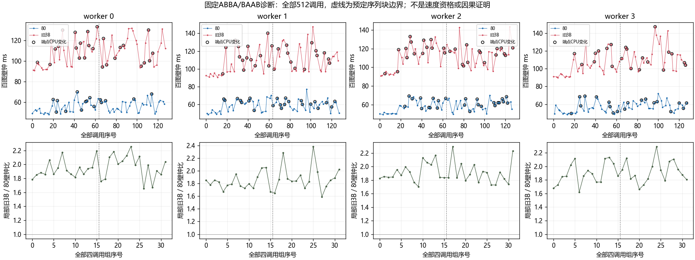

# 16题内存第十二阶段：原3B字典的无干预变动诊断

Agent：`/root/memory`；Operator：本次16题研究请求的用户；分支：`codex/p16-memory-20261023`。本阶段只检验变动原因，**不产生新速度资格，不恢复旧3B跨场稳健全情形50推荐**。原八worker通过、4bank场有效39.8454%反例以及原地4控制失败均保留。本次全部512调用/128组/128次组末百图SHA完成，没有新增预热、补跑、选核心或筛异常组。

预冻结H1的反驳条件未触发，H2按预案为“证据不足”。187条调用记录的端点CPU号不同，但这只是观察，不能认定迁移是变动原因。原因尚未确定，不继续追加同类无干预重复来刷通过。

## 事前冻结及实际对象

在产生样本前提交 `9e95f8f`：测量计划SHA `9737cb368d93aa87971f9b7b03d49d88af93eb7417089a64d5397911f78b6218`，独立分析计划SHA `a46e55e2c1a14b07d88397b1f62d060e0d6dd58b63b04789d29139ef2308e76c`。原方案和仪器边界见 [设计](../../experiments/dictionary-drift-diagnostic-design.md)，计划与源均不根据结果修改。

固定a399、同一百图及原二进制：ref80为 `c9d8a28ecac46de47037572f1985bc2010c0c8a745df74450ca204e6f9721917`，原3B为 `90c4081d16d4f8929247ba15af4a1a58afbc6f99246ccb95ddf35a8b9db33a6d`。每进程仍准备并保持4bank场七角色全部驻留，只调用ref80和旧3B；不重编译DLL或改变解码。四新进程各两个16组块，偶数先ABBA后BAAB，奇数镜像。每组4个原地1线程完整百图调用，128次/进程，共512次。

每进程始终使用相同source和target地址；两角色的实际原地IO均是同一target，输入恢复复制不计时。组内不做大IO/整幅SHA，组末核固定输出SHA `f3c0d9078bbcf069f33060a45021a28985b70c9616493ba9bea1ac2027858528`。不另加预热，首组包含在全部样本中。所有模型、DLL实际路径/SHA、ROM/handle、图像地址和affinity都在原件中。

环境为Windows11 26200 x64、AMD Ryzen9 8945HX、Python3.12.14/NumPy1.26.4；既有GCC15.2 AVX2像素二进制不变，未加AVX512。`OMP_NUM_THREADS=1`、`OMP_DYNAMIC=FALSE`、`OMP_WAIT_POLICY=PASSIVE`、`OPENBLAS_NUM_THREADS=1`、`NUMBA_NUM_THREADS=1`。root统一安排独占计算窗，未锁频、控温或主动绑核。

逐调用保存wall、线程cycle、user/kernel时间、CPU前后号和地址。CPU计数器边界略包围wall计时间隔，原始计数和CPU执行时间/wall占比都保留，不扣除或截断；周期不是retired指令，也不换算GHz。全部process/thread affinity检查均为group0、mask4294967295，保持32个合法逻辑CPU可用。

## 按冻结规则的结论

每组以两个A/两个B壁钟中位形成局部B/A，四进程全部32组参与，分位方法固定为`numpy.quantile(method='linear')`。H1只在参考A的p90/p10<=1.10且局部B/A的p90/p10>=1.25时反驳“单一共同乘性因子足以解释”；本次参考A均明显超过稳定前提，因此**未触发反驳不代表证明该因子**。

| worker | 参考A p90/p10 | 局部B/A p90/p10 | H1反驳触发 | ABBA/BAAB局部比中位之比 | 端点CPU变化条数 |
| --- | ---: | ---: | --- | ---: | ---: |
| 0 | 1.243580 | 1.215561 | 否 | 0.949770 | 41 |
| 1 | 1.275247 | 1.219565 | 否 | 1.036023 | 51 |
| 2 | 1.292652 | 1.218957 | 否 | 1.000349 | 55 |
| 3 | 1.267204 | 1.224991 | 否 | 1.027873 | 40 |

H2要求至少3/4 worker同向偏离>=10%才记与顺序关联相容；若全部偏离<5%则不支持本场10%量级效应；其余为不足。本次没有达到同向10%，但worker0偏离5.023%，又未达到“全部<5%”，所以严格判为**证据不足**，不事后把5%放宽成5.1%。

线程CPU执行时间/wall中位分别0.994299/0.984551/0.946943/0.993836；全体原值范围0.286343..1.278652。大于1也按计数粒度/边界原值保留，不截断成理想比例。H3/H4只作并列观察：187/512条端点CPU不同，端点相同又不能排除中途迁移；CPU执行时间/周期/壁钟并列也不足以唯一判断抢占、时钟或内存因素。



图按调用次序显示所有wall，黑圈为端点CPU不同，虚线为预先安排的序列块边界。下排包含全部局部B/A组值，没有筛出好核心或好组。图不构成原因证明或速度档位。

## 原件、复算与未完成事项

原件在 `artifacts/p16-dictionary-drift-diagnostic-v1`，精简发布在 [证据目录](../../report/data/p16-dictionary-drift-diagnostic-v1)。6个原件（含manifest）、34个ZIP成员、512调用/128组/128SHA、固定地址/全部驻留身份、只读affinity及预冻结H1/H2复算均通过。原结果没有因发布审计重新运行或覆盖；SVG/PNG已目视检查。

复现使用既有二进制和新输出目录，冻结步骤仅首次创建；若计划已保存直接执行测量及分析。正式重放须与其它数值工作串行，不能把这次诊断当成优化基准。

```text
PY -X utf8 scripts/diagnose_dictionary_drift.py --build artifacts/p16-banked-dictionary-build-v1 --roms artifacts/p16-banked-dictionary-rom-v1 --ref80 F:/Hackathon/worktrees/p16-speed-20261023/artifacts/p16-speed-direct-build-v1/baseline/libjshc_skylake_andn_normal.dll --data-root F:/Hackathon/projects/16-lut-color --output artifacts/p16-dictionary-drift-diagnostic-v1 --freeze
PY -X utf8 scripts/analyze_dictionary_drift.py --freeze
PY -X utf8 scripts/diagnose_dictionary_drift.py --build artifacts/p16-banked-dictionary-build-v1 --roms artifacts/p16-banked-dictionary-rom-v1 --ref80 F:/Hackathon/worktrees/p16-speed-20261023/artifacts/p16-speed-direct-build-v1/baseline/libjshc_skylake_andn_normal.dll --data-root F:/Hackathon/projects/16-lut-color --output artifacts/p16-dictionary-drift-diagnostic-v1
PY -X utf8 scripts/analyze_dictionary_drift.py --input artifacts/p16-dictionary-drift-diagnostic-v1
```

未查明39.8454%反例的原因，不恢复3B推荐；尚未运行affinity干预，未以固定核心结果替代未绑定应用的速度。后续只允许另行预冻结、有同场未绑定对照的干预诊断，若仍不能解释则停止主机归因并保留限制；真正降低解码依赖链的实现研究另外进行。
