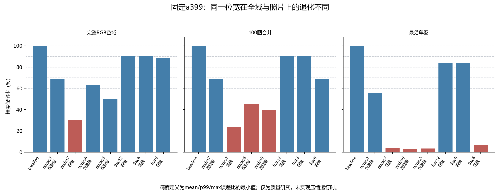

# 节点位宽的真实退化与C99跨目标核验

Agent：Codex `/root`；Operator：本会话项目用户；Task：第16题方向3的有损质量边界及可移植性补充；Status：本阶段实测完成，压缩decoder没有实现，不作为可部署的有损优选。共同源码起点`16ae431`，本阶段在独立内存分支上补充，未改变精度/速度分支、公共默认或AGENTS.md。

## 已得到的结论

**直接减少节点位宽很容易违反照片精度底线。** 同一a399首级及933a/95cb/932f后三模型，首级6bit/5bit在完整色域尚有约63%/50%精度保留，但百图合并已低于50%；不能仅凭全色域过线就采用。第一阶段优先选择保持原输出的ROM压缩有实测依据。

**C99核心已在wasm32实际运行。** 五种ROM各完整遍历16,777,216个RGB输入，与已验a399输出逐字节一致；另完成非对齐ROM、原地/分离、尾部和拒绝检查。Cortex-M3、RV32IM、AArch64大端的C99对象也编译成功，但没有链接目标系统镜像或执行，不能说实板/大端运行已通过。

## 冻结输入、指标与质量结果

初始模型NPZ SHA为`a399b72a2222acef815b6405ebd0132f94f1f3a4e4315f957e90b81f836744bb`；基线完整输出SHA为`3c9ce8d98d8db454ce9337c50c2ecadb8ba59485d6bc3e6a42e3cc1dfe307c22`。最终参考是四个独立原表逐级RGB8串联，参考缓存及全部输入SHA经核验。固定33³、idx和网格；节点以端点保真的等间隔整数码量化后重建RGB8，坐标以Q16中的固定步长取整，仍保护端点与单调性。

每个范围的精度保留率定义为`min(基线mean/候选mean, 基线p99/候选p99, 基线max/候选max)`；逐图再取最劣。误差为RGB8欧氏距离。这是用户六档研究的明确代理定义，不是官方得分函数。原指标和每图结果同时保留，避免接近零误差的图片被平均数掩盖。

| 候选 | 全域mean / p99 / max | 全域保留 | 百图合并保留 | 最劣单图保留 | 节点bitstream逻辑字节 |
| --- | --- | ---: | ---: | ---: | ---: |
| a399 | 0.981111 / 3.741657 / 8.124038 | 100% | 100% | 100% | 431,244 |
| 仅首级节点7bit | 1.426000 / 5.196152 / 8.660254 | 68.80% | 69.01% | 55.54% | 417,768 |
| 四级节点7bit | 3.270544 / 8.124038 / 12.206556 | 30.00% | 23.34% | 3.71% | 377,339 |
| 仅首级节点6bit | 1.546231 / 5.830952 / 9.848858 | 63.45% | 45.58% | 3.24% | 404,292 |
| 仅首级节点5bit | 1.955283 / 6.928203 / 13.928388 | 50.18% | 39.41% | 3.53% | 390,815 |
| 四级坐标12bit | 0.990681 / 4.123106 / 8.124038 | 90.75% | 90.75% | 84.02% | 431,244 |
| 四级坐标8bit | 1.022507 / 4.123106 / 8.124038 | 90.75% | 90.75% | 84.02% | 431,244 |
| 四级坐标6bit | 1.113687 / 4.123106 / 8.246211 | 88.10% | 68.55% | 6.67% | 431,244 |

同一幅图可能在mean、p99或max中成为最差保留者，表中不只比较合并mean。100%档没有有损候选；90%档也没有同时保护最劣单图的候选。12/8bit坐标仅满足质量侧80%档，7bit首级仅满足质量侧50%档。它们尚无压缩decoder速度/容量实测，因此不授予满足“双底线”的部署资格。首级7bit的节点逻辑收益仅3.125%，更没有依据用这些局部质量代价替代无损方案。



表中容量只是可能的节点bitstream载荷；本脚本实际执行的是重建后的RGB8模型，原生句柄均为1,058,292字节。坐标位宽候选没有压缩节点，轴表的潜在逻辑节省没有当作已实现内存收益。没有进行这些重建模型的性能比较，也没有编造100..50%的速度档。

## 实际执行与边界

先以固定seed 2026102307的262,144色对14个配置粗筛，随后冻结8个配置做完整域和全部100图质量检查。每个完整输出都逐色与当前专门化AVX2请求4线程比较，零字节差；基线亦重现原全流SHA及精确统计。百图质量由已验证完整逐色映射索引计算，仍实际读取并核对每张照片SHA；没有把它称为100图原生吞吐或端到端性能。照片历史已见，非盲测。

完整终验的脚本及所用数值模块按测时SHA封存。粗筛之后脚本扩充了原生/完整域/照片支持，保留粗筛旧SHA及原始结果，但不凭粗筛单独授予验收资格。完整RGB流约400MB仅留本机，档案保存每流SHA、可重建模型、直方图和每图结果。

wasm32采用LLVM 21的freestanding C99，`-O3 -ffreestanding -fno-builtin -nostdlib`，仅链接测试夹具提供的memset/memcmp，无WebAssembly imports。Node 24.16.0/V8 13.6实际执行五个格式，各16M色、64个有限用例、3项拒绝及空输入控制；ROM从奇数地址借用，内容SHA和源像素在拒绝后保持。32位模型视图为1044字节。32MiB线性内存含固定ROM/输入/输出/栈测试缓冲，**不能把它称为核心只需1044字节总RAM**，也不能当作移动端性能或闪存等待测量。

另用Clang `-Wall -Wextra -Werror` 编译Cortex-M3/Thumb、RV32IM/ILP32、AArch64BE freestanding对象，逐个核ELF类别、machine及字节序。标准函数声明由最小测试头提供；最终链接可能需要目标工具链常规内存拷贝辅助例程，没有证明无BSP即可部署。未新增QEMU、实体ARM/RISC-V、功耗或实时性结论。

环境为Windows11 26200 x64、Ryzen9 8945HX/32GB；Python3.12.14、NumPy1.26.4、Numba0.60.0，Numba4、OMP/BLAS1。原生质量验证复用GCC15.2 Release的专门化DLL SHA `507b51a31421e3b2ed8b71d9140d79aac2e6cd7435be888754b8acf4bc497372`。编译/Node完整版本、argv、源码和产物SHA见档案，没有AVX512。

## 文件、复现与后续

实现为`scan_node_precision_tiers.py`、`verify_memory_rom_wasm.py`、`compile_memory_rom_targets.py`；`experiments/memory-rom-wasm/`仅提供freestanding测试支撑。`report_node_precision_portability.py`只读冻结结果生成质量图和归档，不重新运行数值或性能。[104份原字节、清单与汇总](../../report/data/p16-node-precision-portability-v1/README.md)约1.84MB，含wasm模块及三个ELF对象。

以下命令使用已有输入和工具链，以新输出目录重放，不覆盖旧证据：

```powershell
$py='F:/Hackathon/projects/16-lut-color/artifacts/error-study-py312/Scripts/python.exe'
$inputs='F:/Hackathon/projects/16-lut-color'
$env:PYTHONUTF8='1'; $env:OMP_NUM_THREADS='1'; $env:OPENBLAS_NUM_THREADS='1'
& $py scripts/scan_node_precision_tiers.py --inputs-root $inputs --output artifacts/node-precision-full-replay --full --candidates nodes7_first nodes6_first nodes5_first nodes7_all frac12_all frac8_all frac6_all --native-library "$inputs/artifacts/channel-native-specialized-v1/jshc_channel_specialized.dll" --native-sha256 507b51a31421e3b2ed8b71d9140d79aac2e6cd7435be888754b8acf4bc497372
& $py scripts/verify_memory_rom_wasm.py --roms artifacts/p16-memory-rom-v2 --cube "$inputs/artifacts/cinema-current-anchor-accept-v1/cube.rgb" --output artifacts/p16-memory-wasm-replay
& $py scripts/compile_memory_rom_targets.py --output artifacts/p16-memory-cross-replay
```

[ENNeLUT论文](https://arxiv.org/html/2412.15438v1#Sx6.SS5)明确区分紧凑网络储存、重建LUT与逐像素推理，启发本阶段将逻辑压缩量、重建执行和真实常驻内存分列；其多LUT共享模型不能直接作为本题四级p99/max证明。[AdaInt](https://arxiv.org/abs/2204.13983)提示采样表示会影响非线性误差，但本阶段没有重新训练网格，也不把坐标降位宽称为该方法实现。后续优先研究无损ROM更好的像素调度和真正可移植C99的50%速度资格；官方阈值/格式许可及新素材仍待独立核对。
