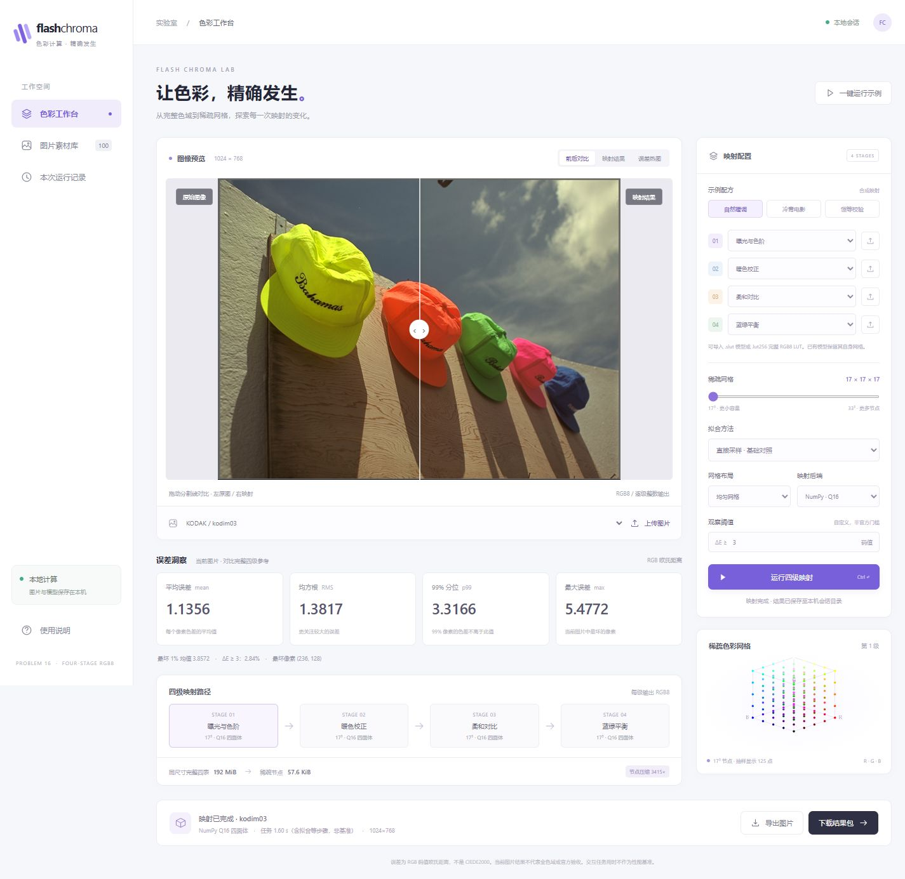

# 本地 GUI 阶段证据

本目录只记录界面接入与功能验收，不作为算法性能排名、完整色域精度或官方成绩。

| 文件 | 内容 |
| --- | --- |
| `contracts.log` | 初轮三项 HTTP/独立整数 oracle/完整参考/输入保护验收，3 passed，5.43秒。 |
| `session-restore.log` | 添加会话刷新恢复后的定向一项，1 passed，2.02秒。 |
| `contracts-final.log` | 整组三项复核，3 passed，3.75秒。 |
| `worker-failure.log` | 后台准备阶段失败修复后的既有输入保护项，1 passed，1.53秒。 |
| `source-sha256.json` | 整组复核与最后后台错误处理修复时的两份源码指纹，前端/算法公式未再改变；git_lf另列Git规范化字节，保留Windows CSS换行差异。 |
| `native-parity.json` | 首轮示例同字节输入/四模型，对原生 CPU auto/4线程的一次实际执行；解码像素0差异。输出 SHA 指原生 PNG 文件，不是像素流 SHA。具体解析内核未报告。 |
| `workbench.png` | 1440×1080桌面视口的完整页面截图。 |
| `mobile.png` | 390×844窄屏视口的完整页面截图。 |
| `file-index.json` | 本目录证据文件 SHA-256 与大小。 |

环境、复现命令、验证目的、首次交互问题及实际修复见[阶段说明](../../../docs/stages/2026-10-18-local-gui.md)。浏览器验收期间先运行示例，再在补齐导航/刷新恢复后重启服务验证同一示例；没有扩展 LUT/方法矩阵。这些交互执行与原生比对分开记录，截图中的单次任务用时不可作为公平性能比较。

截图中照片为项目已有 Kodak `kodim03`（摄影者 Don Cochran），沿用[来源与署名](../../../assets/photos/kodak/README.md)；没有把照片重新声明为项目自有或 MIT/CC0 素材。示例四级为 `gui.py` 中的确定性 RGB8 数值映射，完整参考对每级分别取整；全部照片为已见素材。

